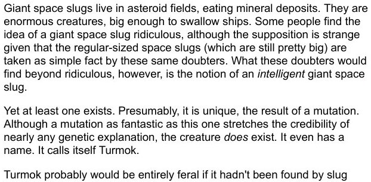
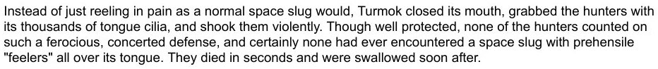
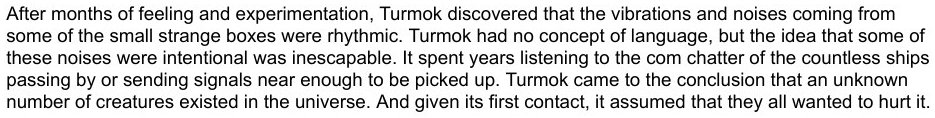
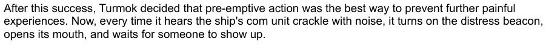
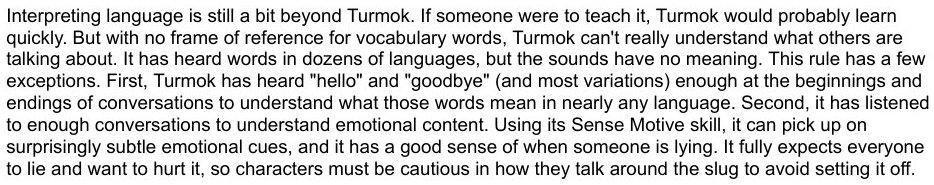

# Owner Material 037 — Star Wars D20 Drive folder (Core, Revised Core and Saga Edition): Creatures/Smart Space Slug.pdf [Star Wars Roleplaying Game Revised Core (d20, 2002)]

- **Source:** Wizards of the Coast Star Wars Roleplaying Game books, web enhancements, Living Force campaign modules and articles (2000–2010), from the owner's "Star Wars D20" Drive folder (only the three edition subfolders; "General" was not read, as instructed). Secondary source (licensed Legends reference). Scan OCR'd on the box; the scan stays box-only and is **not** published.
- **Method:** every scanned page was OCR'd and machine-screened sentence by sentence for power-relevant statements (fights, kills, defeats, Force feats, rankings, superweapons) that name a character on our roster; each kept sentence is quoted verbatim from the OCR text and has a crop of the printed passage directly under it. Pages with nothing power-relevant are still listed with what is on them.
- **Citation:** "*Smart Space Slug* (SWRPG d20 Revised Core), p.X" by printed page ("scan p.X" where no printed number applies). **Weight:** Licensed RPG material: a secondary source. Narrative text sums up Legends lore; game statistics are rules for players, not canon power levels, and rank lowest.

## scan p.1 (scan page 1)

Page contents: Turmok's story: kills slug hunters and rescuers, swallows freighter, explores it with cilia, listens to com chatter, baits ships with the distress beacon; stat block start (hand-read)

- **Turmok** — entry/section: Turmok, the intelligent space slug: "Giant space slugs live in asteroid fields, eating mineral deposits. They are enormous creatures, big enough to swallow ships. Some people find the idea of a giant space slug ridiculous, although the supposition is strange given that the regular-sized space slugs (which are still pretty big) are taken as simple fact by these same doubters. What these doubters would find beyond ridiculous, however, is the notion of an intelligent giant space slug.
Yet at least one exists. Presumably, it is unique, the result of a mutation. Although a mutation as fantastic as this one stretches the credibility of nearly any genetic explanation, the creature does exist. It even has a name. It calls itself Turmok." Source: *Smart Space Slug* (SWRPG d20 Revised Core), scan p.1
  
- **Turmok** — entry/section: Turmok kills the slug hunters: "Instead of just reeling in pain as a normal space slug would, Turmok closed its mouth, grabbed the hunters with its thousands of tongue cilia, and shook them violently. Though well protected, none of the hunters counted on such a ferocious, concerted defense, and certainly none had ever encountered a space slug with prehensile "feelers" all over its tongue. They died in seconds and were swallowed soon after." Source: *Smart Space Slug* (SWRPG d20 Revised Core), scan p.1
  
- **Turmok** — entry/section: Turmok learns of other beings: "After months of feeling and experimentation, Turmok discovered that the vibrations and noises coming from some of the small strange boxes were rhythmic. Turmok had no concept of language, but the idea that some of these noises were intentional was inescapable. It spent years listening to the com chatter of the countless ships passing by or sending signals near enough to be picked up. Turmok came to the conclusion that an unknown number of creatures existed in the universe. And given its first contact, it assumed that they all wanted to hurt it." Source: *Smart Space Slug* (SWRPG d20 Revised Core), scan p.1
  
- **Turmok** — entry/section: Turmok's trap: "After this success, Turmok decided that pre-emptive action was the best way to prevent further painful experiences. Now, every time it hears the ship's com unit crackle with noise, it turns on the distress beacon, opens its mouth, and waits for someone to show up." Source: *Smart Space Slug* (SWRPG d20 Revised Core), scan p.1
  

### Stat block notes (game mechanics, not feats)

- turmok: Turmok, Highly Evolved Giant Space Slug: Vacuum vermin 20/Fringer 1; Defense 27; burrow 100 m; VP/WP 472/376; bite 6d10+10; DR 25; prehensile cilia, swallow whole; SZ C; Int 15; Challenge Code H (Source: *Smart Space Slug* (SWRPG d20 Revised Core), scan p.1)

## scan p.2 (scan page 2)

Page contents: Turmok stats end, prehensile cilia; GM guidance on placing and communicating with Turmok (hand-read)

- **Turmok** — entry/section: Turmok and language: "Interpreting language is still a bit beyond Turmok. If someone were to teach it, Turmok would probably learn quickly. But with no frame of reference for vocabulary words, Turmok can't really understand what others are talking about. It has heard words in dozens of languages, but the sounds have no meaning. This rule has a few exceptions. First, Turmok has heard "hello" and “goodbye” (and most variations) enough at the beginnings and endings of conversations to understand what those words mean in nearly any language. Second, it has listened to enough conversations to understand emotional content. Using its Sense Motive skill, it can pick up on surprisingly subtle emotional cues, and it has a good sense of when someone is lying. It fully expects everyone to lie and want to hurt it, so characters must be cautious in how they talk around the slug to avoid setting it off." Source: *Smart Space Slug* (SWRPG d20 Revised Core), scan p.2
  
