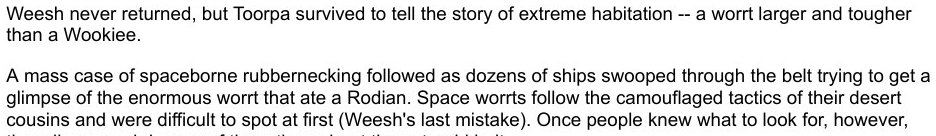

# Owner Material 037 — Star Wars D20 Drive folder (Core, Revised Core and Saga Edition): Creatures/Space Worrt.pdf [Star Wars Roleplaying Game Revised Core (d20, 2002)]

- **Source:** Wizards of the Coast Star Wars Roleplaying Game books, web enhancements, Living Force campaign modules and articles (2000–2010), from the owner's "Star Wars D20" Drive folder (only the three edition subfolders; "General" was not read, as instructed). Secondary source (licensed Legends reference). Scan OCR'd on the box; the scan stays box-only and is **not** published.
- **Method:** every scanned page was OCR'd and machine-screened sentence by sentence for power-relevant statements (fights, kills, defeats, Force feats, rankings, superweapons) that name a character on our roster; each kept sentence is quoted verbatim from the OCR text and has a crop of the printed passage directly under it. Pages with nothing power-relevant are still listed with what is on them.
- **Citation:** "*Space Worrt* (SWRPG d20 Revised Core), p.X" by printed page ("scan p.X" where no printed number applies). **Weight:** Licensed RPG material: a secondary source. Narrative text sums up Legends lore; game statistics are rules for players, not canon power levels, and rank lowest.

## scan p.1 (scan page 1)

Page contents: Space worrts: mynock decline, Toorpa and Weesh's asteroid exploration, tourist dye tagging, anatomy, stats (hand-read)

- **Toorpa; Weesh** — entry/section: Toorpa and Weesh find the space worrts: "Weesh never returned, but Toorpa survived to tell the story of extreme habitation -- a worrt larger and tougher than a Wookiee.
A mass case of spaceborne rubbernecking followed as dozens of ships swooped through the belt trying to get a glimpse of the enormous worrt that ate a Rodian. Space worrts follow the camouflaged tactics of their desert cousins and were difficult to spot at first (Weesh's last mistake)." Source: *Space Worrt* (SWRPG d20 Revised Core), scan p.1
  

### Stat block notes (game mechanics, not feats)

- space worrt (generic): Space Worrt: Vacuum predator 5; Defense 19; VP/WP 47/21; bite 2d6+7, tongue; SZ L; Challenge Code C (Source: *Space Worrt* (SWRPG d20 Revised Core), scan p.1)

## scan p.2 (scan page 2)

Page contents: Tongue attack and swallow whole; GM hooks; Komari Vosa link (hand-read)

