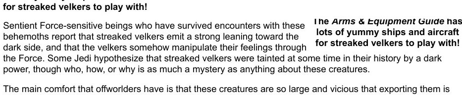

# Owner Material 037 — Star Wars D20 Drive folder (Core, Revised Core and Saga Edition): Creatures/Streaked Velker.pdf [Star Wars Roleplaying Game Revised Core (d20, 2002)]

- **Source:** Wizards of the Coast Star Wars Roleplaying Game books, web enhancements, Living Force campaign modules and articles (2000–2010), from the owner's "Star Wars D20" Drive folder (only the three edition subfolders; "General" was not read, as instructed). Secondary source (licensed Legends reference). Scan OCR'd on the box; the scan stays box-only and is **not** published.
- **Method:** every scanned page was OCR'd and machine-screened sentence by sentence for power-relevant statements (fights, kills, defeats, Force feats, rankings, superweapons) that name a character on our roster; each kept sentence is quoted verbatim from the OCR text and has a crop of the printed passage directly under it. Pages with nothing power-relevant are still listed with what is on them.
- **Citation:** "*Streaked Velker* (SWRPG d20 Revised Core), p.X" by printed page ("scan p.X" where no printed number applies). **Weight:** Licensed RPG material: a secondary source. Narrative text sums up Legends lore; game statistics are rules for players, not canon power levels, and rank lowest.

## scan p.1 (scan page 1)

Page contents: Streaked velkers vs common velkers, encounters with craft, Force users? (dark side fear) (hand-read)

- **No single roster character (rules/setting/general)** — entry/section: Streaked velkers and the dark side: "Sentient Force-sensitive beings who have survived encounters with these behemoths report that streaked velkers emit a strong leaning toward the dark side, and that the velkers somehow manipulate their feelings through the Force. Some Jedi hypothesize that streaked velkers were tainted at some time in their history by a dark power, though who, how, or why is as much a mystery as anything about these creatures." Source: *Streaked Velker* (SWRPG d20 Revised Core), scan p.1
  

## scan p.2 (scan page 2)

Page contents: Force-Using Streaked Velker stats (CC H), electric bolt, GM tactics (hand-read)

### Stat block notes (game mechanics, not feats)

- force-using streaked velker (generic): Force-Using Streaked Velker: Airborne predator 10; Defense 17; fly 100 m; VP/WP 240/360; claws 4d6+20; electric bolt; Enhance Ability +27, Fear +13; SZ C; Challenge Code H (Source: *Streaked Velker* (SWRPG d20 Revised Core), scan p.2)
