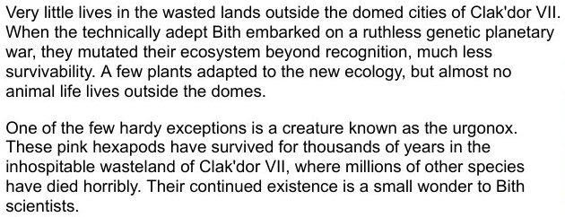

# Owner Material 037 — Star Wars D20 Drive folder (Core, Revised Core and Saga Edition): Creatures/Urgonox.pdf [Star Wars Roleplaying Game Revised Core (d20, 2002)]

- **Source:** Wizards of the Coast Star Wars Roleplaying Game books, web enhancements, Living Force campaign modules and articles (2000–2010), from the owner's "Star Wars D20" Drive folder (only the three edition subfolders; "General" was not read, as instructed). Secondary source (licensed Legends reference). Scan OCR'd on the box; the scan stays box-only and is **not** published.
- **Method:** every scanned page was OCR'd and machine-screened sentence by sentence for power-relevant statements (fights, kills, defeats, Force feats, rankings, superweapons) that name a character on our roster; each kept sentence is quoted verbatim from the OCR text and has a crop of the printed passage directly under it. Pages with nothing power-relevant are still listed with what is on them.
- **Citation:** "*Urgonox* (SWRPG d20 Revised Core), p.X" by printed page ("scan p.X" where no printed number applies). **Weight:** Licensed RPG material: a secondary source. Narrative text sums up Legends lore; game statistics are rules for players, not canon power levels, and rank lowest.

## scan p.1 (scan page 1)

Page contents: Urgonox origin from Bith genetic war, appearance, behavior, packs, litters and chemical burns (hand-read)

- **No single roster character (rules/setting/general)** — entry/section: Urgonox: "Very little lives in the wasted lands outside the domed cities of Clak'dor VII. When the technically adept Bith embarked on a ruthless genetic planetary war, they mutated their ecosystem beyond recognition, much less survivability. A few plants adapted to the new ecology, but almost no animal life lives outside the domes.
One of the few hardy exceptions is a creature known as the urgonox. These pink hexapods have survived for thousands of years in the inhospitable wasteland of Clak'dor VII, where millions of other species have died horribly. Their continued existence is a small wonder to Bith scientists." Source: *Urgonox* (SWRPG d20 Revised Core), scan p.1
  

## scan p.2 (scan page 2)

Page contents: Feeding, thrum, traits (chemical burn, nausea thrum), stats (CC D), GM hooks (hand-read)

### Stat block notes (game mechanics, not feats)

- urgonox (generic): Urgonox: Medium-size scavenger 9; Defense 17; burrow 4 m; VP/WP 61/16; horn 1d8, claws; nausea thrum; Challenge Code D (Source: *Urgonox* (SWRPG d20 Revised Core), scan p.2)

## scan p.3 (scan page 3)

Page contents: Investors hook; Planet Hoppers (Ando) link (hand-read)

