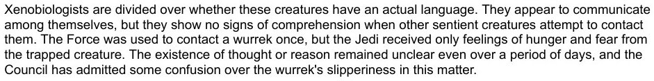
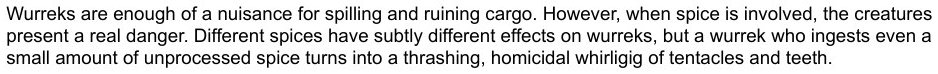

# Owner Material 037 — Star Wars D20 Drive folder (Core, Revised Core and Saga Edition): Creatures/Wurrek.pdf [Star Wars Roleplaying Game Revised Core (d20, 2002)]

- **Source:** Wizards of the Coast Star Wars Roleplaying Game books, web enhancements, Living Force campaign modules and articles (2000–2010), from the owner's "Star Wars D20" Drive folder (only the three edition subfolders; "General" was not read, as instructed). Secondary source (licensed Legends reference). Scan OCR'd on the box; the scan stays box-only and is **not** published.
- **Method:** every scanned page was OCR'd and machine-screened sentence by sentence for power-relevant statements (fights, kills, defeats, Force feats, rankings, superweapons) that name a character on our roster; each kept sentence is quoted verbatim from the OCR text and has a crop of the printed passage directly under it. Pages with nothing power-relevant are still listed with what is on them.
- **Citation:** "*Wurrek* (SWRPG d20 Revised Core), p.X" by printed page ("scan p.X" where no printed number applies). **Weight:** Licensed RPG material: a secondary source. Narrative text sums up Legends lore; game statistics are rules for players, not canon power levels, and rank lowest.

## scan p.1 (scan page 1)

Page contents: Wurrek anatomy (tentacle mouths), cargo raiding, keypad locks, hit-and-run, Jedi Force contact (hand-read)

- **No single roster character (rules/setting/general)** — entry/section: Wurreks and the Jedi: "Xenobiologists are divided over whether these creatures have an actual language. They appear to communicate among themselves, but they show no signs of comprehension when other sentient creatures attempt to contact them. The Force was used to contact a wurrek once, but the Jedi received only feelings of hunger and fear from the trapped creature. The existence of thought or reason remained unclear even over a period of days, and the Council has admitted some confusion over the wurrek's slipperiness in this matter." Source: *Wurrek* (SWRPG d20 Revised Core), scan p.1
  

## scan p.2 (scan page 2)

Page contents: Spice effects and addiction, traits, normal and maddened stats, GM advice and hooks (hand-read)

- **No single roster character (rules/setting/general)** — entry/section: Wurreks on spice: "Wurreks are enough of a nuisance for spilling and ruining cargo. However, when spice is involved, the creatures present a real danger. Different spices have subtly different effects on wurreks, but a wurrek who ingests even a small amount of unprocessed spice turns into a thrashing, homicidal whirligig of tentacles and teeth." Source: *Wurrek* (SWRPG d20 Revised Core), scan p.2
  

### Stat block notes (game mechanics, not feats)

- wurrek (generic): Wurrek: Small subterranean scavenger 5; Defense 17; VP/WP 10/17; 4 bites 1d6-2; Challenge Code C. Maddened Wurrek: VP/WP 13/22; 6 bites 1d6+2, blaster pistol; Challenge Code D (Source: *Wurrek* (SWRPG d20 Revised Core), scan p.2)

## scan p.3 (scan page 3)

Page contents: Hooks (Twi'lek transport with Ryll spice, zoo escape); Thyferra link (hand-read)

