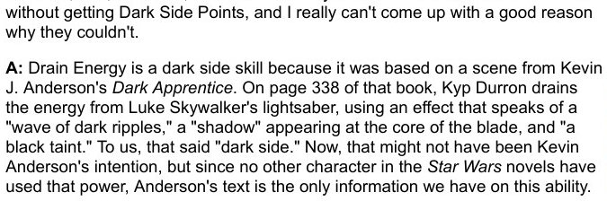
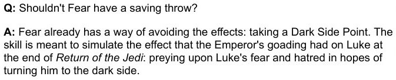

# Owner Material 037 — Star Wars D20 Drive folder (Core, Revised Core and Saga Edition): Jedi Counselling/Jedi Counseling 1 - Drain Energy.pdf [Star Wars Roleplaying Game Revised Core (d20, 2002)]

- **Source:** Wizards of the Coast Star Wars Roleplaying Game books, web enhancements, Living Force campaign modules and articles (2000–2010), from the owner's "Star Wars D20" Drive folder (only the three edition subfolders; "General" was not read, as instructed). Secondary source (licensed Legends reference). Scan OCR'd on the box; the scan stays box-only and is **not** published.
- **Method:** every scanned page was OCR'd and machine-screened sentence by sentence for power-relevant statements (fights, kills, defeats, Force feats, rankings, superweapons) that name a character on our roster; each kept sentence is quoted verbatim from the OCR text and has a crop of the printed passage directly under it. Pages with nothing power-relevant are still listed with what is on them.
- **Citation:** "*Jedi Counseling 1 - Drain Energy* (SWRPG d20 Revised Core), p.X" by printed page ("scan p.X" where no printed number applies). **Weight:** Licensed RPG material: a secondary source. Narrative text sums up Legends lore; game statistics are rules for players, not canon power levels, and rank lowest.

## scan p.1 (scan page 1)

Page contents: Atmospheric speed table, grapple, Dissipate Energy, Force Grip (hand-read)

## scan p.2 (scan page 2)

Page contents: Drain Energy size limit and dark side origin; Fear saving throw and duration; Force Light table; Force warrior Jedi Knight; deflect extend question (hand-read)

- **Kyp Durron; Luke Skywalker** — entry/section: Why Drain Energy is a dark side skill (Kyp Durron drains Luke's lightsaber): "A: Drain Energy is a dark side skill because it was based on a scene from Kevin J. Anderson's Dark Apprentice. On page 338 of that book, Kyp Durron drains the energy from Luke Skywalker's lightsaber, using an effect that speaks of a "wave of dark ripples," a "shadow" appearing at the core of the blade, and "a black taint." To us, that said "dark side." Now, that might not have been Kevin Anderson's intention, but since no other character in the Star Wars novels have used that power, Anderson's text is the only information we have on this ability." Source: *Jedi Counseling 1 - Drain Energy* (SWRPG d20 Revised Core), scan p.2
  
- **Palpatine (Darth Sidious); Luke Skywalker** — entry/section: Fear modeled on the Emperor goading Luke: "A: Fear already has a way of avoiding the effects: taking a Dark Side Point. The skill is meant to simulate the effect that the Emperor's goading had on Luke at the end of Return of the Jedi: preying upon Luke's fear and hatred in hopes of turning him to the dark side." Source: *Jedi Counseling 1 - Drain Energy* (SWRPG d20 Revised Core), scan p.2
  

## scan p.3 (scan page 3)

Page contents: Deflect extend answer (+4 for four guardians); closing (hand-read)

