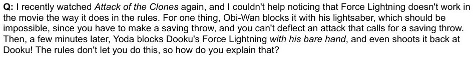
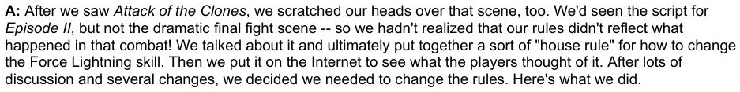
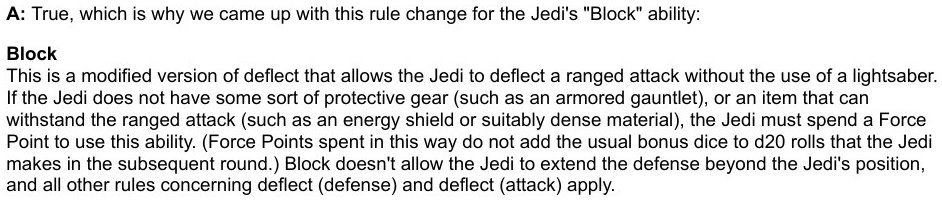
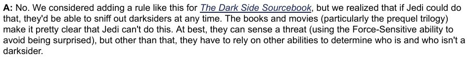

# Owner Material 037 — Star Wars D20 Drive folder (Core, Revised Core and Saga Edition): Jedi Counselling/Jedi Counseling 10 - Force Lightning.pdf [Star Wars Roleplaying Game Revised Core (d20, 2002)]

- **Source:** Wizards of the Coast Star Wars Roleplaying Game books, web enhancements, Living Force campaign modules and articles (2000–2010), from the owner's "Star Wars D20" Drive folder (only the three edition subfolders; "General" was not read, as instructed). Secondary source (licensed Legends reference). Scan OCR'd on the box; the scan stays box-only and is **not** published.
- **Method:** every scanned page was OCR'd and machine-screened sentence by sentence for power-relevant statements (fights, kills, defeats, Force feats, rankings, superweapons) that name a character on our roster; each kept sentence is quoted verbatim from the OCR text and has a crop of the printed passage directly under it. Pages with nothing power-relevant are still listed with what is on them.
- **Citation:** "*Jedi Counseling 10 - Force Lightning* (SWRPG d20 Revised Core), p.X" by printed page ("scan p.X" where no printed number applies). **Weight:** Licensed RPG material: a secondary source. Narrative text sums up Legends lore; game statistics are rules for players, not canon power levels, and rank lowest.

## scan p.1 (scan page 1)

Page contents: AotC Force Lightning question, revised Force Lightning skill, Block ability, Combat Expertise question (hand-read)

- **Obi-Wan Kenobi; Yoda; Count Dooku** — entry/section: Force Lightning in Attack of the Clones (question): "Q: I recently watched Attack of the Clones again, and I couldn't help noticing that Force Lightning doesn't work in the movie the way it does in the rules. For one thing, Obi-Wan blocks it with his lightsaber, which should be impossible, since you have to make a saving throw, and you can't deflect an attack that calls for a saving throw. Then, a few minutes later, Yoda blocks Dooku's Force Lightning with his bare hand, and even shoots it back at Dooku! The rules don't let you do this, so how do you explain that?" Source: *Jedi Counseling 10 - Force Lightning* (SWRPG d20 Revised Core), scan p.1
  
- **Obi-Wan Kenobi; Yoda; Count Dooku** — entry/section: Revising Force Lightning after Attack of the Clones: "A: After we saw Attack of the Clones, we scratched our heads over that scene, too. We'd seen the script for Episode II, but not the dramatic final fight scene -- so we hadn't realized that our rules didn't reflect what happened in that combat! We talked about it and ultimately put together a sort of "house rule" for how to change the Force Lightning skill. Then we put it on the Internet to see what the players thought of it. After lots of discussion and several changes, we decided we needed to change the rules. Here's what we did." Source: *Jedi Counseling 10 - Force Lightning* (SWRPG d20 Revised Core), scan p.1
  
- **Yoda** — entry/section: The Block ability (Yoda throwing lightning back): "Block
This is a modified version of deflect that allows the Jedi to deflect a ranged attack without the use of a lightsaber. If the Jedi does not have some sort of protective gear (such as an armored gauntlet), or an item that can withstand the ranged attack (such as an energy shield or suitably dense material), the Jedi must spend a Force Point to use this ability. (Force Points spent in this way do not add the usual bonus dice to d20 rolls that the Jedi makes in the subsequent round.) Block doesn't allow the Jedi to extend the defense beyond the Jedi's position, and all other rules concerning deflect (defense) and deflect (attack) apply." Source: *Jedi Counseling 10 - Force Lightning* (SWRPG d20 Revised Core), scan p.1
  

## scan p.2 (scan page 2)

Page contents: Combat Expertise answer, jump boots, gravity well, astrogation, Pilot, degeneration and feats, Obi-Wan vs Jango AoO, flechette area, armor DR question (hand-read)

## scan p.3 (scan page 3)

Page contents: Armor DR answers; Jedi cannot sense Dark Side Points (hand-read)

- **No single roster character (rules/setting/general)** — entry/section: Jedi cannot detect Dark Side Points: "A: No. We considered adding a rule like this for The Dark Side Sourcebook, but we realized that if Jedi could do that, they'd be able to sniff out darksiders at any time. The books and movies (particularly the prequel trilogy) make it pretty clear that Jedi can't do this. At best, they can sense a threat (using the Force-Sensitive ability to avoid being surprised), but other than that, they have to rely on other abilities to determine who is and who isn't a darksider." Source: *Jedi Counseling 10 - Force Lightning* (SWRPG d20 Revised Core), scan p.3
  
