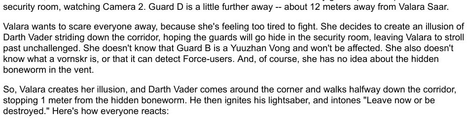
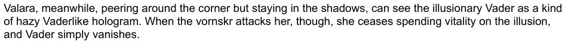
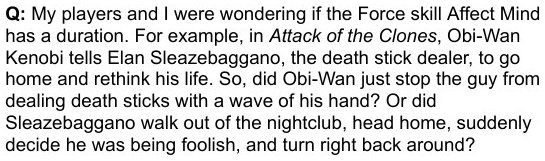
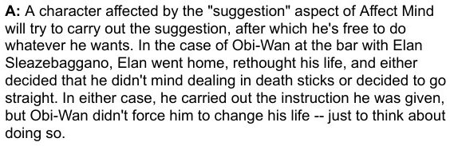
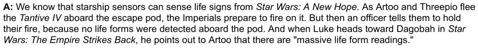

# Owner Material 037 — Star Wars D20 Drive folder (Core, Revised Core and Saga Edition): Jedi Counselling/Jedi Counseling 11 - Illusion Confusion.pdf [Star Wars Roleplaying Game Revised Core (d20, 2002)]

- **Source:** Wizards of the Coast Star Wars Roleplaying Game books, web enhancements, Living Force campaign modules and articles (2000–2010), from the owner's "Star Wars D20" Drive folder (only the three edition subfolders; "General" was not read, as instructed). Secondary source (licensed Legends reference). Scan OCR'd on the box; the scan stays box-only and is **not** published.
- **Method:** every scanned page was OCR'd and machine-screened sentence by sentence for power-relevant statements (fights, kills, defeats, Force feats, rankings, superweapons) that name a character on our roster; each kept sentence is quoted verbatim from the OCR text and has a crop of the printed passage directly under it. Pages with nothing power-relevant are still listed with what is on them.
- **Citation:** "*Jedi Counseling 11 - Illusion Confusion* (SWRPG d20 Revised Core), p.X" by printed page ("scan p.X" where no printed number applies). **Weight:** Licensed RPG material: a secondary source. Narrative text sums up Legends lore; game statistics are rules for players, not canon power levels, and rank lowest.

## scan p.1 (scan page 1)

Page contents: Illusion worked example with Valara Saar and a Vader illusion; reactions of guards A-D, Vong, droid, vornskr, boneworm (hand-read)

- **Valara Saar; Darth Vader (Anakin Skywalker)** — entry/section: Valara Saar's Vader illusion: "Valara wants to scare everyone away, because she's feeling too tired to fight. She decides to create an illusion of Darth Vader striding down the corridor, hoping the guards will go hide in the security room, leaving Valara to stroll past unchallenged. She doesn't know that Guard B is a Yuuzhan Vong and won't be affected. She also doesn't know what a vornskr is, or that it can detect Force-users. And, of course, she has no idea about the hidden boneworm in the vent.
So, Valara creates her illusion, and Darth Vader comes around the corner and walks halfway down the corridor, stopping 1 meter from the hidden boneworm. He then ignites his lightsaber, and intones "Leave now or be destroyed." Here's how everyone reacts:" Source: *Jedi Counseling 11 - Illusion Confusion* (SWRPG d20 Revised Core), scan p.1
  

## scan p.2 (scan page 2)

Page contents: Illusion example ends; Affect Mind suggestion duration; Quickness/Toughness; starship sensors (hand-read)

- **Valara Saar; Darth Vader (Anakin Skywalker)** — entry/section: Valara sees her own illusion: "Valara, meanwhile, peering around the corner but staying in the shadows, can see the illusionary Vader as a kind of hazy Vaderlike hologram. When the vornskr attacks her, though, she ceases spending vitality on the illusion, and Vader simply vanishes." Source: *Jedi Counseling 11 - Illusion Confusion* (SWRPG d20 Revised Core), scan p.2
  
- **Obi-Wan Kenobi; Elan Sleazebaggano** — entry/section: Affect Mind: Obi-Wan and Elan Sleazebaggano (question): "Q: My players and I were wondering if the Force skill Affect Mind has a duration. For example, in Attack of the Clones, Obi-Wan Kenobi tells Elan Sleazebaggano, the death stick dealer, to go home and rethink his life. So, did Obi-Wan just stop the guy from dealing death sticks with a wave of his hand? Or did Sleazebaggano walk out of the nightclub, head home, suddenly decide he was being foolish, and turn right back around?" Source: *Jedi Counseling 11 - Illusion Confusion* (SWRPG d20 Revised Core), scan p.2
  
- **Obi-Wan Kenobi; Elan Sleazebaggano** — entry/section: Affect Mind: what Elan did afterward: "A: A character affected by the "suggestion" aspect of Affect Mind will try to carry out the suggestion, after which he's free to do whatever he wants. In the case of Obi-Wan at the bar with Elan Sleazebaggano, Elan went home, rethought his life, and either decided that he didn't mind dealing in death sticks or decided to go straight. In either case, he carried out the instruction he was given, but Obi-Wan didn't force him to change his life -- just to think about doing so." Source: *Jedi Counseling 11 - Illusion Confusion* (SWRPG d20 Revised Core), scan p.2
  
- **R2-D2; C-3PO; Luke Skywalker** — entry/section: Starship sensors and life forms: "A: We know that starship sensors can sense life signs from Star Wars: A New Hope. As Artoo and Threepio flee the Tantive IV aboard the escape pod, the Imperials prepare to fire on it. But then an officer tells them to hold their fire, because no life forms were detected aboard the pod. And when Luke heads toward Dagobah in Star Wars: The Empire Strikes Back, he points out to Artoo that there are "massive life form readings."" Source: *Jedi Counseling 11 - Illusion Confusion* (SWRPG d20 Revised Core), scan p.2
  

## scan p.3 (scan page 3)

Page contents: Closing (hand-read)

