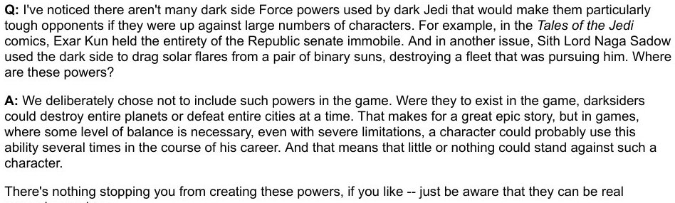
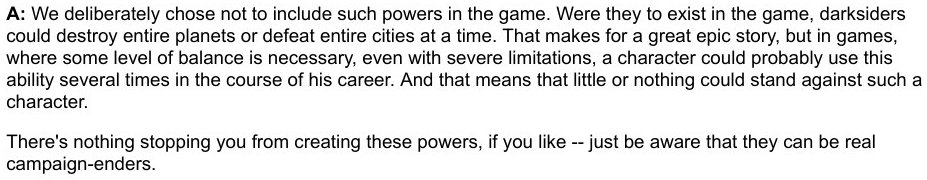

# Owner Material 037 — Star Wars D20 Drive folder (Core, Revised Core and Saga Edition): Jedi Counselling/Jedi Counseling 12 - Ewok Jedi?.pdf [Star Wars Roleplaying Game Revised Core (d20, 2002)]

- **Source:** Wizards of the Coast Star Wars Roleplaying Game books, web enhancements, Living Force campaign modules and articles (2000–2010), from the owner's "Star Wars D20" Drive folder (only the three edition subfolders; "General" was not read, as instructed). Secondary source (licensed Legends reference). Scan OCR'd on the box; the scan stays box-only and is **not** published.
- **Method:** every scanned page was OCR'd and machine-screened sentence by sentence for power-relevant statements (fights, kills, defeats, Force feats, rankings, superweapons) that name a character on our roster; each kept sentence is quoted verbatim from the OCR text and has a crop of the printed passage directly under it. Pages with nothing power-relevant are still listed with what is on them.
- **Citation:** "*Jedi Counseling 12 - Ewok Jedi?* (SWRPG d20 Revised Core), p.X" by printed page ("scan p.X" where no printed number applies). **Weight:** Licensed RPG material: a secondary source. Narrative text sums up Legends lore; game statistics are rules for players, not canon power levels, and rank lowest.

## scan p.1 (scan page 1)

Page contents: Jump landing DCs, Jedi armorers, epic dark side powers, Vong prestige classes, amphistaff, coufee (hand-read)

- **Exar Kun; Naga Sadow** — entry/section: Epic dark side powers (question): "Q: I've noticed there aren't many dark side Force powers used by dark Jedi that would make them particularly tough opponents if they were up against large numbers of characters. For example, in the Tales of the Jedi comics, Exar Kun held the entirety of the Republic senate immobile. And in another issue, Sith Lord Naga Sadow used the dark side to drag solar flares from a pair of binary suns, destroying a fleet that was pursuing him. Where are these powers?" Source: *Jedi Counseling 12 - Ewok Jedi?* (SWRPG d20 Revised Core), scan p.1
  
- **Exar Kun; Naga Sadow** — entry/section: Why epic dark side powers were left out: "A: We deliberately chose not to include such powers in the game. Were they to exist in the game, darksiders could destroy entire planets or defeat entire cities at a time. That makes for a great epic story, but in games, where some level of balance is necessary, even with severe limitations, a character could probably use this ability several times in the course of his career. And that means that little or nothing could stand against such a character.
There's nothing stopping you from creating these powers, if you like -- just be aware that they can be real campaign-enders." Source: *Jedi Counseling 12 - Ewok Jedi?* (SWRPG d20 Revised Core), scan p.1
  

## scan p.2 (scan page 2)

Page contents: Ewok Jedi, primitive penalty, suit rupture, weapon master errata, starship conversions, sensors (hand-read)

## scan p.3 (scan page 3)

Page contents: Pursuit rules, E-web generator (15 kg, 750 cr), Sith warrior errata (hand-read)

