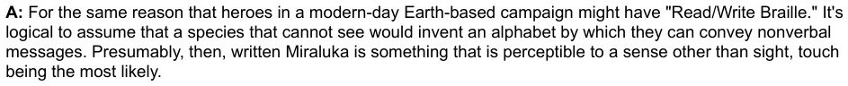
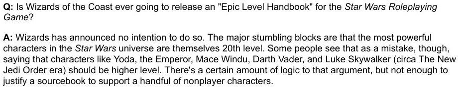

# Owner Material 037 — Star Wars D20 Drive folder (Core, Revised Core and Saga Edition): Jedi Counselling/Jedi Counseling 13 - The Force.pdf [Star Wars Roleplaying Game Revised Core (d20, 2002)]

- **Source:** Wizards of the Coast Star Wars Roleplaying Game books, web enhancements, Living Force campaign modules and articles (2000–2010), from the owner's "Star Wars D20" Drive folder (only the three edition subfolders; "General" was not read, as instructed). Secondary source (licensed Legends reference). Scan OCR'd on the box; the scan stays box-only and is **not** published.
- **Method:** every scanned page was OCR'd and machine-screened sentence by sentence for power-relevant statements (fights, kills, defeats, Force feats, rankings, superweapons) that name a character on our roster; each kept sentence is quoted verbatim from the OCR text and has a crop of the printed passage directly under it. Pages with nothing power-relevant are still listed with what is on them.
- **Citation:** "*Jedi Counseling 13 - The Force* (SWRPG d20 Revised Core), p.X" by printed page ("scan p.X" where no printed number applies). **Weight:** Licensed RPG material: a secondary source. Narrative text sums up Legends lore; game statistics are rules for players, not canon power levels, and rank lowest.

## scan p.1 (scan page 1)

Page contents: Force Mind range, Force Mastery, paralysis, Miraluka script, SD-9 typo, cortosis, translator droids (hand-read)

- **No single roster character (rules/setting/general)** — entry/section: Why Miraluka have a written language: "A: For the same reason that heroes in a modern-day Earth-based campaign might have "Read/Write Braille." It's logical to assume that a species that cannot see would invent an alphabet by which they can convey nonverbal messages. Presumably, then, written Miraluka is something that is perceptible to a sense other than sight, touch being the most likely." Source: *Jedi Counseling 13 - The Force* (SWRPG d20 Revised Core), scan p.1
  

## scan p.2 (scan page 2)

Page contents: Deflect penalties, Battlemind, Dug Great Shout, epic levels, Martial Arts, Dissipate Energy, Force Flight, switching targets (hand-read)

- **Yoda; Palpatine (Darth Sidious); Mace Windu; Darth Vader (Anakin Skywalker); Luke Skywalker** — entry/section: No Epic Level Handbook for Star Wars: "A: Wizards has announced no intention to do so. The major stumbling blocks are that the most powerful characters in the Star Wars universe are themselves 20th level. Some people see that as a mistake, though, saying that characters like Yoda, the Emperor, Mace Windu, Darth Vader, and Luke Skywalker (circa The New Jedi Order era) should be higher level. There's a certain amount of logic to that argument, but not enough to justify a sourcebook to support a handful of nonplayer characters." Source: *Jedi Counseling 13 - The Force* (SWRPG d20 Revised Core), scan p.2
  

## scan p.3 (scan page 3)

Page contents: Guiding Spirit, stun range, Force skill cooperation (hand-read)

