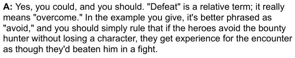
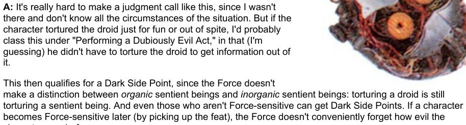
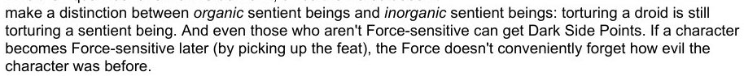

# Owner Material 037 — Star Wars D20 Drive folder (Core, Revised Core and Saga Edition): Jedi Counselling/Jedi Counseling 14 - Run Away!.pdf [Star Wars Roleplaying Game Revised Core (d20, 2002)]

- **Source:** Wizards of the Coast Star Wars Roleplaying Game books, web enhancements, Living Force campaign modules and articles (2000–2010), from the owner's "Star Wars D20" Drive folder (only the three edition subfolders; "General" was not read, as instructed). Secondary source (licensed Legends reference). Scan OCR'd on the box; the scan stays box-only and is **not** published.
- **Method:** every scanned page was OCR'd and machine-screened sentence by sentence for power-relevant statements (fights, kills, defeats, Force feats, rankings, superweapons) that name a character on our roster; each kept sentence is quoted verbatim from the OCR text and has a crop of the printed passage directly under it. Pages with nothing power-relevant are still listed with what is on them.
- **Citation:** "*Jedi Counseling 14 - Run Away!* (SWRPG d20 Revised Core), p.X" by printed page ("scan p.X" where no printed number applies). **Weight:** Licensed RPG material: a secondary source. Narrative text sums up Legends lore; game statistics are rules for players, not canon power levels, and rank lowest.

## scan p.1 (scan page 1)

Page contents: Sith warrior deflect, XP for avoiding foes, Move Object crush, Luminous Being, galaxy map errata begins (hand-read)

- **No single roster character (rules/setting/general)** — entry/section: Defeat means overcome: "A: Yes, you could, and you should. "Defeat" is a relative term; it really means "overcome." In the example you give, it's better phrased as "avoid," and you should simply rule that if the heroes avoid the bounty hunter without losing a character, they get experience for the encounter as though they'd beaten him in a fight." Source: *Jedi Counseling 14 - Run Away!* (SWRPG d20 Revised Core), scan p.1
  

## scan p.2 (scan page 2)

Page contents: Map errata end, droid torture DSP, concealment, point defense errata, shuttle ignition codes, Traxes communicator (hand-read)

- **No single roster character (rules/setting/general)** — entry/section: Torturing a droid earns a Dark Side Point (part 1 of 2): "A: It's really hard to make a judgment call like this, since I wasn't there and don't know all the circumstances of the situation. But if the character tortured the droid just for fun or out of spite, I'd probably class this under "Performing a Dubiously Evil Act," in that (I'm guessing) he didn't have to torture the droid to get information out of it. This then qualifies for a Dark Side Point, since the Force doesn't" Source: *Jedi Counseling 14 - Run Away!* (SWRPG d20 Revised Core), scan p.2
  
- **No single roster character (rules/setting/general)** — entry/section: Torturing a droid earns a Dark Side Point (part 2 of 2): "make a distinction between organic sentient beings and inorganic sentient beings: torturing a droid is still torturing a sentient being. And even those who aren't Force-sensitive can get Dark Side Points. If a character becomes Force-sensitive later (by picking up the feat), the Force doesn't conveniently forget how evil the character was before." Source: *Jedi Counseling 14 - Run Away!* (SWRPG d20 Revised Core), scan p.2
  

## scan p.3 (scan page 3)

Page contents: Combat Reflexes stormtrooper example, Inspire, Jedi investigator, About the Author (hand-read)

