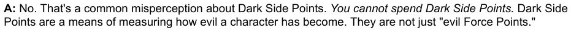
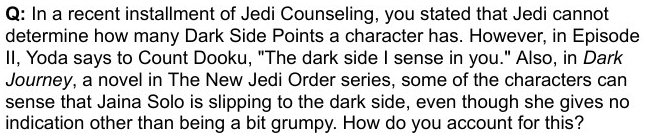
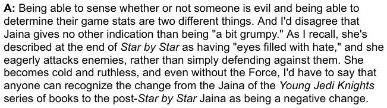
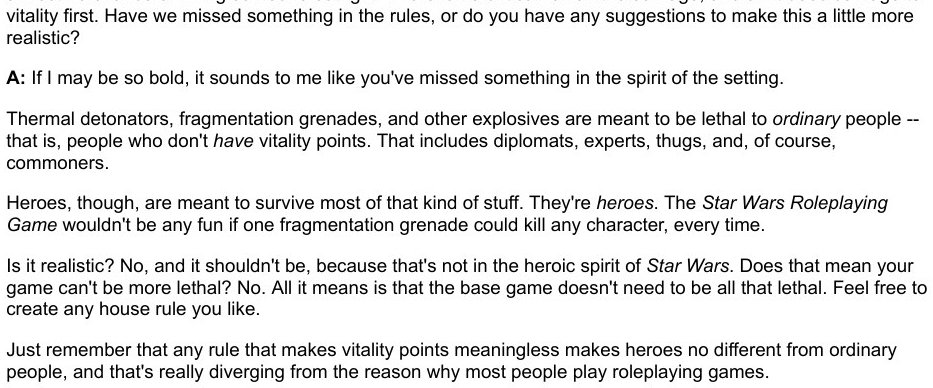

# Owner Material 037 — Star Wars D20 Drive folder (Core, Revised Core and Saga Edition): Jedi Counselling/Jedi Counseling 15 - Dark Side Points.pdf [Star Wars Roleplaying Game Revised Core (d20, 2002)]

- **Source:** Wizards of the Coast Star Wars Roleplaying Game books, web enhancements, Living Force campaign modules and articles (2000–2010), from the owner's "Star Wars D20" Drive folder (only the three edition subfolders; "General" was not read, as instructed). Secondary source (licensed Legends reference). Scan OCR'd on the box; the scan stays box-only and is **not** published.
- **Method:** every scanned page was OCR'd and machine-screened sentence by sentence for power-relevant statements (fights, kills, defeats, Force feats, rankings, superweapons) that name a character on our roster; each kept sentence is quoted verbatim from the OCR text and has a crop of the printed passage directly under it. Pages with nothing power-relevant are still listed with what is on them.
- **Citation:** "*Jedi Counseling 15 - Dark Side Points* (SWRPG d20 Revised Core), p.X" by printed page ("scan p.X" where no printed number applies). **Weight:** Licensed RPG material: a secondary source. Narrative text sums up Legends lore; game statistics are rules for players, not canon power levels, and rank lowest.

## scan p.1 (scan page 1)

Page contents: DSPs not spendable, sensing the dark side (Yoda/Dooku, Jaina Solo), followers XP, deflect vs crits (hand-read)

- **No single roster character (rules/setting/general)** — entry/section: Dark Side Points are not evil Force Points: "A: No. That's a common misperception about Dark Side Points. You cannot spend Dark Side Points. Dark Side Points are a means of measuring how evil a character has become. They are not just "evil Force Points."" Source: *Jedi Counseling 15 - Dark Side Points* (SWRPG d20 Revised Core), scan p.1
  
- **Yoda; Count Dooku; Jaina Solo** — entry/section: Sensing the dark side (question): "Q: In a recent installment of Jedi Counseling, you stated that Jedi cannot determine how many Dark Side Points a character has. However, in Episode Il, Yoda says to Count Dooku, "The dark side I sense in you." Also, in Dark Journey, a novel in The New Jedi Order series, some of the characters can sense that Jaina Solo is slipping to the dark side, even though she gives no indication other than being a bit grumpy. How do you account for this?" Source: *Jedi Counseling 15 - Dark Side Points* (SWRPG d20 Revised Core), scan p.1
  
- **Jaina Solo** — entry/section: Jaina Solo after Star by Star: "A: Being able to sense whether or not someone is evil and being able to determine their game stats are two different things. And I'd disagree that Jaina gives no other indication than being "a bit grumpy." As I recall, she's described at the end of Star by Star as having "eyes filled with hate," and she eagerly attacks enemies, rather than simply defending against them. She becomes cold and ruthless, and even without the Force, I'd have to say that anyone can recognize the change from the Jaina of the Young Jedi Knights series of books to the post-Star by Star Jaina as being a negative change." Source: *Jedi Counseling 15 - Dark Side Points* (SWRPG d20 Revised Core), scan p.1
  

## scan p.2 (scan page 2)

Page contents: Explosive lethality, synergy bonuses, Gungan energy balls and shields, delay vs ready (hand-read)

- **No single roster character (rules/setting/general)** — entry/section: Explosives and the heroic spirit: "A: lf I may be so bold, it sounds to me like you've missed something in the spirit of the setting. Thermal detonators, fragmentation grenades, and other explosives are meant to be lethal to ordinary people -that is, people who don't have vitality points. That includes diplomats, experts, thugs, and, of course, commoners. Heroes, though, are meant to survive most of that kind of stuff. They're heroes. The Star Wars Roleplaying Game wouldn't be any fun if one fragmentation grenade could kill any character, every time. Is it realistic? No, and it shouldn't be, because that's not in the heroic spirit of Star Wars. Does that mean your game can't be more lethal? No. All it means is that the base game doesn't need to be all that lethal. Feel free to create any house rule you like. Just remember that any rule that makes vitality points meaningless makes heroes no different from ordinary people, and that's really diverging from the reason why most people play roleplaying games." Source: *Jedi Counseling 15 - Dark Side Points* (SWRPG d20 Revised Core), scan p.2
  

## scan p.3 (scan page 3)

Page contents: Ready/delay end; About the Author (hand-read)

