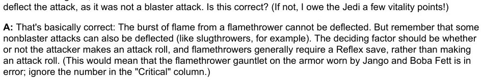

# Owner Material 037 — Star Wars D20 Drive folder (Core, Revised Core and Saga Edition): Jedi Counselling/Jedi Counseling 16 - New Rules?.pdf [Star Wars Roleplaying Game Revised Core (d20, 2002)]

- **Source:** Wizards of the Coast Star Wars Roleplaying Game books, web enhancements, Living Force campaign modules and articles (2000–2010), from the owner's "Star Wars D20" Drive folder (only the three edition subfolders; "General" was not read, as instructed). Secondary source (licensed Legends reference). Scan OCR'd on the box; the scan stays box-only and is **not** published.
- **Method:** every scanned page was OCR'd and machine-screened sentence by sentence for power-relevant statements (fights, kills, defeats, Force feats, rankings, superweapons) that name a character on our roster; each kept sentence is quoted verbatim from the OCR text and has a crop of the printed passage directly under it. Pages with nothing power-relevant are still listed with what is on them.
- **Citation:** "*Jedi Counseling 16 - New Rules?* (SWRPG d20 Revised Core), p.X" by printed page ("scan p.X" where no printed number applies). **Weight:** Licensed RPG material: a secondary source. Narrative text sums up Legends lore; game statistics are rules for players, not canon power levels, and rank lowest.

## scan p.1 (scan page 1)

Page contents: Second printing, bowcasters, afterburn/hard brake, Cure feats question (hand-read)

## scan p.2 (scan page 2)

Page contents: Cure feats, prestige class switching, Familiarity, flamethrowers, repair times, splinter shots (hand-read)

- **Jango Fett; Boba Fett** — entry/section: Flamethrowers cannot be deflected: "A: That's basically correct: The burst of flame from a flamethrower cannot be deflected. But remember that some nonblaster attacks can also be deflected (like slugthrowers, for example). The deciding factor should be whether or not the attacker makes an attack roll, and flamethrowers generally require a Reflex save, rather than making an attack roll. (This would mean that the flamethrower gauntlet on the armor worn by Jango and Boba Fett is in error; ignore the number in the "Critical" column.)" Source: *Jedi Counseling 16 - New Rules?* (SWRPG d20 Revised Core), scan p.2
  

## scan p.3 (scan page 3)

Page contents: Atmospheric speed conversion, Force warrior unarmed damage, About the Author (hand-read)

