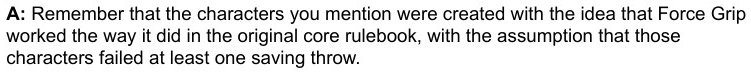
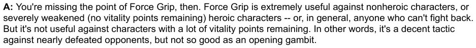
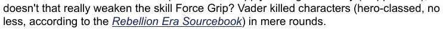
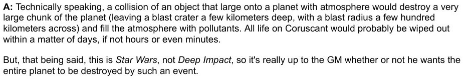
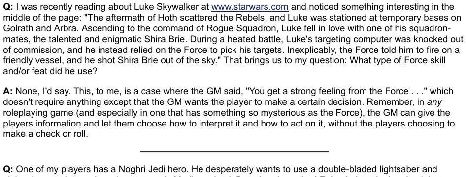
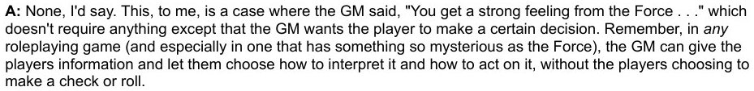
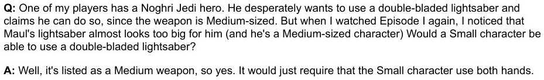
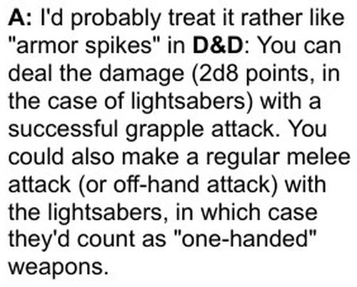

# Owner Material 037 — Star Wars D20 Drive folder (Core, Revised Core and Saga Edition): Jedi Counselling/Jedi Counseling 17 - Killing Coruscant.pdf [Star Wars Roleplaying Game Revised Core (d20, 2002)]

- **Source:** Wizards of the Coast Star Wars Roleplaying Game books, web enhancements, Living Force campaign modules and articles (2000–2010), from the owner's "Star Wars D20" Drive folder (only the three edition subfolders; "General" was not read, as instructed). Secondary source (licensed Legends reference). Scan OCR'd on the box; the scan stays box-only and is **not** published.
- **Method:** every scanned page was OCR'd and machine-screened sentence by sentence for power-relevant statements (fights, kills, defeats, Force feats, rankings, superweapons) that name a character on our roster; each kept sentence is quoted verbatim from the OCR text and has a crop of the printed passage directly under it. Pages with nothing power-relevant are still listed with what is on them.
- **Citation:** "*Jedi Counseling 17 - Killing Coruscant* (SWRPG d20 Revised Core), p.X" by printed page ("scan p.X" where no printed number applies). **Weight:** Licensed RPG material: a secondary source. Narrative text sums up Legends lore; game statistics are rules for players, not canon power levels, and rank lowest.

## scan p.1 (scan page 1)

Page contents: Sith poison, dark Force witches, Force Grip weakening, R2 interface probe (hand-read)

- **Darth Vader (Anakin Skywalker)** — entry/section: Force Grip and Vader's victims: "A: Remember that the characters you mention were created with the idea that Force Grip worked the way it did in the original core rulebook, with the assumption that those characters failed at least one saving throw." Source: *Jedi Counseling 17 - Killing Coruscant* (SWRPG d20 Revised Core), scan p.1
  
- **No single roster character (rules/setting/general)** — entry/section: The point of Force Grip: "A: You're missing the point of Force Grip, then. Force Grip is extremely useful against nonheroic characters, or severely weakened (no vitality points remaining) heroic characters -- or, in general, anyone who can't fight back. But it's not useful against characters with a lot of vitality points remaining. In other words, it's a decent tactic against nearly defeated opponents, but not so good as an opening gambit." Source: *Jedi Counseling 17 - Killing Coruscant* (SWRPG d20 Revised Core), scan p.1
  
- **Darth Vader (Anakin Skywalker)**: "Vader killed characters (hero-classed, no less, according to the Rebellion Era Sourcebook) in mere rounds." Source: *Jedi Counseling 17 - Killing Coruscant* (SWRPG d20 Revised Core), scan p.1
  

## scan p.2 (scan page 2)

Page contents: Coruscant collision, Miraluka sense, Dissipate Energy take 10, Luke and Shira Brie, Small characters with double lightsabers (hand-read)

- **No single roster character (rules/setting/general)** — entry/section: A Star Destroyer hitting Coruscant: "A: Technically speaking, a collision of an object that large onto a planet with atmosphere would destroy a very large chunk of the planet (leaving a blast crater a few kilometers deep, with a blast radius a few hundred kilometers across) and fill the atmosphere with pollutants. All life on Coruscant would probably be wiped out within a matter of days, if not hours or even minutes.
But, that being said, this is Star Wars, not Deep Impact, so it's really up to the GM whether or not he wants the entire planet to be destroyed by such an event." Source: *Jedi Counseling 17 - Killing Coruscant* (SWRPG d20 Revised Core), scan p.2
  
- **Luke Skywalker; Lumiya** — entry/section: Luke fires on Shira Brie (question): "Q: I was recently reading about Luke Skywalker at www.starwars.com and noticed something interesting in the middle of the page: "The aftermath of Hoth scattered the Rebels, and Luke was stationed at temporary bases on Golrath and Arbra. Ascending to the command of Rogue Squadron, Luke fell in love with one of his squadronmates, the talented and enigmatic Shira Brie. During a heated battle, Luke's targeting computer was knocked out of commission, and he instead relied on the Force to pick his targets. Inexplicably, the Force told him to fire on a friendly vessel, and he shot Shira Brie out of the sky." That brings us to my question: What type of Force skill and/or feat did he use?" Source: *Jedi Counseling 17 - Killing Coruscant* (SWRPG d20 Revised Core), scan p.2
  
- **Luke Skywalker; Lumiya** — entry/section: Luke fires on Shira Brie: a feeling from the Force: "A: None, I'd say. This, to me, is a case where the GM said, "You get a strong feeling from the Force . . ." which doesn't require anything except that the GM wants the player to make a certain decision. Remember, in any roleplaying game (and especially in one that has something so mysterious as the Force), the GM can give the players information and let them choose how to interpret it and how to act on it, without the players choosing to make a check or roll." Source: *Jedi Counseling 17 - Killing Coruscant* (SWRPG d20 Revised Core), scan p.2
  
- **Darth Maul** — entry/section: Small characters and double-bladed lightsabers: "Q: One of my players has a Noghri Jedi hero. He desperately wants to use a double-bladed lightsaber and claims he can do so, since the weapon is Medium-sized. But when I watched Episode I again, I noticed that Maul's lightsaber almost looks too big for him (and he's a Medium-sized character) Would a Small character be able to use a double-bladed lightsaber? A: Well, it's listed as a Medium weapon, so yes. It would just require that the Small character use both hands." Source: *Jedi Counseling 17 - Killing Coruscant* (SWRPG d20 Revised Core), scan p.2
  

## scan p.3 (scan page 3)

Page contents: Ship-scale deflect, limb-mounted lightsabers, no burning DSPs (hand-read)

- **No single roster character (rules/setting/general)** — entry/section: Knee and elbow lightsabers (Rebel Stand): "A: I'd probably treat it rather like "armor spikes" in D&D: You can deal the damage (2d8 points, in the case of lightsabers) with a successful grapple attack. You could also make a regular melee attack (or off-hand attack) with the lightsabers, in which case they'd count as "one-handed" weapons." Source: *Jedi Counseling 17 - Killing Coruscant* (SWRPG d20 Revised Core), scan p.3
  
