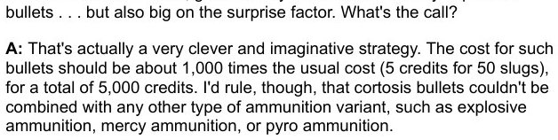
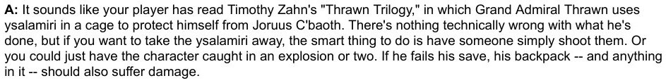
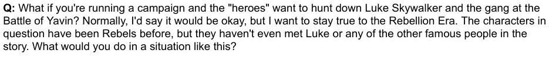
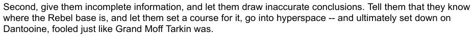

# Owner Material 037 — Star Wars D20 Drive folder (Core, Revised Core and Saga Edition): Jedi Counselling/Jedi Counseling 18 - Cortosis Bullets.pdf [Star Wars Roleplaying Game Revised Core (d20, 2002)]

- **Source:** Wizards of the Coast Star Wars Roleplaying Game books, web enhancements, Living Force campaign modules and articles (2000–2010), from the owner's "Star Wars D20" Drive folder (only the three edition subfolders; "General" was not read, as instructed). Secondary source (licensed Legends reference). Scan OCR'd on the box; the scan stays box-only and is **not** published.
- **Method:** every scanned page was OCR'd and machine-screened sentence by sentence for power-relevant statements (fights, kills, defeats, Force feats, rankings, superweapons) that name a character on our roster; each kept sentence is quoted verbatim from the OCR text and has a crop of the printed passage directly under it. Pages with nothing power-relevant are still listed with what is on them.
- **Citation:** "*Jedi Counseling 18 - Cortosis Bullets* (SWRPG d20 Revised Core), p.X" by printed page ("scan p.X" where no printed number applies). **Weight:** Licensed RPG material: a secondary source. Narrative text sums up Legends lore; game statistics are rules for players, not canon power levels, and rank lowest.

## scan p.1 (scan page 1)

Page contents: Knocked out vs unconscious, cortosis bullets, starship weapon ranges (hand-read)

- **No single roster character (rules/setting/general)** — entry/section: Cortosis bullets: "A: That's actually a very clever and imaginative strategy. The cost for such bullets should be about 1,000 times the usual cost (5 credits for 50 slugs), for a total of 5,000 credits. I'd rule, though, that cortosis bullets couldn't be combined with any other type of ammunition variant, such as explosive ammunition, mercy ammunition, or pyro ammunition." Source: *Jedi Counseling 18 - Cortosis Bullets* (SWRPG d20 Revised Core), scan p.1
  

## scan p.2 (scan page 2)

Page contents: Ranges end, Move Object vs grenades, Anx, comlinks, Instant Mastery, pursuit, Frightful Presence, ysalamiri question (hand-read)

## scan p.3 (scan page 3)

Page contents: Ysalamiri answer, Improved Flight, keeping heroes from rewriting the Battle of Yavin (hand-read)

- **Grand Admiral Thrawn; Joruus C'baoth** — entry/section: Ysalamiri in a backpack: "A: It sounds like your player has read Timothy Zahn's "Thrawn Trilogy," in which Grand Admiral Thrawn uses ysalamiri in a cage to protect himself from Joruus C'baoth. There's nothing technically wrong with what he's done, but if you want to take the ysalamiri away, the smart thing to do is have someone simply shoot them. Or you could just have the character caught in an explosion or two. If he fails his save, his backpack -- and anything in it -- should also suffer damage." Source: *Jedi Counseling 18 - Cortosis Bullets* (SWRPG d20 Revised Core), scan p.3
  
- **Luke Skywalker** — entry/section: Hunting Luke at the Battle of Yavin (question): "Q: What if you're running a campaign and the "heroes" want to hunt down Luke Skywalker and the gang at the Battle of Yavin? Normally, I'd say it would be okay, but I want to stay true to the Rebellion Era. The characters in question have been Rebels before, but they haven't even met Luke or any of the other famous people in the story. What would you do in a situation like this?" Source: *Jedi Counseling 18 - Cortosis Bullets* (SWRPG d20 Revised Core), scan p.3
  
- **Grand Moff Tarkin** — entry/section: Fooled just like Tarkin: "Second, give them incomplete information, and let them draw inaccurate conclusions. Tell them that they know where the Rebel base is, and let them set a course for it, go into hyperspace -- and ultimately set down on Dantooine, fooled just like Grand Moff Tarkin was." Source: *Jedi Counseling 18 - Cortosis Bullets* (SWRPG d20 Revised Core), scan p.3
  

## scan p.4 (scan page 4)

Page contents: Blank (hand-read)

