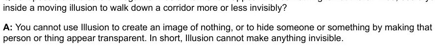
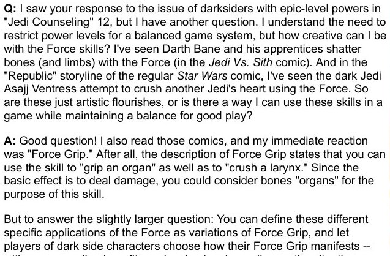
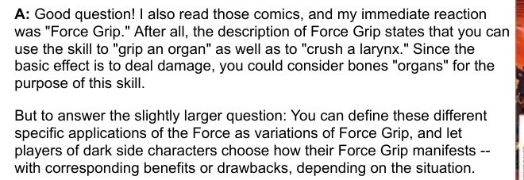

# Owner Material 037 — Star Wars D20 Drive folder (Core, Revised Core and Saga Edition): Jedi Counselling/Jedi Counseling 19 - Illusion Confusion 2.pdf [Star Wars Roleplaying Game Revised Core (d20, 2002)]

- **Source:** Wizards of the Coast Star Wars Roleplaying Game books, web enhancements, Living Force campaign modules and articles (2000–2010), from the owner's "Star Wars D20" Drive folder (only the three edition subfolders; "General" was not read, as instructed). Secondary source (licensed Legends reference). Scan OCR'd on the box; the scan stays box-only and is **not** published.
- **Method:** every scanned page was OCR'd and machine-screened sentence by sentence for power-relevant statements (fights, kills, defeats, Force feats, rankings, superweapons) that name a character on our roster; each kept sentence is quoted verbatim from the OCR text and has a crop of the printed passage directly under it. Pages with nothing power-relevant are still listed with what is on them.
- **Citation:** "*Jedi Counseling 19 - Illusion Confusion 2* (SWRPG d20 Revised Core), p.X" by printed page ("scan p.X" where no printed number applies). **Weight:** Licensed RPG material: a secondary source. Narrative text sums up Legends lore; game statistics are rules for players, not canon power levels, and rank lowest.

## scan p.1 (scan page 1)

Page contents: Illusion hiding, disguise, no invisibility, heavy armor stats, maneuverability (hand-read)

- **No single roster character (rules/setting/general)** — entry/section: Illusions cannot make anything invisible: "A: You cannot use Illusion to create an image of nothing, or to hide someone or something by making that person or thing appear transparent. In short, Illusion cannot make anything invisible." Source: *Jedi Counseling 19 - Illusion Confusion 2* (SWRPG d20 Revised Core), scan p.1
  

## scan p.2 (scan page 2)

Page contents: Arena fame Reputation, Defense penalty per class, DSP feats, Hide cover, droideka shield (hand-read)

## scan p.3 (scan page 3)

Page contents: Lightsaber and blaster two-weapon deflect penalties, Force Grip variants; About the Author (hand-read)

- **Darth Bane; Asajj Ventress** — entry/section: Creative Force Grip (question): "Q: I saw your response to the issue of darksiders with epic-level powers in "Jedi Counseling" 12, but I have another question. I understand the need to restrict power levels for a balanced game system, but how creative can I be with the Force skills? I've seen Darth Bane and his apprentices shatter bones (and limbs) with the Force (in the Jedi Vs. Sith comic). And in the "Republic" storyline of the regular Star Wars comic, I've seen the dark Jedi Asajj Ventress attempt to crush another Jedi’s heart using the Force. So are these just artistic flourishes, or is there a way I can use these skills in a game while maintaining a balance for good play?" Source: *Jedi Counseling 19 - Illusion Confusion 2* (SWRPG d20 Revised Core), scan p.3
  
- **Darth Bane; Asajj Ventress** — entry/section: Bone-shattering and heart-crushing as Force Grip: "A: Good question! I also read those comics, and my immediate reaction was "Force Grip." After all, the description of Force Grip states that you can use the skill to "grip an organ" as well as to "crush a larynx." Since the basic effect is to deal damage, you could consider bones "organs" for the purpose of this skill. But to answer the slightly larger question: You can define these different specific applications of the Force as variations of Force Grip, and let players of dark side characters choose how their Force Grip manifests -- with corresponding benefits or drawbacks, depending on the situation." Source: *Jedi Counseling 19 - Illusion Confusion 2* (SWRPG d20 Revised Core), scan p.3
  
