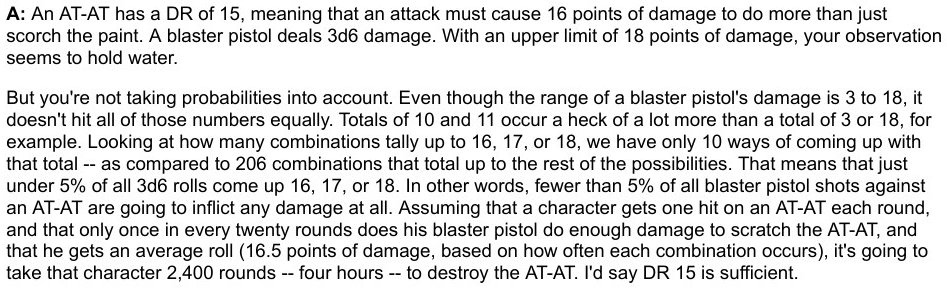

# Owner Material 037 — Star Wars D20 Drive folder (Core, Revised Core and Saga Edition): Jedi Counselling/Jedi Counseling 2 - AT-ATs.pdf [Star Wars Roleplaying Game Revised Core (d20, 2002)]

- **Source:** Wizards of the Coast Star Wars Roleplaying Game books, web enhancements, Living Force campaign modules and articles (2000–2010), from the owner's "Star Wars D20" Drive folder (only the three edition subfolders; "General" was not read, as instructed). Secondary source (licensed Legends reference). Scan OCR'd on the box; the scan stays box-only and is **not** published.
- **Method:** every scanned page was OCR'd and machine-screened sentence by sentence for power-relevant statements (fights, kills, defeats, Force feats, rankings, superweapons) that name a character on our roster; each kept sentence is quoted verbatim from the OCR text and has a crop of the printed passage directly under it. Pages with nothing power-relevant are still listed with what is on them.
- **Citation:** "*Jedi Counseling 2 - AT-ATs* (SWRPG d20 Revised Core), p.X" by printed page ("scan p.X" where no printed number applies). **Weight:** Licensed RPG material: a secondary source. Narrative text sums up Legends lore; game statistics are rules for players, not canon power levels, and rank lowest.

## scan p.1 (scan page 1)

Page contents: Ion damage, grenade radius, stunts, hazards, mastercrafted lightsabers, Friendship (hand-read)

## scan p.2 (scan page 2)

Page contents: Friendship cancel, bacta, Improved Force Mind, attack runs, FP on initiative, Quarren, poison, AT-AT question (hand-read)

## scan p.3 (scan page 3)

Page contents: AT-AT DR probability answer; species illustration guide for Power of the Jedi pp66-71 (hand-read)

- **No single roster character (rules/setting/general)** — entry/section: Why DR 15 is enough for an AT-AT: "A: An AT-AT has a DR of 15, meaning that an attack must cause 16 points of damage to do more than just scorch the paint. A blaster pistol deals 3d6 damage. With an upper limit of 18 points of damage, your observation seems to hold water.
But you're not taking probabilities into account. Even though the range of a blaster pistol's damage is 3 to 18, it doesn't hit all of those numbers equally. Totals of 10 and 11 occur a heck of a lot more than a total of 3 or 18, for example. Looking at how many combinations tally up to 16, 17, or 18, we have only 10 ways of coming up with that total -- as compared to 206 combinations that total up to the rest of the possibilities. That means that just under 5% of all 3d6 rolls come up 16, 17, or 18. In other words, fewer than 5% of all blaster pistol shots against an AT-AT are going to inflict any damage at all. Assuming that a character gets one hit on an AT-AT each round, and that only once in every twenty rounds does his blaster pistol do enough damage to scratch the AT-AT, and that he gets an average roll (16.5 points of damage, based on how often each combination occurs), it's going to take that character 2,400 rounds -- four hours -- to destroy the AT-AT. I'd say DR 15 is sufficient." Source: *Jedi Counseling 2 - AT-ATs* (SWRPG d20 Revised Core), scan p.3
  
