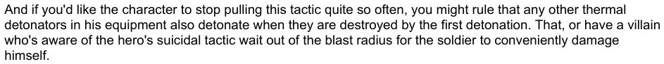
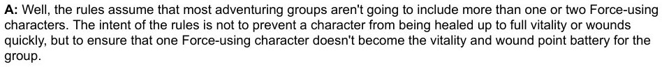

# Owner Material 037 — Star Wars D20 Drive folder (Core, Revised Core and Saga Edition): Jedi Counselling/Jedi Counseling 20 - Boom!.pdf [Star Wars Roleplaying Game Revised Core (d20, 2002)]

- **Source:** Wizards of the Coast Star Wars Roleplaying Game books, web enhancements, Living Force campaign modules and articles (2000–2010), from the owner's "Star Wars D20" Drive folder (only the three edition subfolders; "General" was not read, as instructed). Secondary source (licensed Legends reference). Scan OCR'd on the box; the scan stays box-only and is **not** published.
- **Method:** every scanned page was OCR'd and machine-screened sentence by sentence for power-relevant statements (fights, kills, defeats, Force feats, rankings, superweapons) that name a character on our roster; each kept sentence is quoted verbatim from the OCR text and has a crop of the printed passage directly under it. Pages with nothing power-relevant are still listed with what is on them.
- **Citation:** "*Jedi Counseling 20 - Boom!* (SWRPG d20 Revised Core), p.X" by printed page ("scan p.X" where no printed number applies). **Weight:** Licensed RPG material: a secondary source. Narrative text sums up Legends lore; game statistics are rules for players, not canon power levels, and rank lowest.

## scan p.1 (scan page 1)

Page contents: Thermal detonator suicide tactic, Plant Surge/Neti, Sever Force, stunned saves, Int implants, cyber legs question (hand-read)

- **No single roster character (rules/setting/general)** — entry/section: The self-detonating soldier: "And if you'd like the character to stop pulling this tactic quite so often, you might rule that any other thermal detonators in his equipment also detonate when they are destroyed by the first detonation. That, or have a villain who's aware of the hero's suicidal tactic wait out of the blast radius for the soldier to conveniently damage himself." Source: *Jedi Counseling 20 - Boom!* (SWRPG d20 Revised Core), scan p.1
  

## scan p.2 (scan page 2)

Page contents: Cyber leg damage, Heal Another rules, ability damage, two-lightsaber penalties, Kinetic Combat (hand-read)

- **No single roster character (rules/setting/general)** — entry/section: Why Heal Another is limited: "A: Well, the rules assume that most adventuring groups aren't going to include more than one or two Force-using characters. The intent of the rules is not to prevent a character from being healed up to full vitality or wounds quickly, but to ensure that one Force-using character doesn't become the vitality and wound point battery for the group." Source: *Jedi Counseling 20 - Boom!* (SWRPG d20 Revised Core), scan p.2
  

## scan p.3 (scan page 3)

Page contents: High Force Mastery, lightsaber vs natural armor errata (hand-read)

