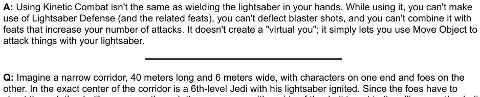

# Owner Material 037 — Star Wars D20 Drive folder (Core, Revised Core and Saga Edition): Jedi Counselling/Jedi Counseling 21 - Telepathy.pdf [Star Wars Roleplaying Game Revised Core (d20, 2002)]

- **Source:** Wizards of the Coast Star Wars Roleplaying Game books, web enhancements, Living Force campaign modules and articles (2000–2010), from the owner's "Star Wars D20" Drive folder (only the three edition subfolders; "General" was not read, as instructed). Secondary source (licensed Legends reference). Scan OCR'd on the box; the scan stays box-only and is **not** published.
- **Method:** every scanned page was OCR'd and machine-screened sentence by sentence for power-relevant statements (fights, kills, defeats, Force feats, rankings, superweapons) that name a character on our roster; each kept sentence is quoted verbatim from the OCR text and has a crop of the printed passage directly under it. Pages with nothing power-relevant are still listed with what is on them.
- **Citation:** "*Jedi Counseling 21 - Telepathy* (SWRPG d20 Revised Core), p.X" by printed page ("scan p.X" where no printed number applies). **Weight:** Licensed RPG material: a secondary source. Narrative text sums up Legends lore; game statistics are rules for players, not canon power levels, and rank lowest.

## scan p.1 (scan page 1)

Page contents: Defels, telepath prestige class, ion damage vs shields, falling checks question (hand-read)

## scan p.2 (scan page 2)

Page contents: Jump/Tumble, Tumble+Combat Expertise, Heal Self at 1 WP, Kinetic Combat, corridor deflect (hand-read)

- **No single roster character (rules/setting/general)** — entry/section: Kinetic Combat is not a virtual you: "A: Using Kinetic Combat isn't the same as wielding the lightsaber in your hands. While using it, you can't make use of Lightsaber Defense (and the related feats), you can't deflect blaster shots, and you can't combine it with feats that increase your number of attacks. It doesn't create a "virtual you"; it simply lets you use Move Object to attack things with your lightsaber." Source: *Jedi Counseling 21 - Telepathy* (SWRPG d20 Revised Core), scan p.2
  

## scan p.3 (scan page 3)

Page contents: Move Object attacks, vehicle quick start, unanswered questions (hand-read)

