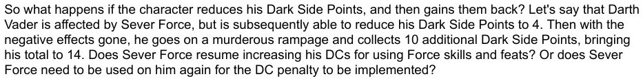
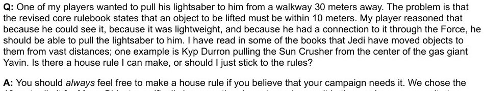
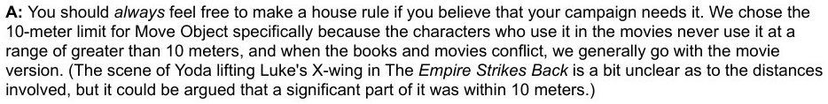
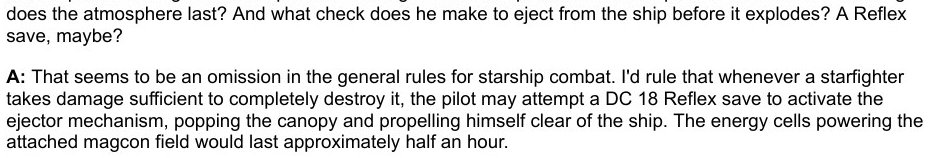

# Owner Material 037 — Star Wars D20 Drive folder (Core, Revised Core and Saga Edition): Jedi Counselling/Jedi Counseling 22 - Sever Force.pdf [Star Wars Roleplaying Game Revised Core (d20, 2002)]

- **Source:** Wizards of the Coast Star Wars Roleplaying Game books, web enhancements, Living Force campaign modules and articles (2000–2010), from the owner's "Star Wars D20" Drive folder (only the three edition subfolders; "General" was not read, as instructed). Secondary source (licensed Legends reference). Scan OCR'd on the box; the scan stays box-only and is **not** published.
- **Method:** every scanned page was OCR'd and machine-screened sentence by sentence for power-relevant statements (fights, kills, defeats, Force feats, rankings, superweapons) that name a character on our roster; each kept sentence is quoted verbatim from the OCR text and has a crop of the printed passage directly under it. Pages with nothing power-relevant are still listed with what is on them.
- **Citation:** "*Jedi Counseling 22 - Sever Force* (SWRPG d20 Revised Core), p.X" by printed page ("scan p.X" where no printed number applies). **Weight:** Licensed RPG material: a secondary source. Narrative text sums up Legends lore; game statistics are rules for players, not canon power levels, and rank lowest.

## scan p.1 (scan page 1)

Page contents: Sever Force, Move Object shield, prestige class Defense, Spellcaster, changeling limits, Empower question (hand-read)

- **Darth Vader (Anakin Skywalker)** — entry/section: Sever Force on Darth Vader (question): "So what happens if the character reduces his Dark Side Points, and then gains them back? Let's say that Darth Vader is affected by Sever Force, but is subsequently able to reduce his Dark Side Points to 4. Then with the negative effects gone, he goes on a murderous rampage and collects 10 additional Dark Side Points, bringing his total to 14. Does Sever Force resume increasing his DCs for using Force skills and feats? Or does Sever Force need to be used on him again for the DC penalty to be implemented?" Source: *Jedi Counseling 22 - Sever Force* (SWRPG d20 Revised Core), scan p.1
  

## scan p.2 (scan page 2)

Page contents: Empower fix, hand gestures, Move Object range, multiclass Force-Sensitive, droid feats, ejection, working out (hand-read)

- **Kyp Durron** — entry/section: Pulling a lightsaber from 30 meters (question): "Q: One of my players wanted to pull his lightsaber to him from a walkway 30 meters away. The problem is that the revised core rulebook states that an object to be lifted must be within 10 meters. My player reasoned that because he could see it, because it was lightweight, and because he had a connection to it through the Force, he should be able to pull the lightsaber to him. I have read in some of the books that Jedi have moved objects to them from vast distances; one example is Kyp Durron pulling the Sun Crusher from the center of the gas giant Yavin. Is there a house rule I can make, or should I just stick to the rules?" Source: *Jedi Counseling 22 - Sever Force* (SWRPG d20 Revised Core), scan p.2
  
- **Yoda; Luke Skywalker** — entry/section: Why Move Object has a 10-meter limit: "A: You should always feel free to make a house rule if you believe that your campaign needs it. We chose the 10-meter limit for Move Object specifically because the characters who use it in the movies never use it at a range of greater than 10 meters, and when the books and movies conflict, we generally go with the movie version. (The scene of Yoda lifting Luke's X-wing in The Empire Strikes Back is a bit unclear as to the distances involved, but it could be argued that a significant part of it was within 10 meters.)" Source: *Jedi Counseling 22 - Sever Force* (SWRPG d20 Revised Core), scan p.2
  
- **No single roster character (rules/setting/general)** — entry/section: Starfighter ejection: "A: That seems to be an omission in the general rules for starship combat. I'd rule that whenever a starfighter takes damage sufficient to completely destroy it, the pilot may attempt a DC 18 Reflex save to activate the ejector mechanism, popping the canopy and propelling himself clear of the ship. The energy cells powering the attached magcon field would last approximately half an hour." Source: *Jedi Counseling 22 - Sever Force* (SWRPG d20 Revised Core), scan p.2
  

## scan p.3 (scan page 3)

Page contents: Bantha rush hazards, lightsaber illumination (hand-read)

