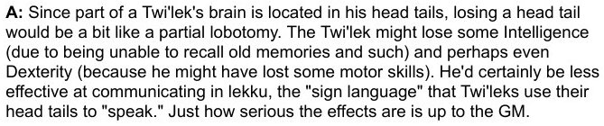
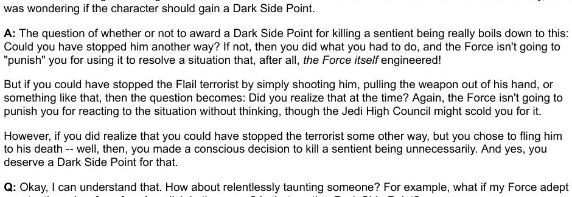
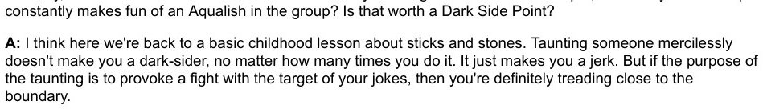
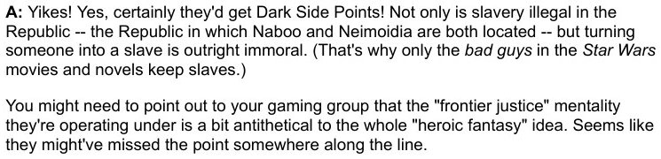

# Owner Material 037 — Star Wars D20 Drive folder (Core, Revised Core and Saga Edition): Jedi Counselling/Jedi Counseling 23 - Twi'lek Lobotomies.pdf [Star Wars Roleplaying Game Revised Core (d20, 2002)]

- **Source:** Wizards of the Coast Star Wars Roleplaying Game books, web enhancements, Living Force campaign modules and articles (2000–2010), from the owner's "Star Wars D20" Drive folder (only the three edition subfolders; "General" was not read, as instructed). Secondary source (licensed Legends reference). Scan OCR'd on the box; the scan stays box-only and is **not** published.
- **Method:** every scanned page was OCR'd and machine-screened sentence by sentence for power-relevant statements (fights, kills, defeats, Force feats, rankings, superweapons) that name a character on our roster; each kept sentence is quoted verbatim from the OCR text and has a crop of the printed passage directly under it. Pages with nothing power-relevant are still listed with what is on them.
- **Citation:** "*Jedi Counseling 23 - Twi'lek Lobotomies* (SWRPG d20 Revised Core), p.X" by printed page ("scan p.X" where no printed number applies). **Weight:** Licensed RPG material: a secondary source. Narrative text sums up Legends lore; game statistics are rules for players, not canon power levels, and rank lowest.

## scan p.1 (scan page 1)

Page contents: Twi'lek head tails, DSP for killing with Move Object, taunting, selling a Neimoidian (hand-read)

- **No single roster character (rules/setting/general)** — entry/section: Losing a Twi'lek head tail: "A: Since part of a Twi'lek's brain is located in his head tails, losing a head tail would be a bit like a partial lobotomy. The Twi'lek might lose some Intelligence (due to being unable to recall old memories and such) and perhaps even Dexterity (because he might have lost some motor skills). He'd certainly be less effective at communicating in lekku, the "sign language" that Twi'leks use their head tails to "speak." Just how serious the effects are is up to the GM." Source: *Jedi Counseling 23 - Twi'lek Lobotomies* (SWRPG d20 Revised Core), scan p.1
  
- **No single roster character (rules/setting/general)** — entry/section: Dark Side Points for killing: could you have stopped him another way?: "A: The question of whether or not to award a Dark Side Point for killing a sentient being really boils down to this: Could you have stopped him another way? If not, then you did what you had to do, and the Force isn't going to "punish" you for using it to resolve a situation that, after all, the Force itself engineered!
But if you could have stopped the Flail terrorist by simply shooting him, pulling the weapon out of his hand, or something like that, then the question becomes: Did you realize that at the time? Again, the Force isn't going to punish you for reacting to the situation without thinking, though the Jedi High Council might scold you for it.
However, if you did realize that you could have stopped the terrorist some other way, but you chose to fling him to his death -- well, then, you made a conscious decision to kill a sentient being unnecessarily. And yes, you deserve a Dark Side Point for that." Source: *Jedi Counseling 23 - Twi'lek Lobotomies* (SWRPG d20 Revised Core), scan p.1
  
- **No single roster character (rules/setting/general)** — entry/section: Taunting is not the dark side: "A: I think here we're back to a basic childhood lesson about sticks and stones. Taunting someone mercilessly doesn't make you a dark-sider, no matter how many times you do it. It just makes you a jerk. But if the purpose of the taunting is to provoke a fight with the target of your jokes, then you're definitely treading close to the boundary." Source: *Jedi Counseling 23 - Twi'lek Lobotomies* (SWRPG d20 Revised Core), scan p.1
  
- **No single roster character (rules/setting/general)** — entry/section: Selling a Neimoidian into slavery: "A: Yikes! Yes, certainly they'd get Dark Side Points! Not only is slavery illegal in the Republic -- the Republic in which Naboo and Neimoidia are both located -- but turning someone into a slave is outright immoral. (That's why only the bad guys in the Star Wars movies and novels keep slaves.)
You might need to point out to your gaming group that the "frontier justice" mentality they're operating under is a bit antithetical to the whole "heroic fantasy" idea. Seems like they might've missed the point somewhere along the line." Source: *Jedi Counseling 23 - Twi'lek Lobotomies* (SWRPG d20 Revised Core), scan p.1
  

## scan p.2 (scan page 2)

Page contents: Sharpshooter fixes, targeting scope, telepath DSPs, Move Object catching, divto poison (hand-read)

- **Yoda; Count Dooku; Obi-Wan Kenobi; Darth Vader (Anakin Skywalker)** — entry/section: Yoda's Move Object contest with Dooku: "I wouldn't say, however, that this is what Yoda did in his battle with Count Dooku at the end of Attack of the Clones. There, Yoda readied his actions to use Move Object to contest Dooku for control of the objects that Dooku was attempting to use to kill Obi-Wan Kenobi and Anakin Skywalker -- and those rules are already in the game on page 95 of the revised core rulebook." Source: *Jedi Counseling 23 - Twi'lek Lobotomies* (SWRPG d20 Revised Core), scan p.2
  

## scan p.3 (scan page 3)

Page contents: Falling damage answer (hand-read)

