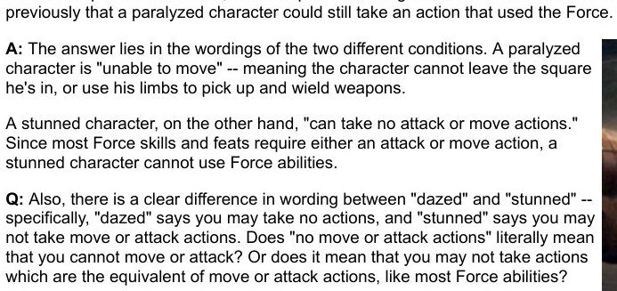
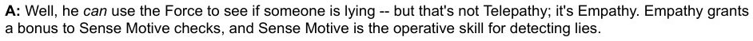

# Owner Material 037 — Star Wars D20 Drive folder (Core, Revised Core and Saga Edition): Jedi Counselling/Jedi Counseling 24 - Dazed and Stunned.pdf [Star Wars Roleplaying Game Revised Core (d20, 2002)]

- **Source:** Wizards of the Coast Star Wars Roleplaying Game books, web enhancements, Living Force campaign modules and articles (2000–2010), from the owner's "Star Wars D20" Drive folder (only the three edition subfolders; "General" was not read, as instructed). Secondary source (licensed Legends reference). Scan OCR'd on the box; the scan stays box-only and is **not** published.
- **Method:** every scanned page was OCR'd and machine-screened sentence by sentence for power-relevant statements (fights, kills, defeats, Force feats, rankings, superweapons) that name a character on our roster; each kept sentence is quoted verbatim from the OCR text and has a crop of the printed passage directly under it. Pages with nothing power-relevant are still listed with what is on them.
- **Citation:** "*Jedi Counseling 24 - Dazed and Stunned* (SWRPG d20 Revised Core), p.X" by printed page ("scan p.X" where no printed number applies). **Weight:** Licensed RPG material: a secondary source. Narrative text sums up Legends lore; game statistics are rules for players, not canon power levels, and rank lowest.

## scan p.1 (scan page 1)

Page contents: Drawing weapons, kneeling cover, findsman, stunned/dazed rules, J9 droid stats question (hand-read)

- **No single roster character (rules/setting/general)** — entry/section: Stunned characters cannot use the Force: "A: The answer lies in the wordings of the two different conditions. A paralyzed character is "unable to move" -- meaning the character cannot leave the square he's in, or use his limbs to pick up and wield weapons.
A stunned character, on the other hand, "can take no attack or move actions." Since most Force skills and feats require either an attack or move action, a stunned character cannot use Force abilities." Source: *Jedi Counseling 24 - Dazed and Stunned* (SWRPG d20 Revised Core), scan p.1
  

## scan p.2 (scan page 2)

Page contents: Droid stats, standard processor, Uncanny Hide, Ranged Disarm, Up the Walls, Telepathy mind probe question (hand-read)

## scan p.3 (scan page 3)

Page contents: Lie detection is Empathy/Sense Motive (hand-read)

- **No single roster character (rules/setting/general)** — entry/section: Detecting lies is Empathy, not Telepathy: "A: Well, he can use the Force to see if someone is lying -- but that's not Telepathy; it's Empathy. Empathy grants a bonus to Sense Motive checks, and Sense Motive is the operative skill for detecting lies." Source: *Jedi Counseling 24 - Dazed and Stunned* (SWRPG d20 Revised Core), scan p.3
  
