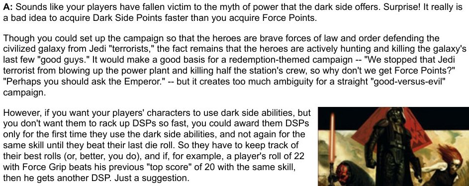
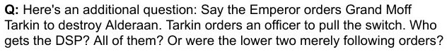
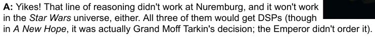
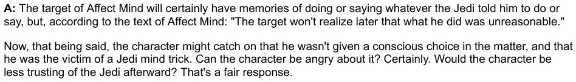
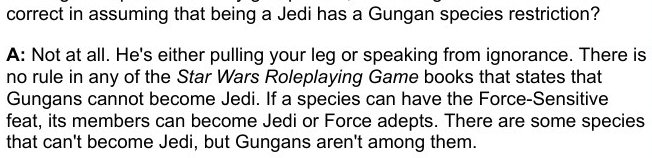

# Owner Material 037 — Star Wars D20 Drive folder (Core, Revised Core and Saga Edition): Jedi Counselling/Jedi Counseling 25 - Dark Side Downside.pdf [Star Wars Roleplaying Game Revised Core (d20, 2002)]

- **Source:** Wizards of the Coast Star Wars Roleplaying Game books, web enhancements, Living Force campaign modules and articles (2000–2010), from the owner's "Star Wars D20" Drive folder (only the three edition subfolders; "General" was not read, as instructed). Secondary source (licensed Legends reference). Scan OCR'd on the box; the scan stays box-only and is **not** published.
- **Method:** every scanned page was OCR'd and machine-screened sentence by sentence for power-relevant statements (fights, kills, defeats, Force feats, rankings, superweapons) that name a character on our roster; each kept sentence is quoted verbatim from the OCR text and has a crop of the printed passage directly under it. Pages with nothing power-relevant are still listed with what is on them.
- **Citation:** "*Jedi Counseling 25 - Dark Side Downside* (SWRPG d20 Revised Core), p.X" by printed page ("scan p.X" where no printed number applies). **Weight:** Licensed RPG material: a secondary source. Narrative text sums up Legends lore; game statistics are rules for players, not canon power levels, and rank lowest.

## scan p.1 (scan page 1)

Page contents: Dark side campaigns, Alderaan DSPs, light side skills, Jedi wanderer archetype (hand-read)

- **Palpatine (Darth Sidious)** — entry/section: The myth of the dark side's power: "A: Sounds like your players have fallen victim to the myth of power that the dark side offers. Surprise! It really is a bad idea to acquire Dark Side Points faster than you acquire Force Points.
Though you could set up the campaign so that the heroes are brave forces of law and order defending the civilized galaxy from Jedi "terrorists," the fact remains that the heroes are actively hunting and killing the galaxy's last few "good guys." It would make a good basis for a redemption-themed campaign -- "We stopped that Jedi terrorist from blowing up the power plant and killing half the station's crew, so why don't we get Force Points?" "Perhaps you should ask the Emperor." -- but it creates too much ambiguity for a straight "good-versus-evil" campaign.
However, if you want your players’ characters to use dark side abilities, but you don't want them to rack up DSPs so fast, you could award them DSPs only for the first time they use the dark side abilities, and not again for the same skill until they beat their last die roll. So they have to keep track of their best rolls (or, better, you do), and if, for example, a player's roll of 22 with Force Grip beats his previous "top score" of 20 with the same skill, then he gets another DSP. Just a suggestion." Source: *Jedi Counseling 25 - Dark Side Downside* (SWRPG d20 Revised Core), scan p.1
  
- **Palpatine (Darth Sidious); Grand Moff Tarkin** — entry/section: Who gets the Dark Side Point for Alderaan (question): "Q: Here's an additional question: Say the Emperor orders Grand Moff Tarkin to destroy Alderaan. Tarkin orders an officer to pull the switch. Who gets the DSP? All of them? Or were the lower two merely following orders?" Source: *Jedi Counseling 25 - Dark Side Downside* (SWRPG d20 Revised Core), scan p.1
  
- **Palpatine (Darth Sidious); Grand Moff Tarkin** — entry/section: Who gets the Dark Side Point for Alderaan: "A: Yikes! That line of reasoning didn't work at Nuremburg, and it won't work in the Star Wars universe, either. All three of them would get DSPs (though in A New Hope, it was actually Grand Moff Tarkin's decision; the Emperor didn't order it)." Source: *Jedi Counseling 25 - Dark Side Downside* (SWRPG d20 Revised Core), scan p.1
  

## scan p.2 (scan page 2)

Page contents: Jedi multiclassing rule, Miraluka Force sight list, Affect Mind memories, mastercraft lightsaber, Lord of the Expanse, Gungan Jedi (hand-read)

- **No single roster character (rules/setting/general)** — entry/section: Affect Mind afterward: "A: The target of Affect Mind will certainly have memories of doing or saying whatever the Jedi told him to do or say, but, according to the text of Affect Mind: "The target won't realize later that what he did was unreasonable."
Now, that being said, the character might catch on that he wasn't given a conscious choice in the matter, and that he was the victim of a Jedi mind trick. Can the character be angry about it? Certainly. Would the character be less trusting of the Jedi afterward? That's a fair response." Source: *Jedi Counseling 25 - Dark Side Downside* (SWRPG d20 Revised Core), scan p.2
  
- **No single roster character (rules/setting/general)** — entry/section: Gungans can be Jedi: "A: Not at all. He's either pulling your leg or speaking from ignorance. There is no rule in any of the Star Wars Roleplaying Game books that states that Gungans cannot become Jedi. If a species can have the Force-Sensitive feat, its members can become Jedi or Force adepts. There are some species “@ that can't become Jedi, but Gungans aren't among them." Source: *Jedi Counseling 25 - Dark Side Downside* (SWRPG d20 Revised Core), scan p.2
  

## scan p.3 (scan page 3)

Page contents: Blank/closing (hand-read)

