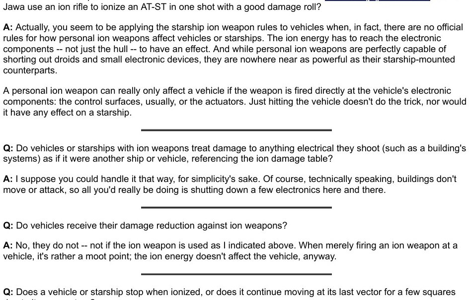
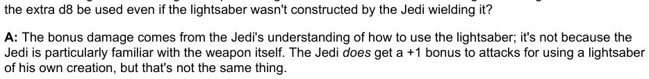

# Owner Material 037 — Star Wars D20 Drive folder (Core, Revised Core and Saga Edition): Jedi Counselling/Jedi Counseling 26 - Eye On Ion.pdf [Star Wars Roleplaying Game Revised Core (d20, 2002)]

- **Source:** Wizards of the Coast Star Wars Roleplaying Game books, web enhancements, Living Force campaign modules and articles (2000–2010), from the owner's "Star Wars D20" Drive folder (only the three edition subfolders; "General" was not read, as instructed). Secondary source (licensed Legends reference). Scan OCR'd on the box; the scan stays box-only and is **not** published.
- **Method:** every scanned page was OCR'd and machine-screened sentence by sentence for power-relevant statements (fights, kills, defeats, Force feats, rankings, superweapons) that name a character on our roster; each kept sentence is quoted verbatim from the OCR text and has a crop of the printed passage directly under it. Pages with nothing power-relevant are still listed with what is on them.
- **Citation:** "*Jedi Counseling 26 - Eye On Ion* (SWRPG d20 Revised Core), p.X" by printed page ("scan p.X" where no printed number applies). **Weight:** Licensed RPG material: a secondary source. Narrative text sums up Legends lore; game statistics are rules for players, not canon power levels, and rank lowest.

## scan p.1 (scan page 1)

Page contents: Personal ion weapons vs vehicles and starships (hand-read)

- **No single roster character (rules/setting/general)** — entry/section: Personal ion weapons against vehicles: "A: Actually, you seem to be applying the starship ion weapon rules to vehicles when, in fact, there are no official rules for how personal ion weapons affect vehicles or starships. The ion energy has to reach the electronic components -- not just the hull -- to have an effect. And while personal ion weapons are perfectly capable of shorting out droids and small electronic devices, they are nowhere near as powerful as their starship-mounted counterparts.
A personal ion weapon can really only affect a vehicle if the weapon is fired directly at the vehicle's electronic components: the control surfaces, usually, or the actuators. Just hitting the vehicle doesn't do the trick, nor would it have any effect on a starship." Source: *Jedi Counseling 26 - Eye On Ion* (SWRPG d20 Revised Core), scan p.1
  

## scan p.2 (scan page 2)

Page contents: Psychic avatar, lucky + Force Point, flanked Jedi, loaner lightsaber, Vong Force Points, Neti consular, droid shields (hand-read)

- **No single roster character (rules/setting/general)** — entry/section: Loaner lightsabers still deal full damage: "A: The bonus damage comes from the Jedi's understanding of how to use the lightsaber; it's not because the Jedi is particularly familiar with the weapon itself. The Jedi does get a +1 bonus to attacks for using a lightsaber of his own creation, but that's not the same thing." Source: *Jedi Counseling 26 - Eye On Ion* (SWRPG d20 Revised Core), scan p.2
  

## scan p.3 (scan page 3)

Page contents: Martial Arts Master prerequisites, D&D 3.5 (hand-read)

