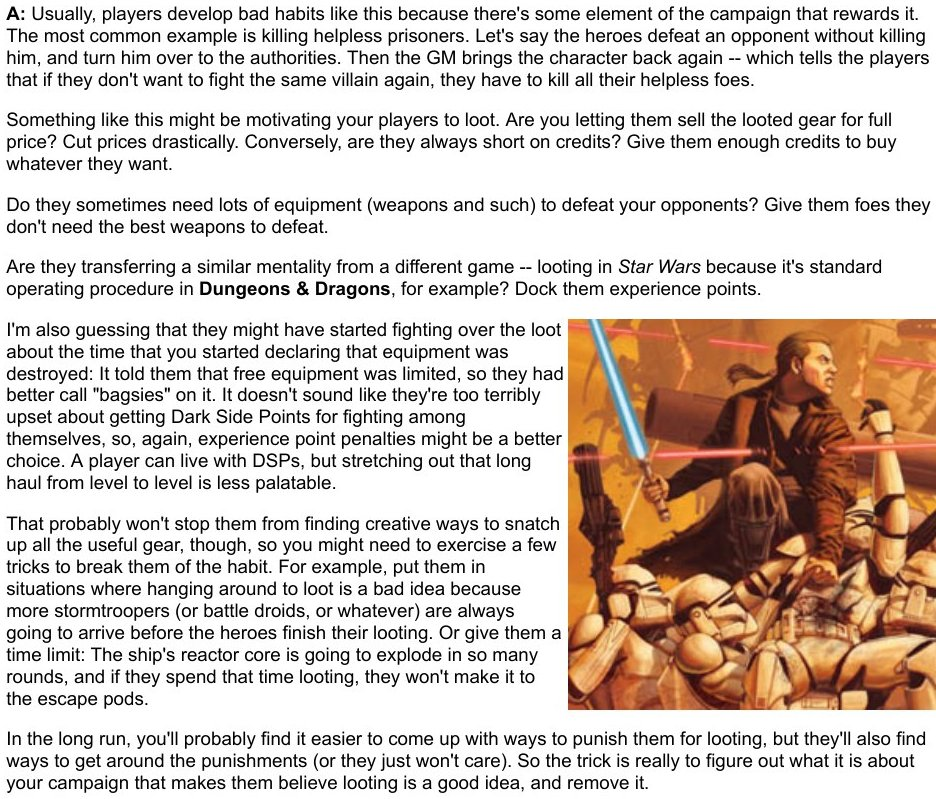
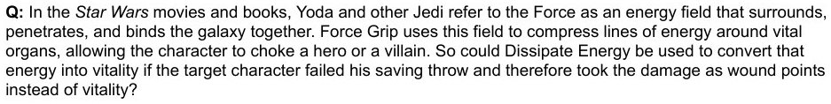
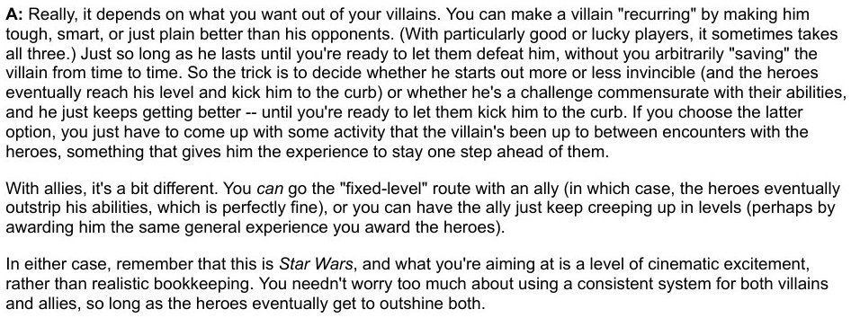

# Owner Material 037 — Star Wars D20 Drive folder (Core, Revised Core and Saga Edition): Jedi Counselling/Jedi Counseling 27 - "We Loot the Bodies!".pdf [Star Wars Roleplaying Game Revised Core (d20, 2002)]

- **Source:** Wizards of the Coast Star Wars Roleplaying Game books, web enhancements, Living Force campaign modules and articles (2000–2010), from the owner's "Star Wars D20" Drive folder (only the three edition subfolders; "General" was not read, as instructed). Secondary source (licensed Legends reference). Scan OCR'd on the box; the scan stays box-only and is **not** published.
- **Method:** every scanned page was OCR'd and machine-screened sentence by sentence for power-relevant statements (fights, kills, defeats, Force feats, rankings, superweapons) that name a character on our roster; each kept sentence is quoted verbatim from the OCR text and has a crop of the printed passage directly under it. Pages with nothing power-relevant are still listed with what is on them.
- **Citation:** "*Jedi Counseling 27 - "We Loot the Bodies!"* (SWRPG d20 Revised Core), p.X" by printed page ("scan p.X" where no printed number applies). **Weight:** Licensed RPG material: a secondary source. Narrative text sums up Legends lore; game statistics are rules for players, not canon power levels, and rank lowest.

## scan p.1 (scan page 1)

Page contents: Looting advice (hand-read)

- **No single roster character (rules/setting/general)** — entry/section: Why players loot bodies: "A: Usually, players develop bad habits like this because there's some element of the campaign that rewards it. The most common example is killing helpless prisoners. Let's say the heroes defeat an opponent without killing him, and turn him over to the authorities. Then the GM brings the character back again -- which tells the players that if they don't want to fight the same villain again, they have to kill all their helpless foes.
Something like this might be motivating your players to loot. Are you letting them sell the looted gear for full price? Cut prices drastically. Conversely, are they always short on credits? Give them enough credits to buy whatever they want.
Do they sometimes need lots of equipment (weapons and such) to defeat your opponents? Give them foes they don't need the best weapons to defeat.
Are they transferring a similar mentality from a different game -- looting in Star Wars because it's standard operating procedure in Dungeons & Dragons, for example? Dock them experience points.
I'm also guessing that they might have started fighting over the loot I about the time that you started declaring that equipment was destroyed: It told them that free equipment was limited, so they had better call "bagsies" on it. It doesn't sound like they're too terribly upset about getting Dark Side Points for fighting among themselves, so, again, experience point penalties might be a better choice. A player can live with DSPs, but stretching out that long haul from level to level is less palatable.
That probably won't stop them from finding creative ways to snatch up all the useful gear, though, so you might need to exercise a few tricks to break them of the habit. For example, put them in situations where hanging around to loot is a bad idea because more stormtroopers (or battle droids, or whatever) are always going to arrive before the heroes finish their looting. Or give them a time limit: The ship's reactor core is going to explode in so many rounds, and if they spend that time looting, they won't make it to the escape pods.
In the long run, you'll probably find it easier to come up with ways to punish them for looting, but they'll also find ways to get around the punishments (or they just won't care). So the trick is really to figure out what it is about your campaign that makes them believe looting is a good idea, and remove it." Source: *Jedi Counseling 27 - "We Loot the Bodies!"* (SWRPG d20 Revised Core), scan p.1
  

## scan p.2 (scan page 2)

Page contents: Kinetic Combat, Dissipate Energy vs Force Grip, recurring villains/allies (hand-read)

- **Yoda** — entry/section: The Force as energy field vs Dissipate Energy (question): "Q: In the Star Wars movies and books, Yoda and other Jedi refer to the Force as an energy field that surrounds, penetrates, and binds the galaxy together. Force Grip uses this field to compress lines of energy around vital organs, allowing the character to choke a hero or a villain. So could Dissipate Energy be used to convert that energy into vitality if the target character failed his saving throw and therefore took the damage as wound points instead of vitality?" Source: *Jedi Counseling 27 - "We Loot the Bodies!"* (SWRPG d20 Revised Core), scan p.2
  
- **No single roster character (rules/setting/general)** — entry/section: Recurring villains and allies: "A: Really, it depends on what you want out of your villains. You can make a villain "recurring" by making him tough, smart, or just plain better than his opponents. (With particularly good or lucky players, it sometimes takes all three.) Just so long as he lasts until you're ready to let them defeat him, without you arbitrarily "saving" the villain from time to time. So the trick is to decide whether he starts out more or less invincible (and the heroes eventually reach his level and kick him to the curb) or whether he's a challenge commensurate with their abilities, and he just keeps getting better -- until you're ready to let them kick him to the curb. If you choose the latter option, you just have to come up with some activity that the villain's been up to between encounters with the heroes, something that gives him the experience to stay one step ahead of them.
With allies, it's a bit different. You can go the "fixed-level" route with an ally (in which case, the heroes eventually outstrip his abilities, which is perfectly fine), or you can have the ally just keep creeping up in levels (perhaps by awarding him the same general experience you award the heroes).
In either case, remember that this is Star Wars, and what you're aiming at is a level of cinematic excitement, rather than realistic bookkeeping. You needn't worry too much about using a consistent system for both villains and allies, so long as the heroes eventually get to outshine both." Source: *Jedi Counseling 27 - "We Loot the Bodies!"* (SWRPG d20 Revised Core), scan p.2
  

## scan p.3 (scan page 3)

Page contents: Uncanny Dodge, Quick Draw, Sever Force, Redirect Attack, vitality, beyond 20th level (hand-read)

## scan p.4 (scan page 4)

Page contents: Blank (hand-read)

