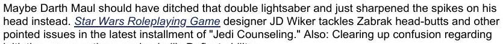
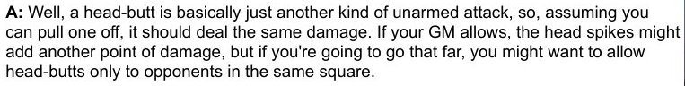

# Owner Material 037 — Star Wars D20 Drive folder (Core, Revised Core and Saga Edition): Jedi Counselling/Jedi Counseling 28 - Zabrak Head-Butts.pdf [Star Wars Roleplaying Game Revised Core (d20, 2002)]

- **Source:** Wizards of the Coast Star Wars Roleplaying Game books, web enhancements, Living Force campaign modules and articles (2000–2010), from the owner's "Star Wars D20" Drive folder (only the three edition subfolders; "General" was not read, as instructed). Secondary source (licensed Legends reference). Scan OCR'd on the box; the scan stays box-only and is **not** published.
- **Method:** every scanned page was OCR'd and machine-screened sentence by sentence for power-relevant statements (fights, kills, defeats, Force feats, rankings, superweapons) that name a character on our roster; each kept sentence is quoted verbatim from the OCR text and has a crop of the printed passage directly under it. Pages with nothing power-relevant are still listed with what is on them.
- **Citation:** "*Jedi Counseling 28 - Zabrak Head-Butts* (SWRPG d20 Revised Core), p.X" by printed page ("scan p.X" where no printed number applies). **Weight:** Licensed RPG material: a secondary source. Narrative text sums up Legends lore; game statistics are rules for players, not canon power levels, and rank lowest.

## scan p.1 (scan page 1)

Page contents: Lightsaber personalization, Zabrak head-butts, Force warrior Jedi Knight, Force weapon, damage types (hand-read)

- **Darth Maul** — entry/section: Zabrak head-butts (intro): "Maybe Darth Maul should have ditched that double lightsaber and just sharpened the spikes on his head instead. Star Wars Roleplaying Game designer JD Wiker tackles Zabrak head-butts and other pointed issues in the latest installment of "Jedi Counseling."" Source: *Jedi Counseling 28 - Zabrak Head-Butts* (SWRPG d20 Revised Core), scan p.1
  
- **No single roster character (rules/setting/general)** — entry/section: Zabrak head-butts: "A: Well, a head-butt is basically just another kind of unarmed attack, so, assuming you can pull one off, it should deal the same damage. If your GM allows, the head spikes might add another point of damage, but if you're going to go that far, you might want to allow head-butts only to opponents in the same square." Source: *Jedi Counseling 28 - Zabrak Head-Butts* (SWRPG d20 Revised Core), scan p.1
  

## scan p.2 (scan page 2)

Page contents: Energy damage, Resource Access, flat-footed deflect, extend to noble, deflect move action timing, total defense (hand-read)

## scan p.3 (scan page 3)

Page contents: Total defense deflect not a reaction (hand-read)

