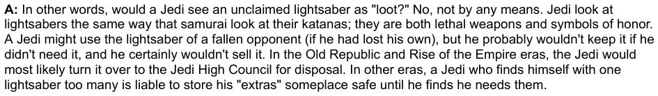
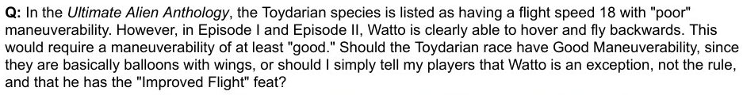
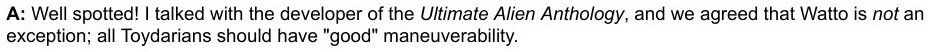
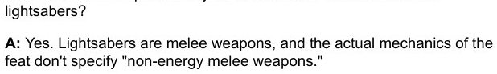

# Owner Material 037 — Star Wars D20 Drive folder (Core, Revised Core and Saga Edition): Jedi Counselling/Jedi Counseling 29 - 'Sabers for Sale.pdf [Star Wars Roleplaying Game Revised Core (d20, 2002)]

- **Source:** Wizards of the Coast Star Wars Roleplaying Game books, web enhancements, Living Force campaign modules and articles (2000–2010), from the owner's "Star Wars D20" Drive folder (only the three edition subfolders; "General" was not read, as instructed). Secondary source (licensed Legends reference). Scan OCR'd on the box; the scan stays box-only and is **not** published.
- **Method:** every scanned page was OCR'd and machine-screened sentence by sentence for power-relevant statements (fights, kills, defeats, Force feats, rankings, superweapons) that name a character on our roster; each kept sentence is quoted verbatim from the OCR text and has a crop of the printed passage directly under it. Pages with nothing power-relevant are still listed with what is on them.
- **Citation:** "*Jedi Counseling 29 - 'Sabers for Sale* (SWRPG d20 Revised Core), p.X" by printed page ("scan p.X" where no printed number applies). **Weight:** Licensed RPG material: a secondary source. Narrative text sums up Legends lore; game statistics are rules for players, not canon power levels, and rank lowest.

## scan p.1 (scan page 1)

Page contents: Lightsabers not loot, Force talismans, uncanny dodge vs feint, Craft (armor) (hand-read)

- **No single roster character (rules/setting/general)** — entry/section: Jedi and the lightsabers of the fallen: "A: In other words, would a Jedi see an unclaimed lightsaber as "loot?" No, not by any means. Jedi look at lightsabers the same way that samurai look at their katanas; they are both lethal weapons and symbols of honor. A Jedi might use the lightsaber of a fallen opponent (if he had lost his own), but he probably wouldn't keep it if he didn't need it, and he certainly wouldn't sell it. In the Old Republic and Rise of the Empire eras, the Jedi would most likely turn it over to the Jedi High Council for disposal. In other eras, a Jedi who finds himself with one lightsaber too many is liable to store his "extras" someplace safe until he finds he needs them." Source: *Jedi Counseling 29 - 'Sabers for Sale* (SWRPG d20 Revised Core), scan p.1
  

## scan p.2 (scan page 2)

Page contents: Falling damage, Toydarians/Watto, shipjacker, coup de grace, fatigue and feats, grapple natural 20s (hand-read)

- **Watto** — entry/section: Watto's flying (question): "Q: In the Ultimate Alien Anthology, the Toydarian species is listed as having a flight speed 18 with "poor" maneuverability. However, in Episode I and Episode II, Watto is clearly able to hover and fly backwards. This would require a maneuverability of at least "good." Should the Toydarian race have Good Maneuverability, since they are basically balloons with wings, or should I simply tell my players that Watto is an exception, not the rule, and that he has the "Improved Flight" feat?" Source: *Jedi Counseling 29 - 'Sabers for Sale* (SWRPG d20 Revised Core), scan p.2
  
- **Watto** — entry/section: All Toydarians fly like Watto: "A: Well spotted! I talked with the developer of the Ultimate Alien Anthology, and we agreed that Watto is not an exception; all Toydarians should have "good" maneuverability." Source: *Jedi Counseling 29 - 'Sabers for Sale* (SWRPG d20 Revised Core), scan p.2
  

## scan p.3 (scan page 3)

Page contents: Grapple ties, Teras Kasi vs lightsabers, two-weapon holding, firing into melee, Heal Another retry (hand-read)

- **No single roster character (rules/setting/general)** — entry/section: Teras Kasi against lightsabers: "A: Yes. Lightsabers are melee weapons, and the actual mechanics of the feat don't specify "non-energy melee weapons."" Source: *Jedi Counseling 29 - 'Sabers for Sale* (SWRPG d20 Revised Core), scan p.3
  
