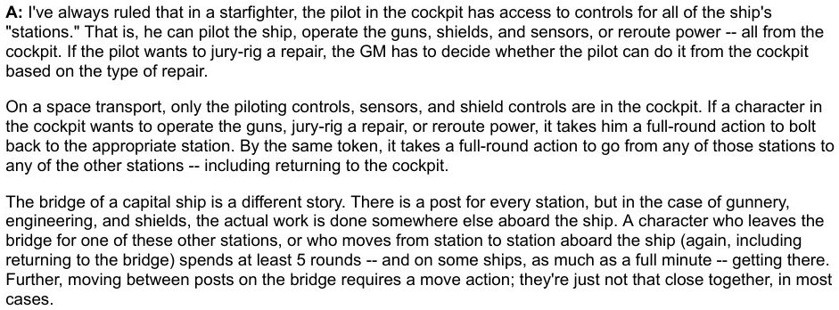

# Owner Material 037 — Star Wars D20 Drive folder (Core, Revised Core and Saga Edition): Jedi Counselling/Jedi Counseling 3 - NJO Ships.pdf [Star Wars Roleplaying Game Revised Core (d20, 2002)]

- **Source:** Wizards of the Coast Star Wars Roleplaying Game books, web enhancements, Living Force campaign modules and articles (2000–2010), from the owner's "Star Wars D20" Drive folder (only the three edition subfolders; "General" was not read, as instructed). Secondary source (licensed Legends reference). Scan OCR'd on the box; the scan stays box-only and is **not** published.
- **Method:** every scanned page was OCR'd and machine-screened sentence by sentence for power-relevant statements (fights, kills, defeats, Force feats, rankings, superweapons) that name a character on our roster; each kept sentence is quoted verbatim from the OCR text and has a crop of the printed passage directly under it. Pages with nothing power-relevant are still listed with what is on them.
- **Citation:** "*Jedi Counseling 3 - NJO Ships* (SWRPG d20 Revised Core), p.X" by printed page ("scan p.X" where no printed number applies). **Weight:** Licensed RPG material: a secondary source. Narrative text sums up Legends lore; game statistics are rules for players, not canon power levels, and rank lowest.

## scan p.1 (scan page 1)

Page contents: Shields, rerouting power from stations, Lightsaber Defense, ion repair, NJO armor conversion (hand-read)

- **No single roster character (rules/setting/general)** — entry/section: Moving between stations aboard ships: "A: I've always ruled that in a starfighter, the pilot in the cockpit has access to controls for all of the ship's "stations." That is, he can pilot the ship, operate the guns, shields, and sensors, or reroute power -- all from the cockpit. If the pilot wants to jury-rig a repair, the GM has to decide whether the pilot can do it from the cockpit based on the type of repair.
On a space transport, only the piloting controls, sensors, and shield controls are in the cockpit. If a character in the cockpit wants to operate the guns, jury-rig a repair, or reroute power, it takes him a full-round action to bolt back to the appropriate station. By the same token, it takes a full-round action to go from any of those stations to any of the other stations -- including returning to the cockpit.
The bridge of a capital ship is a different story. There is a post for every station, but in the case of gunnery, engineering, and shields, the actual work is done somewhere else aboard the ship. A character who leaves the bridge for one of these other stations, or who moves from station to station aboard the ship (again, including returning to the bridge) spends at least 5 rounds -- and on some ships, as much as a full minute -- getting there. Further, moving between posts on the bridge requires a move action; they're just not that close together, in most cases." Source: *Jedi Counseling 3 - NJO Ships* (SWRPG d20 Revised Core), scan p.1
  

## scan p.2 (scan page 2)

Page contents: Armor DR, thud bug revision, starship-combat feats, NJO starfighter/transport speeds (hand-read)

### Stat block notes (game mechanics, not feats)

- thud bug (Yuuzhan Vong weapon): Thud Bug: not for sale; 2d6 bludgeoning plus Strength DC 15 or prone; Tiny, 0.5 kg, simple; flies 10 m perfect; +5 equipment bonus to hurler; 1 WP, +5 melee, Defense 19 (Source: *Jedi Counseling 3 - NJO Ships* (SWRPG d20 Revised Core), scan p.2)

## scan p.3 (scan page 3)

Page contents: NJO capital ship speeds, Force Mastery, Sense Surroundings (hand-read)

