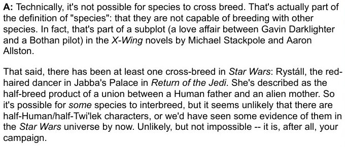

# Owner Material 037 — Star Wars D20 Drive folder (Core, Revised Core and Saga Edition): Jedi Counselling/Jedi Counseling 30 - Cross Breeding.pdf [Star Wars Roleplaying Game Revised Core (d20, 2002)]

- **Source:** Wizards of the Coast Star Wars Roleplaying Game books, web enhancements, Living Force campaign modules and articles (2000–2010), from the owner's "Star Wars D20" Drive folder (only the three edition subfolders; "General" was not read, as instructed). Secondary source (licensed Legends reference). Scan OCR'd on the box; the scan stays box-only and is **not** published.
- **Method:** every scanned page was OCR'd and machine-screened sentence by sentence for power-relevant statements (fights, kills, defeats, Force feats, rankings, superweapons) that name a character on our roster; each kept sentence is quoted verbatim from the OCR text and has a crop of the printed passage directly under it. Pages with nothing power-relevant are still listed with what is on them.
- **Citation:** "*Jedi Counseling 30 - Cross Breeding* (SWRPG d20 Revised Core), p.X" by printed page ("scan p.X" where no printed number applies). **Weight:** Licensed RPG material: a secondary source. Narrative text sums up Legends lore; game statistics are rules for players, not canon power levels, and rank lowest.

## scan p.1 (scan page 1)

Page contents: Mastercraft limits, cross breeding, high and low gravity (hand-read)

- **Gavin Darklighter; Rystall; Jabba the Hutt** — entry/section: Can species cross-breed?: "A: Technically, it's not possible for species to cross breed. That's actually part of the definition of "species": that they are not capable of breeding with other species. In fact, that's part of a subplot (a love affair between Gavin Darklighter and a Bothan pilot) in the X-Wing novels by Michael Stackpole and Aaron Allston.
That said, there has been at least one cross-breed in Star Wars: Rystall, the redhaired dancer in Jabba's Palace in Return of the Jedi. She's described as the half-breed product of a union between a Human father and an alien mother. So it's possible for some species to interbreed, but it seems unlikely that there are half-Human/half-Twi'lek characters, or we'd have seen some evidence of them in the Star Wars universe by now. Unlikely, but not impossible -- it is, after all, your campaign." Source: *Jedi Counseling 30 - Cross Breeding* (SWRPG d20 Revised Core), scan p.1
  

## scan p.2 (scan page 2)

Page contents: Sunder correction, prestige rank requirements, multiclassing for ranks, size modifiers, 6+ notation, Echani (hand-read)

## scan p.3 (scan page 3)

Page contents: Blank/closing (hand-read)

