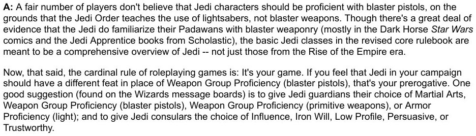
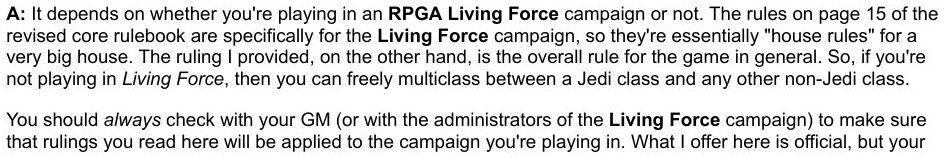

# Owner Material 037 — Star Wars D20 Drive folder (Core, Revised Core and Saga Edition): Jedi Counselling/Jedi Counseling 31 - Blastin' Jedi.pdf [Star Wars Roleplaying Game Revised Core (d20, 2002)]

- **Source:** Wizards of the Coast Star Wars Roleplaying Game books, web enhancements, Living Force campaign modules and articles (2000–2010), from the owner's "Star Wars D20" Drive folder (only the three edition subfolders; "General" was not read, as instructed). Secondary source (licensed Legends reference). Scan OCR'd on the box; the scan stays box-only and is **not** published.
- **Method:** every scanned page was OCR'd and machine-screened sentence by sentence for power-relevant statements (fights, kills, defeats, Force feats, rankings, superweapons) that name a character on our roster; each kept sentence is quoted verbatim from the OCR text and has a crop of the printed passage directly under it. Pages with nothing power-relevant are still listed with what is on them.
- **Citation:** "*Jedi Counseling 31 - Blastin' Jedi* (SWRPG d20 Revised Core), p.X" by printed page ("scan p.X" where no printed number applies). **Weight:** Licensed RPG material: a secondary source. Narrative text sums up Legends lore; game statistics are rules for players, not canon power levels, and rank lowest.

## scan p.1 (scan page 1)

Page contents: Space battle CL, Jedi blaster proficiency, Defensive Martial Arts, Hide approach (hand-read)

- **No single roster character (rules/setting/general)** — entry/section: Should Jedi know blasters?: "A: A fair number of players don't believe that Jedi characters should be proficient with blaster pistols, on the grounds that the Jedi Order teaches the use of lightsabers, not blaster weapons. Though there's a great deal of evidence that the Jedi do familiarize their Padawans with blaster weaponry (mostly in the Dark Horse Star Wars comics and the Jedi Apprentice books from Scholastic), the basic Jedi classes in the revised core rulebook are meant to be a comprehensive overview of Jedi -- not just those from the Rise of the Empire era.
Now, that said, the cardinal rule of roleplaying games is: It's your game. If you feel that Jedi in your campaign should have a different feat in place of Weapon Group Proficiency (blaster pistols), that's your prerogative. One good suggestion (found on the Wizards message boards) is to give Jedi guardians their choice of Martial Arts, Weapon Group Proficiency (blaster pistols), Weapon Group Proficiency (primitive weapons), or Armor Proficiency (light); and to give Jedi consulars the choice of Influence, Iron Will, Low Profile, Persuasive, or Trustworthy." Source: *Jedi Counseling 31 - Blastin' Jedi* (SWRPG d20 Revised Core), scan p.1
  

## scan p.2 (scan page 2)

Page contents: Senate Guard rifle, nonlethal, Kinetic Combat cost, AoO, ability checks, hit locations, crits, fatigue, Living Force multiclassing (hand-read)

- **No single roster character (rules/setting/general)** — entry/section: Living Force multiclassing rule (part 1 of 2): "A: It depends on whether you're playing in an RPGA Living Force campaign or not. The rules on page 15 of the revised core rulebook are specifically for the Living Force campaign, so they're essentially "house rules" for a very big house. The ruling I provided, on the other hand, is the overall rule for the game in general. So, if you're not playing in Living Force, then you can freely multiclass between a Jedi class and any other non-Jedi class. You should always check with your GM (or with the administrators of the Living Force campaign) to make sure that rulings you read here will be applied to the campaign you're playing in. What I offer here is official, but your" Source: *Jedi Counseling 31 - Blastin' Jedi* (SWRPG d20 Revised Core), scan p.2
  

## scan p.3 (scan page 3)

Page contents: GM has last word (hand-read)

- **No single roster character (rules/setting/general)** — entry/section: Living Force multiclassing rule (part 2 of 2): "GM has the last word on whether or not to use my rulings in his or her campaign." Source: *Jedi Counseling 31 - Blastin' Jedi* (SWRPG d20 Revised Core), scan p.3
  
