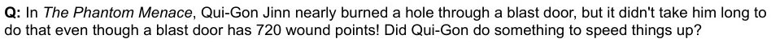
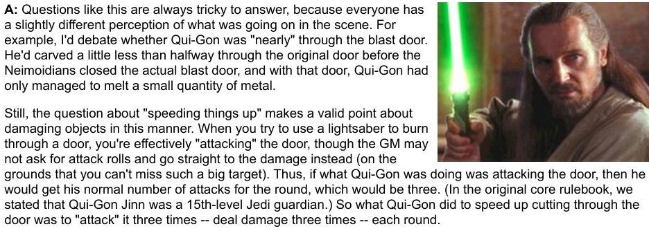
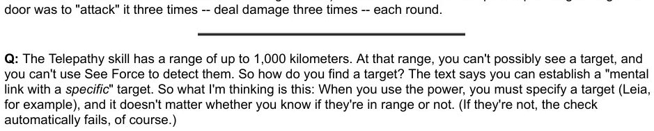
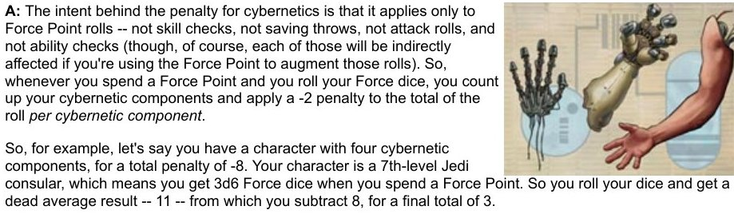
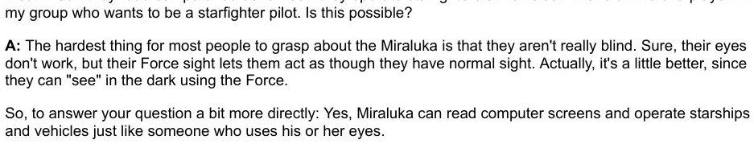

# Owner Material 037 — Star Wars D20 Drive folder (Core, Revised Core and Saga Edition): Jedi Counselling/Jedi Counseling 32 - Jedi Vs. Door.pdf [Star Wars Roleplaying Game Revised Core (d20, 2002)]

- **Source:** Wizards of the Coast Star Wars Roleplaying Game books, web enhancements, Living Force campaign modules and articles (2000–2010), from the owner's "Star Wars D20" Drive folder (only the three edition subfolders; "General" was not read, as instructed). Secondary source (licensed Legends reference). Scan OCR'd on the box; the scan stays box-only and is **not** published.
- **Method:** every scanned page was OCR'd and machine-screened sentence by sentence for power-relevant statements (fights, kills, defeats, Force feats, rankings, superweapons) that name a character on our roster; each kept sentence is quoted verbatim from the OCR text and has a crop of the printed passage directly under it. Pages with nothing power-relevant are still listed with what is on them.
- **Citation:** "*Jedi Counseling 32 - Jedi Vs. Door* (SWRPG d20 Revised Core), p.X" by printed page ("scan p.X" where no printed number applies). **Weight:** Licensed RPG material: a secondary source. Narrative text sums up Legends lore; game statistics are rules for players, not canon power levels, and rank lowest.

## scan p.1 (scan page 1)

Page contents: Qui-Gon vs blast door, Telepathy vs See Force, droid reprogramming (hand-read)

- **Qui-Gon Jinn** — entry/section: Qui-Gon's blast door (question): "Q: In The Phantom Menace, Qui-Gon Jinn nearly burned a hole through a blast door, but it didn't take him long to do that even though a blast door has 720 wound points! Did Qui-Gon do something to speed things up?" Source: *Jedi Counseling 32 - Jedi Vs. Door* (SWRPG d20 Revised Core), scan p.1
  
- **Qui-Gon Jinn** — entry/section: How Qui-Gon cut the blast door: "A: Questions like this are always tricky to answer, because everyone has a slightly different perception of what was going on in the scene. For example, I'd debate whether Qui-Gon was "nearly" through the blast door. He'd carved a little less than halfway through the original door before the Neimoidians closed the actual blast door, and with that door, Qui-Gon had only managed to melt a small quantity of metal. Still, the question about "speeding things up" makes a valid point about damaging objects in this manner. When you try to use a lightsaber to burn through a door, you're effectively "attacking" the door, though the GM may not ask for attack rolls and go straight to the damage instead (on the grounds that you can't miss such a big target). Thus, if what Qui-Gon was doing was attacking the door, then he would get his normal number of attacks for the round, which would be three. (In the original core rulebook, we stated that Qui-Gon Jinn was a 15th-level Jedi guardian.) So what Qui-Gon did to speed up cutting through the door was to "attack" it three times -- deal damage three times -- each round." Source: *Jedi Counseling 32 - Jedi Vs. Door* (SWRPG d20 Revised Core), scan p.1
  
- **Leia Organa Solo** — entry/section: Telepathy target example (question): "Q: The Telepathy skill has a range of up to 1,000 kilometers. At that range, you can't possibly see a target, and you can't use See Force to detect them. So how do you find a target? The text says you can establish a "mental link with a specific" target. So what I'm thinking is this: When you use the power, you must specify a target (Leia, for example), and it doesn't matter whether you know if they're in range or not. (If they're not, the check automatically fails, of course.)" Source: *Jedi Counseling 32 - Jedi Vs. Door* (SWRPG d20 Revised Core), scan p.1
  

## scan p.2 (scan page 2)

Page contents: Droid feats, cybernetics and Force Points, Miraluka sight and Force Stealth, Xexto multiple limbs (hand-read)

- **No single roster character (rules/setting/general)** — entry/section: Cybernetics and Force Points: "A: The intent behind the penalty for cybernetics is that it applies only to Force Point rolls -- not skill checks, not saving throws, not attack rolls, and not ability checks (though, of course, each of those will be indirectly affected if you're using the Force Point to augment those rolls). So, whenever you spend a Force Point and you roll your Force dice, you count up your cybernetic components and apply a -2 penalty to the total of the roll per cybernetic component.
So, for example, let's say you have a character with four cybernetic components, for a total penalty of -8. Your character is a 7th-level Jedi consular, which means you get 3d6 Force dice when you spend a Force Point. So you roll your dice and get a dead average result -- 11 -- from which you subtract 8, for a final total of 3." Source: *Jedi Counseling 32 - Jedi Vs. Door* (SWRPG d20 Revised Core), scan p.2
  
- **No single roster character (rules/setting/general)** — entry/section: Miraluka aren't really blind: "A: The hardest thing for most people to grasp about the Miraluka is that they aren't really blind. Sure, their eyes don't work, but their Force sight lets them act as though they have normal sight. Actually, it's a little better, since they can "see" in the dark using the Force.
So, to answer your question a bit more directly: Yes, Miraluka can read computer screens and operate starships and vehicles just like someone who uses his or her eyes." Source: *Jedi Counseling 32 - Jedi Vs. Door* (SWRPG d20 Revised Core), scan p.2
  

## scan p.3 (scan page 3)

Page contents: Multifire/autofire with multiple arms (hand-read)

