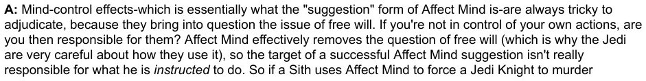
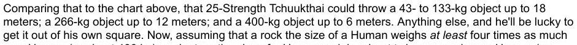

# Owner Material 037 — Star Wars D20 Drive folder (Core, Revised Core and Saga Edition): Jedi Counselling/Jedi Counseling 33 - Double Trouble.pdf [Star Wars Roleplaying Game Revised Core (d20, 2002)]

- **Source:** Wizards of the Coast Star Wars Roleplaying Game books, web enhancements, Living Force campaign modules and articles (2000–2010), from the owner's "Star Wars D20" Drive folder (only the three edition subfolders; "General" was not read, as instructed). Secondary source (licensed Legends reference). Scan OCR'd on the box; the scan stays box-only and is **not** published.
- **Method:** every scanned page was OCR'd and machine-screened sentence by sentence for power-relevant statements (fights, kills, defeats, Force feats, rankings, superweapons) that name a character on our roster; each kept sentence is quoted verbatim from the OCR text and has a crop of the printed passage directly under it. Pages with nothing power-relevant are still listed with what is on them.
- **Citation:** "*Jedi Counseling 33 - Double Trouble* (SWRPG d20 Revised Core), p.X" by printed page ("scan p.X" where no printed number applies). **Weight:** Licensed RPG material: a secondary source. Narrative text sums up Legends lore; game statistics are rules for players, not canon power levels, and rank lowest.

## scan p.1 (scan page 1)

Page contents: Double-bladed lightsaber proficiency, Force Defense, Affect Mind and Dark Side Points (hand-read)

- **No single roster character (rules/setting/general)** — entry/section: Affect Mind murder: who gets the Dark Side Point: "A: Mind-control effects-which is essentially what the "suggestion" form of Affect Mind is-are always tricky to adjudicate, because they bring into question the issue of free will. If you're not in control of your own actions, are you then responsible for them? Affect Mind effectively removes the question of free will (which is why the Jedi are very careful about how they use it), so the target of a successful Affect Mind suggestion isn't really responsible for what he is instructed to do. So if a Sith uses Affect Mind to force a Jedi Knight to murder" Source: *Jedi Counseling 33 - Double Trouble* (SWRPG d20 Revised Core), scan p.1
  

## scan p.2 (scan page 2)

Page contents: DSP collateral damage, multi-armed species, sliced thermal detonator, Force Weapon, Tchuukthai throwing rocks (hand-read)

## scan p.3 (scan page 3)

Page contents: Throwing distances/damage for heavy objects; author bio (hand-read)

- **No single roster character (rules/setting/general)** — entry/section: Strength 25 Tchuukthai throwing range: "Comparing that to the chart above, that 25-Strength Tchuukthai could throw a 43- to 133-kg object up to 18 meters; a 266-kg object up to 12 meters; and a 400-kg object up to 6 meters. Anything else, and he'll be lucky to get it out of his own square." Source: *Jedi Counseling 33 - Double Trouble* (SWRPG d20 Revised Core), scan p.3
  
