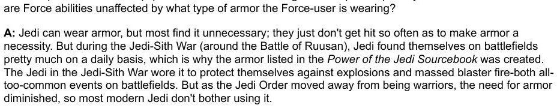
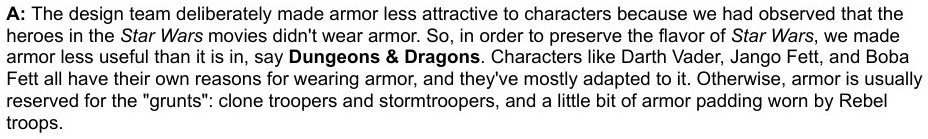

# Owner Material 037 — Star Wars D20 Drive folder (Core, Revised Core and Saga Edition): Jedi Counselling/Jedi Counseling 34 - Shifty Shi'ido.pdf [Star Wars Roleplaying Game Revised Core (d20, 2002)]

- **Source:** Wizards of the Coast Star Wars Roleplaying Game books, web enhancements, Living Force campaign modules and articles (2000–2010), from the owner's "Star Wars D20" Drive folder (only the three edition subfolders; "General" was not read, as instructed). Secondary source (licensed Legends reference). Scan OCR'd on the box; the scan stays box-only and is **not** published.
- **Method:** every scanned page was OCR'd and machine-screened sentence by sentence for power-relevant statements (fights, kills, defeats, Force feats, rankings, superweapons) that name a character on our roster; each kept sentence is quoted verbatim from the OCR text and has a crop of the printed passage directly under it. Pages with nothing power-relevant are still listed with what is on them.
- **Citation:** "*Jedi Counseling 34 - Shifty Shi'ido* (SWRPG d20 Revised Core), p.X" by printed page ("scan p.X" where no printed number applies). **Weight:** Licensed RPG material: a secondary source. Narrative text sums up Legends lore; game statistics are rules for players, not canon power levels, and rank lowest.

## scan p.1 (scan page 1)

Page contents: Shi'ido shapeshifting and changeling prestige class (hand-read)

## scan p.2 (scan page 2)

Page contents: Jedi armor, armor design philosophy, Demolitions, Jawa Jedi, toxins, Dark Side Points (hand-read)

- **No single roster character (rules/setting/general)** — entry/section: Jedi armor in the Jedi-Sith War: "A: Jedi can wear armor, but most find it unnecessary; they just don't get hit so often as to make armor a necessity. But during the Jedi-Sith War (around the Battle of Ruusan), Jedi found themselves on battlefields pretty much on a daily basis, which is why the armor listed in the Power of the Jedi Sourcebook was created. The Jedi in the Jedi-Sith War wore it to protect themselves against explosions and massed blaster fire-both alltoo-common events on battlefields. But as the Jedi Order moved away from being warriors, the need for armor diminished, so most modern Jedi don't bother using it." Source: *Jedi Counseling 34 - Shifty Shi'ido* (SWRPG d20 Revised Core), scan p.2
  
- **Darth Vader (Anakin Skywalker); Jango Fett; Boba Fett** — entry/section: Why armor is less useful (Vader, Jango, Boba): "A: The design team deliberately made armor less attractive to characters because we had observed that the heroes in the Star Wars movies didn't wear armor. So, in order to preserve the flavor of Star Wars, we made armor less useful than it is in, say Dungeons & Dragons. Characters like Darth Vader, Jango Fett, and Boba Fett all have their own reasons for wearing armor, and they've mostly adapted to it. Otherwise, armor is usually reserved for the "grunts": clone troopers and stormtroopers, and a little bit of armor padding worn by Rebel troops." Source: *Jedi Counseling 34 - Shifty Shi'ido* (SWRPG d20 Revised Core), scan p.2
  

## scan p.3 (scan page 3)

Page contents: DSPs cannot be spent; author bio (hand-read)

