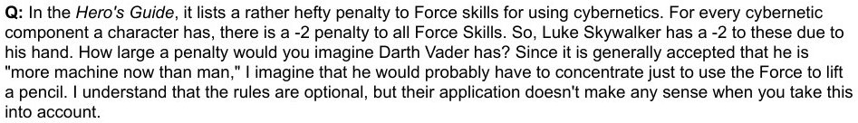
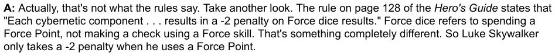
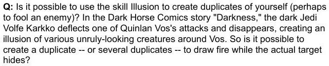

# Owner Material 037 — Star Wars D20 Drive folder (Core, Revised Core and Saga Edition): Jedi Counselling/Jedi Counseling 37 - Up the Walls.pdf [Star Wars Roleplaying Game Revised Core (d20, 2002)]

- **Source:** Wizards of the Coast Star Wars Roleplaying Game books, web enhancements, Living Force campaign modules and articles (2000–2010), from the owner's "Star Wars D20" Drive folder (only the three edition subfolders; "General" was not read, as instructed). Secondary source (licensed Legends reference). Scan OCR'd on the box; the scan stays box-only and is **not** published.
- **Method:** every scanned page was OCR'd and machine-screened sentence by sentence for power-relevant statements (fights, kills, defeats, Force feats, rankings, superweapons) that name a character on our roster; each kept sentence is quoted verbatim from the OCR text and has a crop of the printed passage directly under it. Pages with nothing power-relevant are still listed with what is on them.
- **Citation:** "*Jedi Counseling 37 - Up the Walls* (SWRPG d20 Revised Core), p.X" by printed page ("scan p.X" where no printed number applies). **Weight:** Licensed RPG material: a secondary source. Narrative text sums up Legends lore; game statistics are rules for players, not canon power levels, and rank lowest.

## scan p.1 (scan page 1)

Page contents: Up the Walls, discblade, ranged AoOs, Cathar Martial Arts (hand-read)

## scan p.2 (scan page 2)

Page contents: Rebuilding lightsabers, cybernetics penalties (Luke, Vader), Drain Energy, ion deflection, Illusion duplicates (hand-read)

- **Luke Skywalker; Darth Vader (Anakin Skywalker)** — entry/section: Cybernetics penalty: Luke and Vader (question): "Q: In the Hero's Guide, it lists a rather hefty penalty to Force skills for using cybernetics. For every cybernetic component a character has, there is a -2 penalty to all Force Skills. So, Luke Skywalker has a -2 to these due to his hand. How large a penalty would you imagine Darth Vader has? Since it is generally accepted that he is "more machine now than man," | imagine that he would probably have to concentrate just to use the Force to lift a pencil. | understand that the rules are optional, but their application doesn't make any sense when you take this into account." Source: *Jedi Counseling 37 - Up the Walls* (SWRPG d20 Revised Core), scan p.2
  
- **Luke Skywalker** — entry/section: Cybernetics penalty applies only to Force dice: "A: Actually, that's not what the rules say. Take another look. The rule on page 128 of the Hero's Guide states that "Each cybernetic component . . . results in a -2 penalty on Force dice results." Force dice refers to spending a Force Point, not making a check using a Force skill. That's something completely different. So Luke Skywalker only takes a -2 penalty when he uses a Force Point." Source: *Jedi Counseling 37 - Up the Walls* (SWRPG d20 Revised Core), scan p.2
  
- **Volfe Karkko; Quinlan Vos** — entry/section: Volfe Karkko's illusion vs Quinlan Vos (question): "Q: Is it possible to use the skill Illusion to create duplicates of yourself (perhaps to fool an enemy)? In the Dark Horse Comics story "Darkness," the dark Jedi Volfe Karkko deflects one of Quinlan Vos's attacks and disappears, creating an illusion of various unruly-looking creatures around Vos. So is it possible to create a duplicate -- or several duplicates -- to draw fire while the actual target hides?" Source: *Jedi Counseling 37 - Up the Walls* (SWRPG d20 Revised Core), scan p.2
  

## scan p.3 (scan page 3)

Page contents: Intelligence and skill points; author bio (hand-read)

