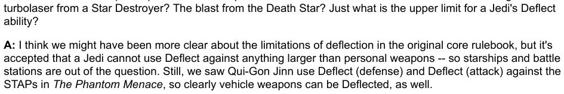
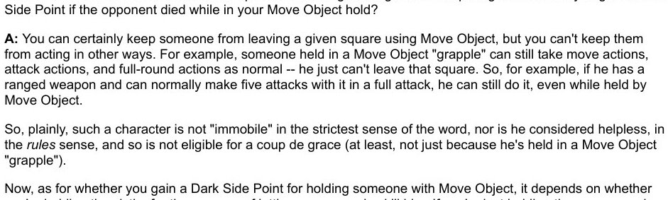

# Owner Material 037 — Star Wars D20 Drive folder (Core, Revised Core and Saga Edition): Jedi Counselling/Jedi Counseling 39 - Big Deflections.pdf [Star Wars Roleplaying Game Revised Core (d20, 2002)]

- **Source:** Wizards of the Coast Star Wars Roleplaying Game books, web enhancements, Living Force campaign modules and articles (2000–2010), from the owner's "Star Wars D20" Drive folder (only the three edition subfolders; "General" was not read, as instructed). Secondary source (licensed Legends reference). Scan OCR'd on the box; the scan stays box-only and is **not** published.
- **Method:** every scanned page was OCR'd and machine-screened sentence by sentence for power-relevant statements (fights, kills, defeats, Force feats, rankings, superweapons) that name a character on our roster; each kept sentence is quoted verbatim from the OCR text and has a crop of the printed passage directly under it. Pages with nothing power-relevant are still listed with what is on them.
- **Citation:** "*Jedi Counseling 39 - Big Deflections* (SWRPG d20 Revised Core), p.X" by printed page ("scan p.X" where no printed number applies). **Weight:** Licensed RPG material: a secondary source. Narrative text sums up Legends lore; game statistics are rules for players, not canon power levels, and rank lowest.

## scan p.1 (scan page 1)

Page contents: Deflect limits (Qui-Gon vs STAPs), vehicle weapon proficiency, pistols and AoOs, Make it Fit (hand-read)

- **Qui-Gon Jinn** — entry/section: Deflect limits: Qui-Gon vs the STAPs: "A: | think we might have been more clear about the limitations of deflection in the original core rulebook, but it's accepted that a Jedi cannot use Deflect against anything larger than personal weapons -- so starships and battle stations are out of the question. Still, we saw Qui-Gon Jinn use Deflect (defense) and Deflect (attack) against the STAPs in The Phantom Menace, so clearly vehicle weapons can be Deflected, as well." Source: *Jedi Counseling 39 - Big Deflections* (SWRPG d20 Revised Core), scan p.1
  

## scan p.2 (scan page 2)

Page contents: Make it Fit, BAB attacks, Move Object hold and DSPs, Kinetic Combat (hand-read)

- **No single roster character (rules/setting/general)** — entry/section: Move Object hold doesn't make a target helpless: "A: You can certainly keep someone from leaving a given square using Move Object, but you can't keep them from acting in other ways. For example, someone held in a Move Object "grapple" can still take move actions, attack actions, and full-round actions as normal -- he just can't leave that square. So, for example, if he has a ranged weapon and can normally make five attacks with it in a full attack, he can still do it, even while held by Move Object." Source: *Jedi Counseling 39 - Big Deflections* (SWRPG d20 Revised Core), scan p.2
  

## scan p.3 (scan page 3)

Page contents: Kinetic Combat disarm, Split Force vitality; author bio (hand-read)

