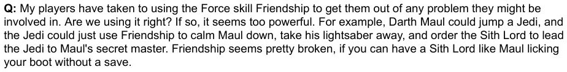
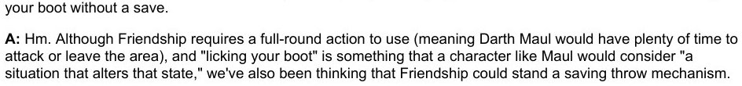
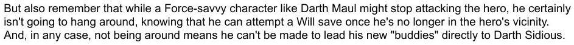

# Owner Material 037 — Star Wars D20 Drive folder (Core, Revised Core and Saga Edition): Jedi Counselling/Jedi Counseling 4 - Friendship.pdf [Star Wars Roleplaying Game Revised Core (d20, 2002)]

- **Source:** Wizards of the Coast Star Wars Roleplaying Game books, web enhancements, Living Force campaign modules and articles (2000–2010), from the owner's "Star Wars D20" Drive folder (only the three edition subfolders; "General" was not read, as instructed). Secondary source (licensed Legends reference). Scan OCR'd on the box; the scan stays box-only and is **not** published.
- **Method:** every scanned page was OCR'd and machine-screened sentence by sentence for power-relevant statements (fights, kills, defeats, Force feats, rankings, superweapons) that name a character on our roster; each kept sentence is quoted verbatim from the OCR text and has a crop of the printed passage directly under it. Pages with nothing power-relevant are still listed with what is on them.
- **Citation:** "*Jedi Counseling 4 - Friendship* (SWRPG d20 Revised Core), p.X" by printed page ("scan p.X" where no printed number applies). **Weight:** Licensed RPG material: a secondary source. Narrative text sums up Legends lore; game statistics are rules for players, not canon power levels, and rank lowest.

## scan p.1 (scan page 1)

Page contents: Disarm AoOs, Force Strike on items, Shot on the Run, ionization, nav computers, KD-30 (hand-read)

## scan p.2 (scan page 2)

Page contents: Deadly Strike, Reputation, Friendship errata (Darth Maul), Battle Influence, Track, prolong Force (hand-read)

- **Darth Maul** — entry/section: Friendship on Darth Maul (question): "Q: My players have taken to using the Force skill Friendship to get them out of any problem they might be involved in. Are we using it right? If so, it seems too powerful. For example, Darth Maul could jump a Jedi, and the Jedi could just use Friendship to calm Maul down, take his lightsaber away, and order the Sith Lord to lead the Jedi to Maul's secret master. Friendship seems pretty broken, if you can have a Sith Lord like Maul licking your boot without a save." Source: *Jedi Counseling 4 - Friendship* (SWRPG d20 Revised Core), scan p.2
  
- **Darth Maul** — entry/section: Friendship errata: Maul would have time to attack: "A: Hm. Although Friendship requires a full-round action to use (meaning Darth Maul would have plenty of time to attack or leave the area), and "licking your boot" is something that a character like Maul would consider "a situation that alters that state," we've also been thinking that Friendship could stand a saving throw mechanism." Source: *Jedi Counseling 4 - Friendship* (SWRPG d20 Revised Core), scan p.2
  
- **Darth Maul; Palpatine (Darth Sidious)** — entry/section: Force-savvy Maul wouldn't lead heroes to Sidious: "But also remember that while a Force-savvy character like Darth Maul might stop attacking the hero, he certainly isn't going to hang around, knowing that he can attempt a Will save once he's no longer in the hero's vicinity. And, in any case, not being around means he can't be made to lead his new "buddies" directly to Darth Sidious." Source: *Jedi Counseling 4 - Friendship* (SWRPG d20 Revised Core), scan p.2
  

## scan p.3 (scan page 3)

Page contents: Plant Surge, Force Light abuse (hand-read)

