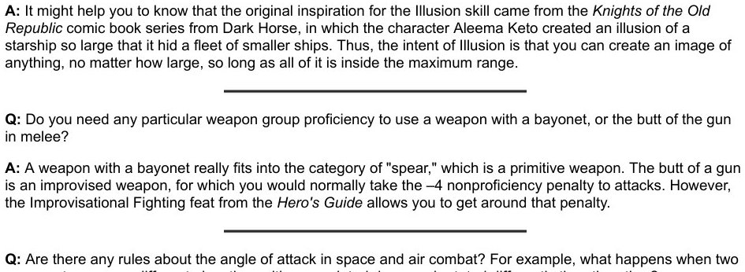

# Owner Material 037 — Star Wars D20 Drive folder (Core, Revised Core and Saga Edition): Jedi Counselling/Jedi Counseling 41 - Fake Death Stars.pdf [Star Wars Roleplaying Game Revised Core (d20, 2002)]

- **Source:** Wizards of the Coast Star Wars Roleplaying Game books, web enhancements, Living Force campaign modules and articles (2000–2010), from the owner's "Star Wars D20" Drive folder (only the three edition subfolders; "General" was not read, as instructed). Secondary source (licensed Legends reference). Scan OCR'd on the box; the scan stays box-only and is **not** published.
- **Method:** every scanned page was OCR'd and machine-screened sentence by sentence for power-relevant statements (fights, kills, defeats, Force feats, rankings, superweapons) that name a character on our roster; each kept sentence is quoted verbatim from the OCR text and has a crop of the printed passage directly under it. Pages with nothing power-relevant are still listed with what is on them.
- **Citation:** "*Jedi Counseling 41 - Fake Death Stars* (SWRPG d20 Revised Core), p.X" by printed page ("scan p.X" where no printed number applies). **Weight:** Licensed RPG material: a secondary source. Narrative text sums up Legends lore; game statistics are rules for players, not canon power levels, and rank lowest.

## scan p.1 (scan page 1)

Page contents: Species phobias, illusion size (illusory Death Star, Aleema), bayonets, elevation (hand-read)

- **Aleema Keto** — entry/section: Aleema's starship illusion inspired the Illusion skill: "A: It might help you to know that the original inspiration for the Illusion skill came from the Knights of the Old Republic comic book series from Dark Horse, in which the character Aleema Keto created an illusion of a starship so large that it hid a fleet of smaller ships. Thus, the intent of Illusion is that you can create an image of anything, no matter how large, so long as all of it is inside the maximum range." Source: *Jedi Counseling 41 - Fake Death Stars* (SWRPG d20 Revised Core), scan p.1
  

## scan p.2 (scan page 2)

Page contents: Readied actions, Spirited Charge, XP, Shot on the Run, grappling over lava (hand-read)

## scan p.3 (scan page 3)

Page contents: Lava Reflex save, Maximize Force; author bio (hand-read)

