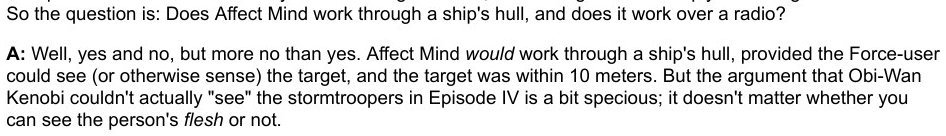
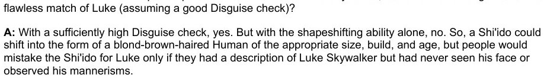

# Owner Material 037 — Star Wars D20 Drive folder (Core, Revised Core and Saga Edition): Jedi Counselling/Jedi Counseling 45 - Affect Mind.pdf [Star Wars Roleplaying Game Revised Core (d20, 2002)]

- **Source:** Wizards of the Coast Star Wars Roleplaying Game books, web enhancements, Living Force campaign modules and articles (2000–2010), from the owner's "Star Wars D20" Drive folder (only the three edition subfolders; "General" was not read, as instructed). Secondary source (licensed Legends reference). Scan OCR'd on the box; the scan stays box-only and is **not** published.
- **Method:** every scanned page was OCR'd and machine-screened sentence by sentence for power-relevant statements (fights, kills, defeats, Force feats, rankings, superweapons) that name a character on our roster; each kept sentence is quoted verbatim from the OCR text and has a crop of the printed passage directly under it. Pages with nothing power-relevant are still listed with what is on them.
- **Citation:** "*Jedi Counseling 45 - Affect Mind* (SWRPG d20 Revised Core), p.X" by printed page ("scan p.X" where no printed number applies). **Weight:** Licensed RPG material: a secondary source. Narrative text sums up Legends lore; game statistics are rules for players, not canon power levels, and rank lowest.

## scan p.1 (scan page 1)

Page contents: Affect Mind via transceiver/through hull, Force Light loophole, Multidexterity, Trandoshan regeneration (hand-read)

- **Obi-Wan Kenobi** — entry/section: Affect Mind through armor; Obi-Wan and the stormtroopers: "A: Well, yes and no, but more no than yes. Affect Mind would work through a ship's hull, provided the Force-user could see (or otherwise sense) the target, and the target was within 10 meters. But the argument that Obi-Wan Kenobi couldn't actually "see" the stormtroopers in Episode IV is a bit specious; it doesn't matter whether you can see the person's flesh or not." Source: *Jedi Counseling 45 - Affect Mind* (SWRPG d20 Revised Core), scan p.1
  

## scan p.2 (scan page 2)

Page contents: Move Object AoOs, Shi'ido disguise/Luke, Echani Expertise, downtime advice (hand-read)

- **Luke Skywalker** — entry/section: A Shi'ido imitating Luke Skywalker: "A: With a sufficiently high Disguise check, yes. But with the shapeshifting ability alone, no. So, a Shi'ido could shift into the form of a blond-brown-haired Human of the appropriate size, build, and age, but people would mistake the Shi'ido for Luke only if they had a description of Luke Skywalker but had never seen his face or observed his mannerisms." Source: *Jedi Counseling 45 - Affect Mind* (SWRPG d20 Revised Core), scan p.2
  

## scan p.3 (scan page 3)

Page contents: Author bio (hand-read)

