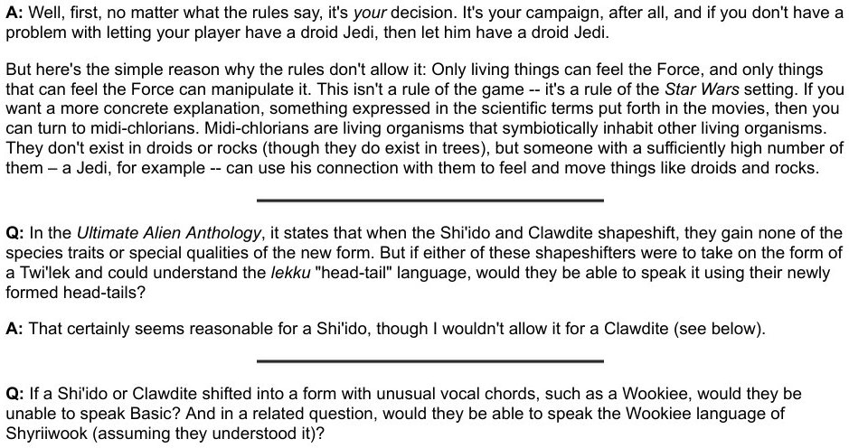

# Owner Material 037 — Star Wars D20 Drive folder (Core, Revised Core and Saga Edition): Jedi Counselling/Jedi Counseling 46 - Droid Jedi?.pdf [Star Wars Roleplaying Game Revised Core (d20, 2002)]

- **Source:** Wizards of the Coast Star Wars Roleplaying Game books, web enhancements, Living Force campaign modules and articles (2000–2010), from the owner's "Star Wars D20" Drive folder (only the three edition subfolders; "General" was not read, as instructed). Secondary source (licensed Legends reference). Scan OCR'd on the box; the scan stays box-only and is **not** published.
- **Method:** every scanned page was OCR'd and machine-screened sentence by sentence for power-relevant statements (fights, kills, defeats, Force feats, rankings, superweapons) that name a character on our roster; each kept sentence is quoted verbatim from the OCR text and has a crop of the printed passage directly under it. Pages with nothing power-relevant are still listed with what is on them.
- **Citation:** "*Jedi Counseling 46 - Droid Jedi?* (SWRPG d20 Revised Core), p.X" by printed page ("scan p.X" where no printed number applies). **Weight:** Licensed RPG material: a secondary source. Narrative text sums up Legends lore; game statistics are rules for players, not canon power levels, and rank lowest.

## scan p.1 (scan page 1)

Page contents: Hidden prerequisites, droid Jedi and midi-chlorians, shapeshifters and lekku/Wookiee speech, Clawdite limits (hand-read)

- **Yoda** — entry/section: Why droids can't be Jedi (Yoda's teaching): "A: Well, first, no matter what the rules say, it's your decision. It's your campaign, after all, and if you don't have a problem with letting your player have a droid Jedi, then let him have a droid Jedi.
But here's the simple reason why the rules don't allow it: Only living things can feel the Force, and only things that can feel the Force can manipulate it. This isn't a rule of the game -- it's a rule of the Star Wars setting. If you want a more concrete explanation, something expressed in the scientific terms put forth in the movies, then you can turn to midi-chlorians. Midi-chlorians are living organisms that symbiotically inhabit other living organisms. They don't exist in droids or rocks (though they do exist in trees), but someone with a sufficiently high number of them — a Jedi, for example -- can use his connection with them to feel and move things like droids and rocks." Source: *Jedi Counseling 46 - Droid Jedi?* (SWRPG d20 Revised Core), scan p.1
  

## scan p.2 (scan page 2)

Page contents: Negative wounds, languages, droid abilities, Ewok primitive limitation (Piggy), cortosis reactivation (hand-read)

- **Voort "Piggy" saBinring** — entry/section: Piggy as a species-drawback exception: "There's nothing inherently wrong with these ideas. For example, the character of "Piggy" in the X-Wing novel series is quite a clever concept. But as a GM, you have to be aware of the ramifications of allowing characters who don't have the usual drawbacks of their species." Source: *Jedi Counseling 46 - Droid Jedi?* (SWRPG d20 Revised Core), scan p.2
  

## scan p.3 (scan page 3)

Page contents: Author bio (hand-read)

