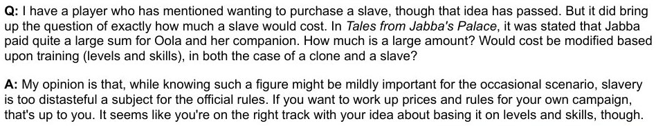
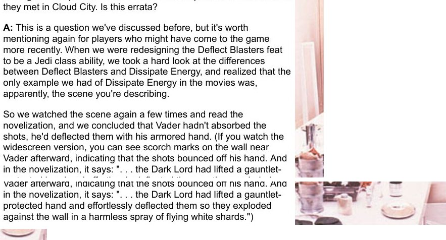

# Owner Material 037 — Star Wars D20 Drive folder (Core, Revised Core and Saga Edition): Jedi Counselling/Jedi Counseling 47 - Clone Cost.pdf [Star Wars Roleplaying Game Revised Core (d20, 2002)]

- **Source:** Wizards of the Coast Star Wars Roleplaying Game books, web enhancements, Living Force campaign modules and articles (2000–2010), from the owner's "Star Wars D20" Drive folder (only the three edition subfolders; "General" was not read, as instructed). Secondary source (licensed Legends reference). Scan OCR'd on the box; the scan stays box-only and is **not** published.
- **Method:** every scanned page was OCR'd and machine-screened sentence by sentence for power-relevant statements (fights, kills, defeats, Force feats, rankings, superweapons) that name a character on our roster; each kept sentence is quoted verbatim from the OCR text and has a crop of the printed passage directly under it. Pages with nothing power-relevant are still listed with what is on them.
- **Citation:** "*Jedi Counseling 47 - Clone Cost* (SWRPG d20 Revised Core), p.X" by printed page ("scan p.X" where no printed number applies). **Weight:** Licensed RPG material: a secondary source. Narrative text sums up Legends lore; game statistics are rules for players, not canon power levels, and rank lowest.

## scan p.1 (scan page 1)

Page contents: Force jumps x3, slave/clone costs, two-weapon penalties (hand-read)

- **Jabba the Hutt; Oola** — entry/section: Pricing slaves (Jabba and Oola): "Q: I have a player who has mentioned wanting to purchase a slave, though that idea has passed. But it did bring up the question of exactly how much a slave would cost. In Tales from Jabba's Palace, it was stated that Jabba paid quite a large sum for Oola and her companion. How much is a large amount? Would cost be modified based upon training (levels and skills), in both the case of a clone and a slave?
A: My opinion is that, while knowing such a figure might be mildly important for the occasional scenario, slavery is too distasteful a subject for the official rules. If you want to work up prices and rules for your own campaign, that's up to you. It seems like you're on the right track with your idea about basing it on levels and skills, though." Source: *Jedi Counseling 47 - Clone Cost* (SWRPG d20 Revised Core), scan p.1
  

## scan p.2 (scan page 2)

Page contents: Cover, Comprehend Speech vs lekku, swallowed whole, Vader vs Dissipate Energy, synergy, droid programming (hand-read)

- **Darth Vader (Anakin Skywalker); Han Solo** — entry/section: Vader deflected Han's blaster shots with his armored hand: "A: This is a question we've discussed before, but it's worth mentioning again for players who might have come to the game more recently. When we were redesigning the Deflect Blasters feat to be a Jedi class ability, we took a hard look at the differences between Deflect Blasters and Dissipate Energy, and realized that the only example we had of Dissipate Energy in the movies was, apparently, the scene you're describing.
So we watched the scene again a few times and read the novelization, and we concluded that Vader hadn't absorbed the shots, he'd deflected them with his armored hand. (If you watch the widescreen version, you can see scorch marks on the wall near Vader afterward, indicating that the shots bounced off his hand. And in the novelization, it says: ". . . the Dark Lord had lifted a gauntlet-protected hand and effortlessly deflected them so they exploded against the wall in a harmless spray of flying white shards.")" Source: *Jedi Counseling 47 - Clone Cost* (SWRPG d20 Revised Core), scan p.2
  
- **Darth Vader (Anakin Skywalker)**: "So we watched the scene again a few times and read the novelization, and we concluded that Vader hadn't absorbed the tf . ; ." Source: *Jedi Counseling 47 - Clone Cost* (SWRPG d20 Revised Core), scan p.2
  

## scan p.3 (scan page 3)

Page contents: Farseeing recall and control; author bio (hand-read)

