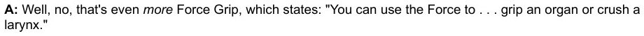

# Owner Material 037 — Star Wars D20 Drive folder (Core, Revised Core and Saga Edition): Jedi Counselling/Jedi Counseling 48 - Dark Side Points 2.pdf [Star Wars Roleplaying Game Revised Core (d20, 2002)]

- **Source:** Wizards of the Coast Star Wars Roleplaying Game books, web enhancements, Living Force campaign modules and articles (2000–2010), from the owner's "Star Wars D20" Drive folder (only the three edition subfolders; "General" was not read, as instructed). Secondary source (licensed Legends reference). Scan OCR'd on the box; the scan stays box-only and is **not** published.
- **Method:** every scanned page was OCR'd and machine-screened sentence by sentence for power-relevant statements (fights, kills, defeats, Force feats, rankings, superweapons) that name a character on our roster; each kept sentence is quoted verbatim from the OCR text and has a crop of the printed passage directly under it. Pages with nothing power-relevant are still listed with what is on them.
- **Citation:** "*Jedi Counseling 48 - Dark Side Points 2* (SWRPG d20 Revised Core), p.X" by printed page ("scan p.X" where no printed number applies). **Weight:** Licensed RPG material: a secondary source. Narrative text sums up Legends lore; game statistics are rules for players, not canon power levels, and rank lowest.

## scan p.1 (scan page 1)

Page contents: Zeison Sha Second Nature cost, stun in mouth DSPs, Force Points, stealing speeders (hand-read)

## scan p.2 (scan page 2)

Page contents: DSP strictness, grenades, crew rating, Ubese, Force Grip organs, feint (hand-read)

- **No single roster character (rules/setting/general)** — entry/section: Moving a heart with the Force is Force Grip: "A: Well, no, that's even more Force Grip, which states: "You can use the Force to . . . grip an organ or crush a larynx."" Source: *Jedi Counseling 48 - Dark Side Points 2* (SWRPG d20 Revised Core), scan p.2
  

## scan p.3 (scan page 3)

Page contents: Feint melee only; author bio (hand-read)

