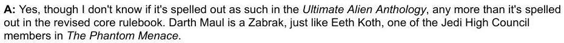
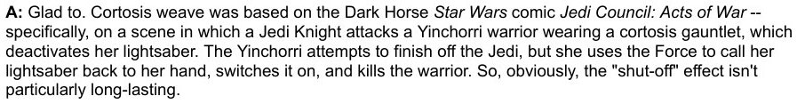

# Owner Material 037 — Star Wars D20 Drive folder (Core, Revised Core and Saga Edition): Jedi Counselling/Jedi Counseling 49 - Hit Me!.pdf [Star Wars Roleplaying Game Revised Core (d20, 2002)]

- **Source:** Wizards of the Coast Star Wars Roleplaying Game books, web enhancements, Living Force campaign modules and articles (2000–2010), from the owner's "Star Wars D20" Drive folder (only the three edition subfolders; "General" was not read, as instructed). Secondary source (licensed Legends reference). Scan OCR'd on the box; the scan stays box-only and is **not** published.
- **Method:** every scanned page was OCR'd and machine-screened sentence by sentence for power-relevant statements (fights, kills, defeats, Force feats, rankings, superweapons) that name a character on our roster; each kept sentence is quoted verbatim from the OCR text and has a crop of the printed passage directly under it. Pages with nothing power-relevant are still listed with what is on them.
- **Citation:** "*Jedi Counseling 49 - Hit Me!* (SWRPG d20 Revised Core), p.X" by printed page ("scan p.X" where no printed number applies). **Weight:** Licensed RPG material: a secondary source. Narrative text sums up Legends lore; game statistics are rules for players, not canon power levels, and rank lowest.

## scan p.1 (scan page 1)

Page contents: Scale, traps and flat-footed, wanting to be hit (hand-read)

## scan p.2 (scan page 2)

Page contents: Foregoing Defense/attack bonuses, Darth Maul's species, sandstorm damage, cortosis weave question (hand-read)

- **Darth Maul; Eeth Koth** — entry/section: Darth Maul is a Zabrak, like Eeth Koth: "A: Yes, though I don't know if it's spelled out as such in the Ultimate Alien Anthology, any more than it's spelled out in the revised core rulebook. Darth Maul is a Zabrak, just like Eeth Koth, one of the Jedi High Council members in The Phantom Menace." Source: *Jedi Counseling 49 - Hit Me!* (SWRPG d20 Revised Core), scan p.2
  

## scan p.3 (scan page 3)

Page contents: Cortosis weave/shield/ore origins; author bio (hand-read)

- **No single roster character (rules/setting/general)** — entry/section: Cortosis gauntlet in Jedi Council: Acts of War: "A: Glad to. Cortosis weave was based on the Dark Horse Star Wars comic Jedi Council: Acts of War -specifically, on a scene in which a Jedi Knight attacks a Yinchorri warrior wearing a cortosis gauntlet, which deactivates her lightsaber. The Yinchorri attempts to finish off the Jedi, but she uses the Force to call her lightsaber back to her hand, switches it on, and kills the warrior. So, obviously, the "shut-off" effect isn't particularly long-lasting." Source: *Jedi Counseling 49 - Hit Me!* (SWRPG d20 Revised Core), scan p.3
  
