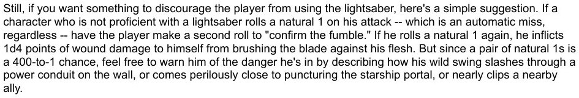

# Owner Material 037 — Star Wars D20 Drive folder (Core, Revised Core and Saga Edition): Jedi Counselling/Jedi Counseling 5 - Lightsaber Fumbles.pdf [Star Wars Roleplaying Game Revised Core (d20, 2002)]

- **Source:** Wizards of the Coast Star Wars Roleplaying Game books, web enhancements, Living Force campaign modules and articles (2000–2010), from the owner's "Star Wars D20" Drive folder (only the three edition subfolders; "General" was not read, as instructed). Secondary source (licensed Legends reference). Scan OCR'd on the box; the scan stays box-only and is **not** published.
- **Method:** every scanned page was OCR'd and machine-screened sentence by sentence for power-relevant statements (fights, kills, defeats, Force feats, rankings, superweapons) that name a character on our roster; each kept sentence is quoted verbatim from the OCR text and has a crop of the printed passage directly under it. Pages with nothing power-relevant are still listed with what is on them.
- **Citation:** "*Jedi Counseling 5 - Lightsaber Fumbles* (SWRPG d20 Revised Core), p.X" by printed page ("scan p.X" where no printed number applies). **Weight:** Licensed RPG material: a secondary source. Narrative text sums up Legends lore; game statistics are rules for players, not canon power levels, and rank lowest.

## scan p.1 (scan page 1)

Page contents: Crew rating, lightsaber fumbles, deflecting projectiles, Wookiee armor, combat gloves (hand-read)

- **No single roster character (rules/setting/general)** — entry/section: Optional lightsaber fumble rule for the untrained: "Still, if you want something to discourage the player from using the lightsaber, here's a simple suggestion. If a character who is not proficient with a lightsaber rolls a natural 1 on his attack -- which is an automatic miss, regardless -- have the player make a second roll to "confirm the fumble." If he rolls a natural 1 again, he inflicts 1d4 points of wound damage to himself from brushing the blade against his flesh. But since a pair of natural 1s is a 400-to-1 chance, feel free to warn him of the danger he's in by describing how his wild swing slashes through a power conduit on the wall, or comes perilously close to puncturing the starship portal, or nearly clips a nearby ally." Source: *Jedi Counseling 5 - Lightsaber Fumbles* (SWRPG d20 Revised Core), scan p.1
  

## scan p.2 (scan page 2)

Page contents: Combat gloves threat range, prolong Force fatigue (hand-read)

