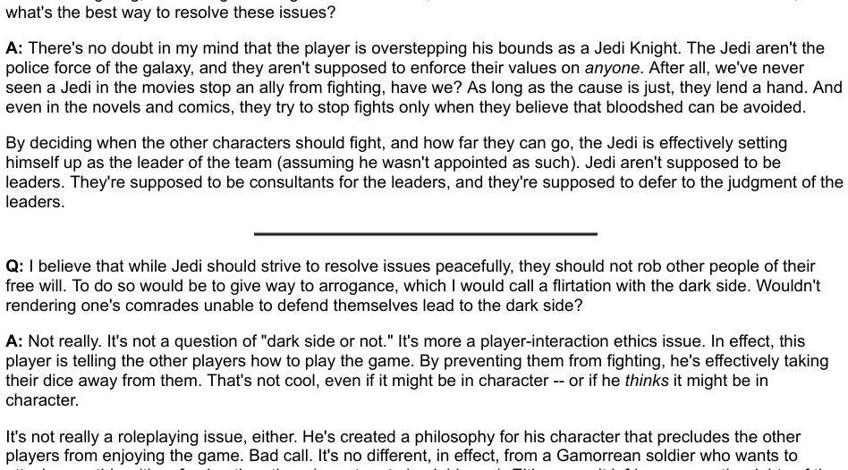

# Owner Material 037 — Star Wars D20 Drive folder (Core, Revised Core and Saga Edition): Jedi Counselling/Jedi Counseling 50 - JD's Last.pdf [Star Wars Roleplaying Game Revised Core (d20, 2002)]

- **Source:** Wizards of the Coast Star Wars Roleplaying Game books, web enhancements, Living Force campaign modules and articles (2000–2010), from the owner's "Star Wars D20" Drive folder (only the three edition subfolders; "General" was not read, as instructed). Secondary source (licensed Legends reference). Scan OCR'd on the box; the scan stays box-only and is **not** published.
- **Method:** every scanned page was OCR'd and machine-screened sentence by sentence for power-relevant statements (fights, kills, defeats, Force feats, rankings, superweapons) that name a character on our roster; each kept sentence is quoted verbatim from the OCR text and has a crop of the printed passage directly under it. Pages with nothing power-relevant are still listed with what is on them.
- **Citation:** "*Jedi Counseling 50 - JD's Last* (SWRPG d20 Revised Core), p.X" by printed page ("scan p.X" where no printed number applies). **Weight:** Licensed RPG material: a secondary source. Narrative text sums up Legends lore; game statistics are rules for players, not canon power levels, and rank lowest.

## scan p.1 (scan page 1)

Page contents: Farewell, lightsaber gyroscopes and extra rolls, custom droids, Grievous stats question (hand-read)

## scan p.2 (scan page 2)

Page contents: Making your own stats, playtesting, Jedi behavior and group dynamics (hand-read)

- **No single roster character (rules/setting/general)** — entry/section: How Jedi should behave in a group: "A: There's no doubt in my mind that the player is overstepping his bounds as a Jedi Knight. The Jedi aren't the police force of the galaxy, and they aren't supposed to enforce their values on anyone. After all, we've never seen a Jedi in the movies stop an ally from fighting, have we? As long as the cause is just, they lend a hand. And even in the novels and comics, they try to stop fights only when they believe that bloodshed can be avoided.
By deciding when the other characters should fight, and how far they can go, the Jedi is effectively setting himself up as the leader of the team (assuming he wasn't appointed as such). Jedi aren't supposed to be leaders. They're supposed to be consultants for the leaders, and they're supposed to defer to the judgment of the leaders." Source: *Jedi Counseling 50 - JD's Last* (SWRPG d20 Revised Core), scan p.2
  

## scan p.3 (scan page 3)

Page contents: Author bio (hand-read)

