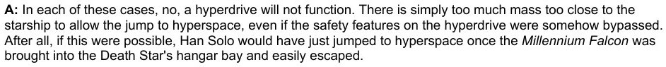
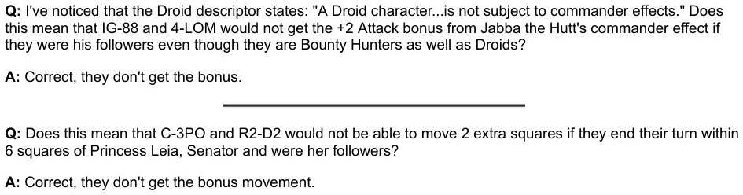
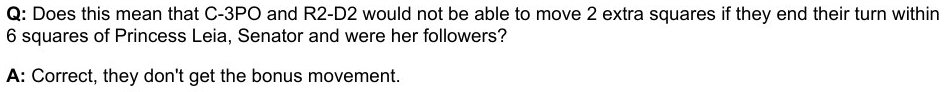
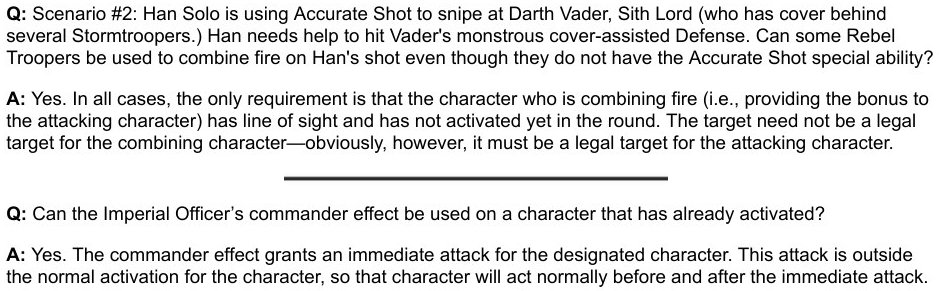

# Owner Material 037 — Star Wars D20 Drive folder (Core, Revised Core and Saga Edition): Jedi Counselling/Jedi Counseling 51.pdf [Star Wars Roleplaying Game Revised Core (d20, 2002)]

- **Source:** Wizards of the Coast Star Wars Roleplaying Game books, web enhancements, Living Force campaign modules and articles (2000–2010), from the owner's "Star Wars D20" Drive folder (only the three edition subfolders; "General" was not read, as instructed). Secondary source (licensed Legends reference). Scan OCR'd on the box; the scan stays box-only and is **not** published.
- **Method:** every scanned page was OCR'd and machine-screened sentence by sentence for power-relevant statements (fights, kills, defeats, Force feats, rankings, superweapons) that name a character on our roster; each kept sentence is quoted verbatim from the OCR text and has a crop of the printed passage directly under it. Pages with nothing power-relevant are still listed with what is on them.
- **Citation:** "*Jedi Counseling 51* (SWRPG d20 Revised Core), p.X" by printed page ("scan p.X" where no printed number applies). **Weight:** Licensed RPG material: a secondary source. Narrative text sums up Legends lore; game statistics are rules for players, not canon power levels, and rank lowest.

## scan p.1 (scan page 1)

Page contents: Shield DR, emplacement points, hyperdrive in hangars, Move Object, Illusion light; Miniatures Strafe Attack (hand-read)

- **Han Solo** — entry/section: Han couldn't jump to hyperspace from the Death Star hangar: "A: In each of these cases, no, a hyperdrive will not function. There is simply too much mass too close to the starship to allow the jump to hyperspace, even if the safety features on the hyperdrive were somehow bypassed. After all, if this were possible, Han Solo would have just jumped to hyperspace once the Millennium Falcon was brought into the Death Star's hangar bay and easily escaped." Source: *Jedi Counseling 51* (SWRPG d20 Revised Core), scan p.1
  

## scan p.2 (scan page 2)

Page contents: Low cover, droids and commander effects, combined fire scenarios (hand-read)

- **IG-88; 4-LOM; Jabba the Hutt** — entry/section: IG-88 and 4-LOM don't get Jabba's commander bonus: "Q: I've noticed that the Droid descriptor states: "A Droid character...is not subject to commander effects." Does this mean that IG-88 and 4-LOM would not get the +2 Attack bonus from Jabba the Hutt's commander effect if they were his followers even though they are Bounty Hunters as well as Droids?
A: Correct, they don't get the bonus." Source: *Jedi Counseling 51* (SWRPG d20 Revised Core), scan p.2
  
- **C-3PO; R2-D2; Leia Organa Solo** — entry/section: C-3PO and R2-D2 don't get Leia's bonus movement: "Q: Does this mean that C-3PO and R2-D2 would not be able to move 2 extra squares if they end their turn within 6 squares of Princess Leia, Senator and were her followers?
A: Correct, they don't get the bonus movement." Source: *Jedi Counseling 51* (SWRPG d20 Revised Core), scan p.2
  
- **Han Solo; Darth Vader (Anakin Skywalker)** — entry/section: Rebel Troopers combine fire on Han's shot at Vader: "Q: Scenario #2: Han Solo is using Accurate Shot to snipe at Darth Vader, Sith Lord (who has cover behind several Stormtroopers.) Han needs help to hit Vader's monstrous cover-assisted Defense. Can some Rebel Troopers be used to combine fire on Han's shot even though they do not have the Accurate Shot special ability?
A: Yes. In all cases, the only requirement is that the character who is combining fire (i.e., providing the bonus to the attacking character) has line of sight and has not activated yet in the round. The target need not be a legal target for the combining character—obviously, however, it must be a legal target for the attacking character." Source: *Jedi Counseling 51* (SWRPG d20 Revised Core), scan p.2
  

## scan p.3 (scan page 3)

Page contents: Stacking commander effects; author bio (hand-read)

