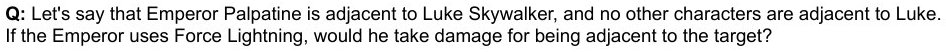
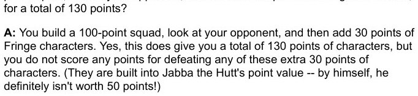
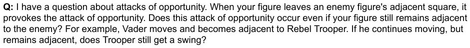

# Owner Material 037 — Star Wars D20 Drive folder (Core, Revised Core and Saga Edition): Jedi Counselling/Jedi Counseling 52 - Zap!.pdf [Star Wars Roleplaying Game Revised Core (d20, 2002)]

- **Source:** Wizards of the Coast Star Wars Roleplaying Game books, web enhancements, Living Force campaign modules and articles (2000–2010), from the owner's "Star Wars D20" Drive folder (only the three edition subfolders; "General" was not read, as instructed). Secondary source (licensed Legends reference). Scan OCR'd on the box; the scan stays box-only and is **not** published.
- **Method:** every scanned page was OCR'd and machine-screened sentence by sentence for power-relevant statements (fights, kills, defeats, Force feats, rankings, superweapons) that name a character on our roster; each kept sentence is quoted verbatim from the OCR text and has a crop of the printed passage directly under it. Pages with nothing power-relevant are still listed with what is on them.
- **Citation:** "*Jedi Counseling 52 - Zap!* (SWRPG d20 Revised Core), p.X" by printed page ("scan p.X" where no printed number applies). **Weight:** Licensed RPG material: a secondary source. Narrative text sums up Legends lore; game statistics are rules for players, not canon power levels, and rank lowest.

## scan p.1 (scan page 1)

Page contents: Disarm and Martial Arts, Jedi lightsaber damage multiplied, Master Duelist; Miniatures Palpatine Force Lightning (hand-read)

- **Palpatine (Darth Sidious); Luke Skywalker** — entry/section: The Emperor zaps himself with Force Lightning: "Q: Let's say that Emperor Palpatine is adjacent to Luke Skywalker, and no other characters are adjacent to Luke. If the Emperor uses Force Lightning, would he take damage for being adjacent to the target?
A: Yes. The Emperor would indeed take damage from his own Force Lightning in this case. The only way he could avoid taking the damage is if there were at least two other characters adjacent to Luke." Source: *Jedi Counseling 52 - Zap!* (SWRPG d20 Revised Core), scan p.1
  
- **Palpatine (Darth Sidious)**: "Can Emperor Palpatine zap himself with Force Lightning?" Source: *Jedi Counseling 52 - Zap!* (SWRPG d20 Revised Core), scan p.1
  

## scan p.2 (scan page 2)

Page contents: Range, speeder bikes, Jabba Fringe Reinforcements, commander effects, Vader AoO (hand-read)

- **Jabba the Hutt** — entry/section: Jabba's Fringe Reinforcements: "A: You build a 100-point squad, look at your opponent, and then add 30 points of Fringe characters. Yes, this does give you a total of 130 points of characters, but you do not score any points for defeating any of these extra 30 points of characters. (They are built into Jabba the Hutt's point value -- by himself, he definitely isn't worth 50 points!)" Source: *Jedi Counseling 52 - Zap!* (SWRPG d20 Revised Core), scan p.2
  
- **Darth Vader (Anakin Skywalker)** — entry/section: Vader moving past a Rebel Trooper provokes: "Q: I have a question about attacks of opportunity. When your figure leaves an enemy figure's adjacent square, it provokes the attack of opportunity. Does this attack of opportunity occur even if your figure still remains adjacent to the enemy? For example, Vader moves and becomes adjacent to Rebel Trooper. If he continues moving, but remains adjacent, does Trooper still get a swing?
A: Yes. You get an attack of opportunity if a character leaves an adjacent square, even if he is moving into another adjacent square." Source: *Jedi Counseling 52 - Zap!* (SWRPG d20 Revised Core), scan p.2
  

## scan p.3 (scan page 3)

Page contents: AoOs once per turn; author bio (hand-read)

