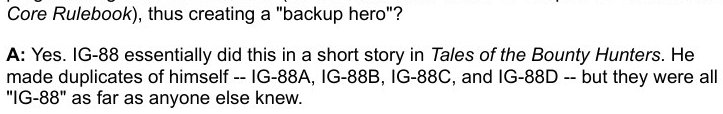
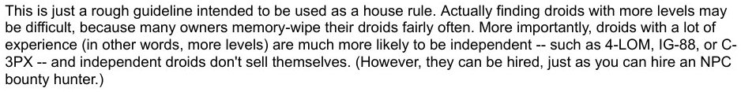
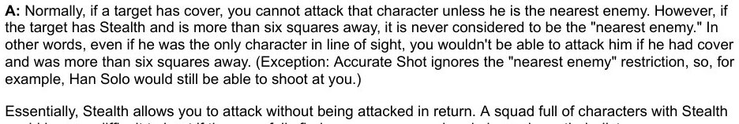
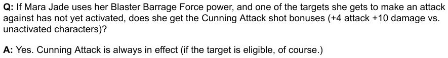
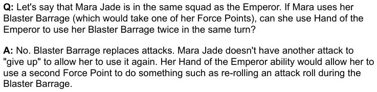
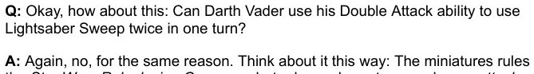
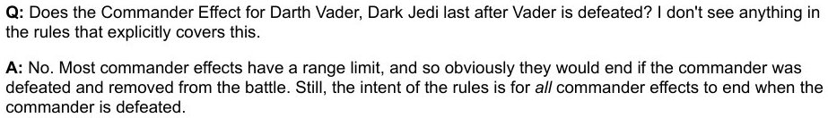

# Owner Material 037 — Star Wars D20 Drive folder (Core, Revised Core and Saga Edition): Jedi Counselling/Jedi Counseling 53 - Backups.pdf [Star Wars Roleplaying Game Revised Core (d20, 2002)]

- **Source:** Wizards of the Coast Star Wars Roleplaying Game books, web enhancements, Living Force campaign modules and articles (2000–2010), from the owner's "Star Wars D20" Drive folder (only the three edition subfolders; "General" was not read, as instructed). Secondary source (licensed Legends reference). Scan OCR'd on the box; the scan stays box-only and is **not** published.
- **Method:** every scanned page was OCR'd and machine-screened sentence by sentence for power-relevant statements (fights, kills, defeats, Force feats, rankings, superweapons) that name a character on our roster; each kept sentence is quoted verbatim from the OCR text and has a crop of the printed passage directly under it. Pages with nothing power-relevant are still listed with what is on them.
- **Citation:** "*Jedi Counseling 53 - Backups* (SWRPG d20 Revised Core), p.X" by printed page ("scan p.X" where no printed number applies). **Weight:** Licensed RPG material: a secondary source. Narrative text sums up Legends lore; game statistics are rules for players, not canon power levels, and rank lowest.

## scan p.1 (scan page 1)

Page contents: Droid backups (IG-88), droid levels pricing, droid feats, droid upgrades (hand-read)

- **IG-88** — entry/section: IG-88 duplicated himself as backups: "A: Yes. IG-88 essentially did this in a short story in Tales of the Bounty Hunters. He made duplicates of himself -- IG-88A, IG-88B, IG-88C, and IG-88D -- but they were all "IG-88" as far as anyone else knew." Source: *Jedi Counseling 53 - Backups* (SWRPG d20 Revised Core), scan p.1
  
- **4-LOM; IG-88; C-3PX** — entry/section: Experienced droids become independent: "This is just a rough guideline intended to be used as a house rule. Actually finding droids with more levels may be difficult, because many owners memory-wipe their droids fairly often. More importantly, droids with a lot of experience (in other words, more levels) are much more likely to be independent -- such as 4-LOM, IG-88, or C- 3PX -- and independent droids don't sell themselves. (However, they can be hired, just as you can hire an NPC bounty hunter.)" Source: *Jedi Counseling 53 - Backups* (SWRPG d20 Revised Core), scan p.1
  

## scan p.2 (scan page 2)

Page contents: Upgrade packages, poison hazards, lightsaber reactivation, Defel gear, Wookiee rage martial arts; Veers Accurate Shot (hand-read)

## scan p.3 (scan page 3)

Page contents: Stealth, Mara Jade Blaster Barrage, Vader Double Attack/commander effect, Probe Droid, combined fire (hand-read)

- **Han Solo** — entry/section: Han's Accurate Shot ignores Stealth: "A: Normally, if a target has cover, you cannot attack that character unless he is the nearest enemy. However, if the target has Stealth and is more than six squares away, it is never considered to be the "nearest enemy." In other words, even if he was the only character in line of sight, you wouldn't be able to attack him if he had cover and was more than six squares away. (Exception: Accurate Shot ignores the "nearest enemy" restriction, so, for example, Han Solo would still be able to shoot at you.)" Source: *Jedi Counseling 53 - Backups* (SWRPG d20 Revised Core), scan p.3
  
- **Mara Jade Skywalker** — entry/section: Mara Jade's Blaster Barrage and Cunning Attack: "Q: If Mara Jade uses her Blaster Barrage Force power, and one of the targets she gets to make an attack against has not yet activated, does she get the Cunning Attack shot bonuses (+4 attack +10 damage vs. unactivated characters)?
A: Yes. Cunning Attack is always in effect (if the target is eligible, of course.)" Source: *Jedi Counseling 53 - Backups* (SWRPG d20 Revised Core), scan p.3
  
- **Mara Jade Skywalker; Palpatine (Darth Sidious)** — entry/section: Mara Jade can't Blaster Barrage twice: "Q: Let's say that Mara Jade is in the same squad as the Emperor. If Mara uses her Blaster Barrage (which would take one of her Force Points), can she use Hand of the Emperor to use her Blaster Barrage twice in the same turn?
A: No. Blaster Barrage replaces attacks. Mara Jade doesn't have another attack to "give up" to allow her to use it again. Her Hand of the Emperor ability would allow her to use a second Force Point to do something such as re-rolling an attack roll during the Blaster Barrage." Source: *Jedi Counseling 53 - Backups* (SWRPG d20 Revised Core), scan p.3
  
- **Darth Vader (Anakin Skywalker)** — entry/section: Vader can't Lightsaber Sweep twice: "Q: Okay, how about this: Can Darth Vader use his Double Attack ability to use Lightsaber Sweep twice in one turn?
A: Again, no, for the same reason." Source: *Jedi Counseling 53 - Backups* (SWRPG d20 Revised Core), scan p.3
  
- **Darth Vader (Anakin Skywalker)** — entry/section: Vader's commander effect ends when he is defeated: "Q: Does the Commander Effect for Darth Vader, Dark Jedi last after Vader is defeated? I don't see anything in the rules that explicitly covers this.
A: No. Most commander effects have a range limit, and so obviously they would end if the commander was defeated and removed from the battle. Still, the intent of the rules is for all commander effects to end when the commander is defeated." Source: *Jedi Counseling 53 - Backups* (SWRPG d20 Revised Core), scan p.3
  

## scan p.4 (scan page 4)

Page contents: Combined fire end; author bio (hand-read)

