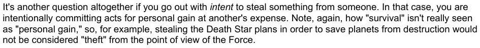
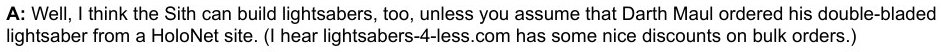
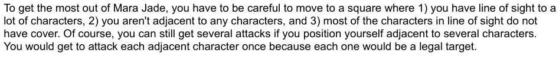
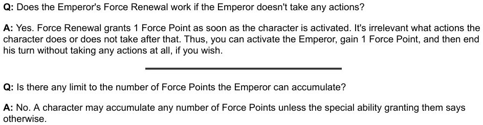
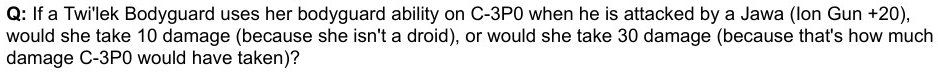

# Owner Material 037 — Star Wars D20 Drive folder (Core, Revised Core and Saga Edition): Jedi Counselling/Jedi Counseling 54 - Pursuit.pdf [Star Wars Roleplaying Game Revised Core (d20, 2002)]

- **Source:** Wizards of the Coast Star Wars Roleplaying Game books, web enhancements, Living Force campaign modules and articles (2000–2010), from the owner's "Star Wars D20" Drive folder (only the three edition subfolders; "General" was not read, as instructed). Secondary source (licensed Legends reference). Scan OCR'd on the box; the scan stays box-only and is **not** published.
- **Method:** every scanned page was OCR'd and machine-screened sentence by sentence for power-relevant statements (fights, kills, defeats, Force feats, rankings, superweapons) that name a character on our roster; each kept sentence is quoted verbatim from the OCR text and has a crop of the printed passage directly under it. Pages with nothing power-relevant are still listed with what is on them.
- **Citation:** "*Jedi Counseling 54 - Pursuit* (SWRPG d20 Revised Core), p.X" by printed page ("scan p.X" where no printed number applies). **Weight:** Licensed RPG material: a secondary source. Narrative text sums up Legends lore; game statistics are rules for players, not canon power levels, and rank lowest.

## scan p.1 (scan page 1)

Page contents: Pursuit rules, elite trooper deadly strike (hand-read)

## scan p.2 (scan page 2)

Page contents: Stealing and DSPs, who can build lightsabers, energy cells (hand-read)

- **No single roster character (rules/setting/general)** — entry/section: Stealing the Death Star plans isn't theft to the Force: "It's another question altogether if you go out with intent to steal something from someone. In that case, you are intentionally committing acts for personal gain at another's expense. Note, again, how "survival" isn't really seen as "personal gain," so, for example, stealing the Death Star plans in order to save planets from destruction would not be considered "theft" from the point of view of the Force." Source: *Jedi Counseling 54 - Pursuit* (SWRPG d20 Revised Core), scan p.2
  
- **Darth Maul** — entry/section: Darth Maul didn't order his lightsaber from the HoloNet: "A: Well, I think the Sith can build lightsabers, too, unless you assume that Darth Maul ordered his double-bladed lightsaber from a HoloNet site. (I hear lightsabers-4-less.com has some nice discounts on bulk orders.)" Source: *Jedi Counseling 54 - Pursuit* (SWRPG d20 Revised Core), scan p.2
  

## scan p.3 (scan page 3)

Page contents: Miniatures: trooper followers, Obi-Wan Force Heal, Mara Jade targets, Emperor Force Points, Momentum, grenades, cover, bodyguard vs C-3PO (hand-read)

- **Obi-Wan Kenobi** — entry/section: Obi-Wan can Force Heal himself: "Q: Can Obi-Wan Kenobi use Force Heal on himself?
A: Yes. The latest version of the FAQ now states the official ruling that Obi-Wan can indeed heal himself." Source: *Jedi Counseling 54 - Pursuit* (SWRPG d20 Revised Core), scan p.3
  
- **Mara Jade Skywalker** — entry/section: Getting the most out of Mara Jade's Blaster Barrage: "To get the most out of Mara Jade, you have to be careful to move to a square where 1) you have line of sight to a lot of characters, 2) you aren't adjacent to any characters, and 3) most of the characters in line of sight do not have cover. Of course, you can still get several attacks if you position yourself adjacent to several characters. You would get to attack each adjacent character once because each one would be a legal target." Source: *Jedi Counseling 54 - Pursuit* (SWRPG d20 Revised Core), scan p.3
  
- **Palpatine (Darth Sidious)** — entry/section: The Emperor's Force Renewal and unlimited Force Points: "Q: Does the Emperor's Force Renewal work if the Emperor doesn't take any actions?
A: Yes. Force Renewal grants 1 Force Point as soon as the character is activated. It's irrelevant what actions the character does or does not take after that. Thus, you can activate the Emperor, gain 1 Force Point, and then end his turn without taking any actions at all, if you wish.
Q: Is there any limit to the number of Force Points the Emperor can accumulate?
A: No. A character may accumulate any number of Force Points unless the special ability granting them says otherwise." Source: *Jedi Counseling 54 - Pursuit* (SWRPG d20 Revised Core), scan p.3
  
- **C-3PO** — entry/section: Twi'lek Bodyguard protecting C-3PO from a Jawa ion gun: "Q: If a Twi'lek Bodyguard uses her bodyguard ability on C-3P0 when he is attacked by a Jawa (Ion Gun +20), would she take 10 damage (because she isn't a droid), or would she take 30 damage (because that's how much damage C-3P0 would have taken)?" Source: *Jedi Counseling 54 - Pursuit* (SWRPG d20 Revised Core), scan p.3
  

## scan p.4 (scan page 4)

Page contents: Bodyguard ruling; author bio (hand-read)

