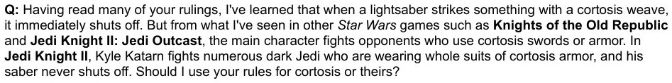
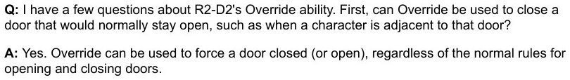
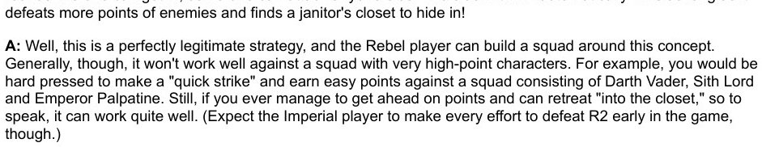
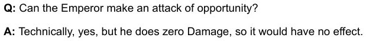
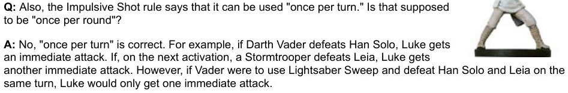

# Owner Material 037 — Star Wars D20 Drive folder (Core, Revised Core and Saga Edition): Jedi Counselling/Jedi Counseling 55 - Ship Squadrons.pdf [Star Wars Roleplaying Game Revised Core (d20, 2002)]

- **Source:** Wizards of the Coast Star Wars Roleplaying Game books, web enhancements, Living Force campaign modules and articles (2000–2010), from the owner's "Star Wars D20" Drive folder (only the three edition subfolders; "General" was not read, as instructed). Secondary source (licensed Legends reference). Scan OCR'd on the box; the scan stays box-only and is **not** published.
- **Method:** every scanned page was OCR'd and machine-screened sentence by sentence for power-relevant statements (fights, kills, defeats, Force feats, rankings, superweapons) that name a character on our roster; each kept sentence is quoted verbatim from the OCR text and has a crop of the printed passage directly under it. Pages with nothing power-relevant are still listed with what is on them.
- **Citation:** "*Jedi Counseling 55 - Ship Squadrons* (SWRPG d20 Revised Core), p.X" by printed page ("scan p.X" where no printed number applies). **Weight:** Licensed RPG material: a secondary source. Narrative text sums up Legends lore; game statistics are rules for players, not canon power levels, and rank lowest.

## scan p.1 (scan page 1)

Page contents: ISD and MC80 fighter complements, complement table (hand-read)

## scan p.2 (scan page 2)

Page contents: Table notes, Quick Draw holster, cortosis alloys (Kyle Katarn), illusory light; R2-D2 Override (hand-read)

- **Kyle Katarn** — entry/section: Kyle Katarn's saber vs cortosis armor in Jedi Outcast: "Q: Having read many of your rulings, I've learned that when a lightsaber strikes something with a cortosis weave, it immediately shuts off. But from what I've seen in other Star Wars games such as Knights of the Old Republic and Jedi Knight II: Jedi Outcast, the main character fights opponents who use cortosis swords or armor. In Jedi Knight II, Kyle Katarn fights numerous dark Jedi who are wearing whole suits of cortosis armor, and his saber never shuts off. Should I use your rules for cortosis or theirs?" Source: *Jedi Counseling 55 - Ship Squadrons* (SWRPG d20 Revised Core), scan p.2
  
- **R2-D2** — entry/section: R2-D2's Override can force doors: "Q: I have a few questions about R2-D2's Override ability. First, can Override be used to close a door that would normally stay open, such as when a character is adjacent to that door?
A: Yes. Override can be used to force a door closed (or open), regardless of the normal rules for opening and closing doors." Source: *Jedi Counseling 55 - Ship Squadrons* (SWRPG d20 Revised Core), scan p.2
  

## scan p.3 (scan page 3)

Page contents: R2 closet tactic, Emperor AoO, Probe Droid Recon, Luke Impulsive Shot, Bodyguard (hand-read)

- **R2-D2; Darth Vader (Anakin Skywalker); Palpatine (Darth Sidious)** — entry/section: R2-D2's "closet" strategy: "A: Well, this is a perfectly legitimate strategy, and the Rebel player can build a squad around this concept. Generally, though, it won't work well against a squad with very high-point characters. For example, you would be hard pressed to make a "quick strike" and earn easy points against a squad consisting of Darth Vader, Sith Lord and Emperor Palpatine. Still, if you ever manage to get ahead on points and can retreat "into the closet," so to speak, it can work quite well. (Expect the Imperial player to make every effort to defeat R2 early in the game, though.)" Source: *Jedi Counseling 55 - Ship Squadrons* (SWRPG d20 Revised Core), scan p.3
  
- **Palpatine (Darth Sidious)** — entry/section: The Emperor's attacks of opportunity: "Q: Can the Emperor make an attack of opportunity?
A: Technically, yes, but he does zero Damage, so it would have no effect." Source: *Jedi Counseling 55 - Ship Squadrons* (SWRPG d20 Revised Core), scan p.3
  
- **Luke Skywalker; Darth Vader (Anakin Skywalker); Han Solo; Leia Organa Solo** — entry/section: Luke's Impulsive Shot once per turn: "A: No, "once per turn" is correct. For example, if Darth Vader defeats Han Solo, Luke gets an immediate attack. If, on the next activation, a Stormtrooper defeats Leia, Luke gets another immediate attack. However, if Vader were to use Lightsaber Sweep and defeat Han Solo and Leia on the same turn, Luke would only get one immediate attack." Source: *Jedi Counseling 55 - Ship Squadrons* (SWRPG d20 Revised Core), scan p.3
  

## scan p.4 (scan page 4)

Page contents: Force points own rolls only; author bio (hand-read)

