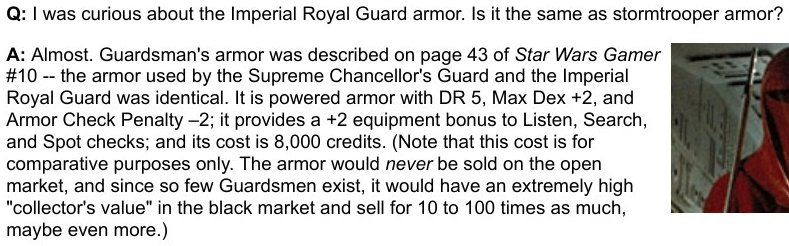
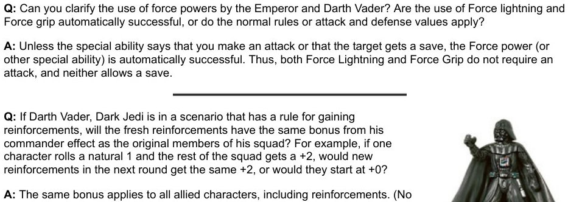
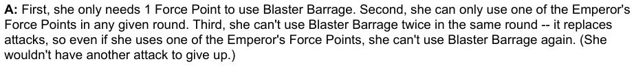
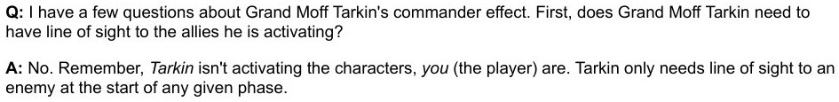
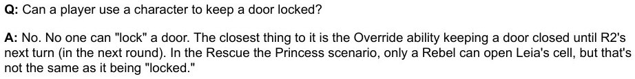

# Owner Material 037 — Star Wars D20 Drive folder (Core, Revised Core and Saga Edition): Jedi Counselling/Jedi Counseling 56.pdf [Star Wars Roleplaying Game Revised Core (d20, 2002)]

- **Source:** Wizards of the Coast Star Wars Roleplaying Game books, web enhancements, Living Force campaign modules and articles (2000–2010), from the owner's "Star Wars D20" Drive folder (only the three edition subfolders; "General" was not read, as instructed). Secondary source (licensed Legends reference). Scan OCR'd on the box; the scan stays box-only and is **not** published.
- **Method:** every scanned page was OCR'd and machine-screened sentence by sentence for power-relevant statements (fights, kills, defeats, Force feats, rankings, superweapons) that name a character on our roster; each kept sentence is quoted verbatim from the OCR text and has a crop of the printed passage directly under it. Pages with nothing power-relevant are still listed with what is on them.
- **Citation:** "*Jedi Counseling 56* (SWRPG d20 Revised Core), p.X" by printed page ("scan p.X" where no printed number applies). **Weight:** Licensed RPG material: a secondary source. Narrative text sums up Legends lore; game statistics are rules for players, not canon power levels, and rank lowest.

## scan p.1 (scan page 1)

Page contents: Aquar, starship collisions, Royal Guard armor, Alchemy, Off-hand Parry (hand-read)

- **No single roster character (rules/setting/general)** — entry/section: Imperial Royal Guard armor stats: "A: Almost. Guardsman's armor was described on page 43 of Star Wars Gamer #10 -- the armor used by the Supreme Chancellor's Guard and the Imperial Royal Guard was identical. It is powered armor with DR 5, Max Dex +2, and Armor Check Penalty —2; it provides a +2 equipment bonus to Listen, Search, and Spot checks; and its cost is 8,000 credits. (Note that this cost is for comparative purposes only. The armor would never be sold on the open market, and since so few Guardsmen exist, it would have an extremely high "collector's value" in the black market and sell for 10 to 100 times as much, maybe even more.)" Source: *Jedi Counseling 56* (SWRPG d20 Revised Core), scan p.1
  

## scan p.2 (scan page 2)

Page contents: Double vibrosword, imbued gloves, Teras Kasi, Force Strike vs grenades; Miniatures Force powers, Vader commander effect, Hand of the Emperor (hand-read)

- **Palpatine (Darth Sidious); Darth Vader (Anakin Skywalker)** — entry/section: Emperor's Force Lightning and Vader's Force Grip always succeed: "Q: Can you clarify the use of force powers by the Emperor and Darth Vader? Are the use of Force lightning and Force grip automatically successful, or do the normal rules or attack and defense values apply?
A: Unless the special ability says that you make an attack or that the target gets a save, the Force power (or other special ability) is automatically successful. Thus, both Force Lightning and Force Grip do not require an attack, and neither allows a save." Source: *Jedi Counseling 56* (SWRPG d20 Revised Core), scan p.2
  

## scan p.3 (scan page 3)

Page contents: Mara/Emperor Force points, line of sight, Tarkin commander effect, doors, Rescue the Princess (hand-read)

- **Mara Jade Skywalker; Palpatine (Darth Sidious)** — entry/section: Mara can't double Blaster Barrage with the Emperor's Force Points: "A: First, she only needs 1 Force Point to use Blaster Barrage. Second, she can only use one of the Emperor's Force Points in any given round. Third, she can't use Blaster Barrage twice in the same round -- it replaces attacks, so even if she uses one of the Emperor's Force Points, she can't use Blaster Barrage again. (She wouldn't have another attack to give up.)" Source: *Jedi Counseling 56* (SWRPG d20 Revised Core), scan p.3
  
- **Grand Moff Tarkin** — entry/section: Tarkin's commander effect: "Q: I have a few questions about Grand Moff Tarkin's commander effect. First, does Grand Moff Tarkin need to have line of sight to the allies he is activating?
A: No. Remember, Tarkin isn't activating the characters, you (the player) are. Tarkin only needs line of sight to an enemy at the start of any given phase." Source: *Jedi Counseling 56* (SWRPG d20 Revised Core), scan p.3
  
- **R2-D2; Leia Organa Solo** — entry/section: No one can lock a door (R2's Override; Leia's cell): "A: No. No one can "lock" a door. The closest thing to it is the Override ability keeping a door closed until R2's next turn (in the next round). In the Rescue the Princess scenario, only a Rebel can open Leia's cell, but that's not the same as it being "locked."" Source: *Jedi Counseling 56* (SWRPG d20 Revised Core), scan p.3
  

## scan p.4 (scan page 4)

Page contents: Author bio (hand-read)

